# Manual del cajero de BusinessPost

Este manual explica cómo vender con BusinessPost en la caja: entrar, abrir el turno, registrar productos, cobrar con cualquier medio de
pago, corregir errores y cerrar el turno con el reporte Z. Está escrito para el cajero y para quien lo capacita. Las imágenes son de una
tienda de ejemplo (*Supermercado La Economía*, sucursal Centro, caja C01) con datos ficticios.

> **Consejo:** al final del manual está la **hoja de atajos**: una página para imprimir y pegar junto a la caja.

## Contenido

1. La pantalla de la caja
2. Entrar a la caja
3. Abrir el turno
4. Vender: escanear, cantidades y búsqueda
5. Cliente de la venta (F3)
6. Descuentos y autorización del supervisor (F6)
7. Cobrar: efectivo, tarjeta, pago mixto y Sistecrédito (F10)
8. Anular una línea (Supr)
9. Suspender y recuperar una venta (F8 y F9)
10. Cancelar la venta (F7)
11. Cerrar el turno y el reporte Z
12. Lo que cambia según el tipo de negocio
13. Atajos de teclado
14. Problemas comunes y soluciones
15. Hoja de atajos para imprimir

## 1. La pantalla de la caja

La caja se maneja casi toda con el teclado y el lector de códigos de barras. La pantalla tiene cuatro zonas:

- **Barra superior:** la caja (C01), el número del turno, el nombre del cajero, el estado de la conexión (**En línea** o **Sin conexión**),
  la hora y los botones **Reimprimir** (aparece después de la primera venta), **Cerrar turno** y **Salir**. Si hay ventas suspendidas,
  aparece también el aviso **"1 suspendida"** (al pulsarlo se abren).
- **Escáner** (arriba a la izquierda): el campo "Escanee el código o escriba el nombre del producto". Siempre tiene el cursor: lo que
  lea el lector entra ahí, aunque usted haya hecho clic en otra parte.
- **Lista de productos** (centro): cada línea con su número, nombre, código interno, cantidad, precio, descuento y subtotal. La línea
  seleccionada se ve resaltada; las etiquetas debajo del nombre indican si tiene promoción, descuento manual, si se pesó o si está anulada.
- **Panel derecho:** el **Total a pagar** con el número de artículos, el subtotal, los impuestos, el **Ahorro del cliente** (promociones y
  descuentos), el redondeo si lo hay, el cliente de la venta, el botón verde **Cobrar F10** y los botones de acciones, cada uno con su
  tecla: Cliente **F3**, Cantidad **F4**, Descuento **F6**, Anular línea **Supr**, Suspender **F8**, Recuperar **F9** y Cancelar venta **F7**.

La barra inferior recuerda las dos teclas más útiles: `F5` consultar precio y `F1` todos los atajos.

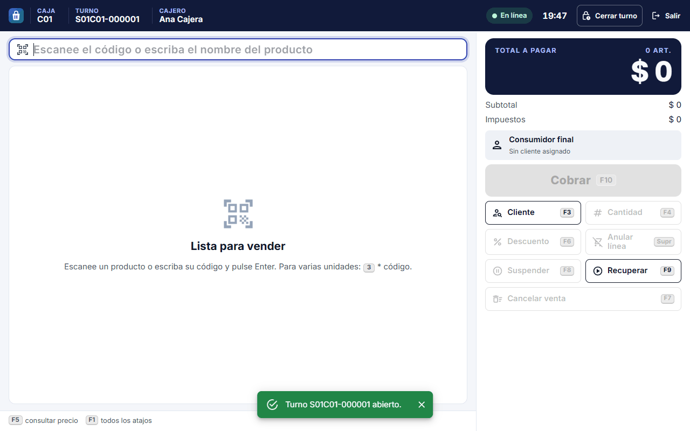

## 2. Entrar a la caja

1. Abra BusinessPost en el computador de la caja. Aparece la pantalla de ingreso.
2. Elija la pestaña **Caja**.
3. Escriba su **Código de cajero** y su **PIN** (los números que le entregó el administrador) y pulse **Entrar a la caja** o Enter.

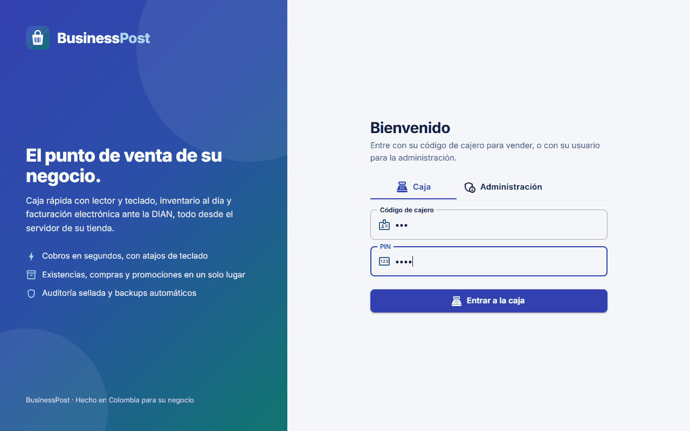

> **Importante:** el código y el PIN son personales. Cada venta, cada turno y cada conteo de la caja quedan a su nombre. No los preste ni
> los anote en la caja.

### Cambiar su PIN de caja

El PIN se cambia en la administración, en el menú de su nombre (arriba a la derecha) → **Cambiar PIN de caja**:

- Si ya tiene PIN, escriba el **PIN actual**, el **nuevo PIN** y repítalo, y pulse **Cambiar PIN**.
- Si todavía no tiene PIN (por ejemplo, el propietario que instaló el sistema), la página dice "Defina su PIN de caja": confirme su
  **contraseña**, elija su **código de caja** si no tiene uno (3 a 6 dígitos, que nadie más use) y escriba el PIN dos veces. Pulse
  **Guardar PIN**.

El PIN tiene exactamente la cantidad de dígitos que fijó la empresa (la página lo dice) y no puede ser una secuencia (1234), un mismo
dígito repetido (1111), un PIN muy común (1212, 2580…) ni igual a su código de caja. Al cambiarlo, se cierran sus otras sesiones de caja
abiertas. Si se equivoca varias veces con el PIN actual, se bloquea unos minutos como al entrar. El código de caja no se cambia aquí: lo
cambia un administrador en **Usuarios** (Restablecer PIN).

Si usted solo entra a la caja (no a la administración) u olvidó su PIN, pídale al administrador que se lo **restablezca** en
**Administración → Usuarios**.

Si alguien entró por la pestaña **Administración** y pulsa **Ir a la caja**, BusinessPost muestra "Para vender, entre como cajero": pulse
**Entrar con código de caja** para salir y volver a entrar con el código y el PIN de cajero.

## 3. Abrir el turno

La primera vez que entra en el turno, la caja pide contar la **base del cajón** (el efectivo inicial).

1. Cuente el dinero del cajón.
2. En cada valor de billete o moneda escriba **cuánto dinero hay de ese valor** (no cuántos billetes). Por ejemplo, si tiene dos
   billetes de $ 50.000, escriba 100.000 en el de $ 50.000. Debajo de cada valor la caja le confirma "= 2 billetes".
3. Deje vacío lo que no tenga.
4. Revise el total **Base del cajón** y pulse **Abrir turno**.

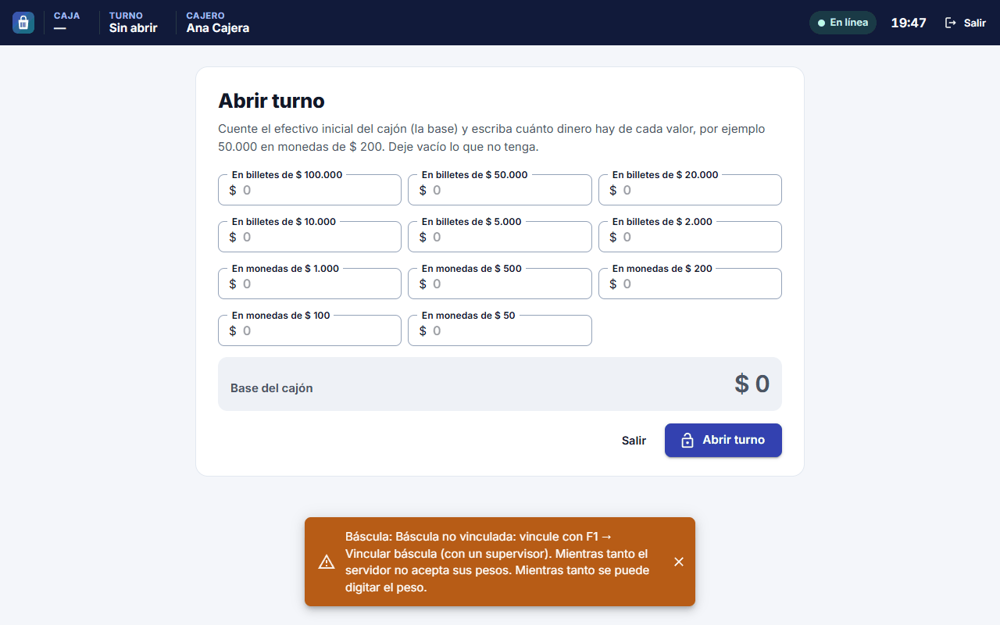

Aparece el aviso "Turno … abierto." y la pantalla queda en **Lista para vender**. El número del turno queda en la barra superior.

## 4. Vender: escanear, cantidades y búsqueda

### Escanear un producto

Pase el código de barras por el lector. El lector escribe el código y da Enter solo: el producto se agrega a la lista y queda
seleccionado. Si no tiene lector, escriba el código de barras, el código interno (SKU) o el PLU y pulse **Enter**.

Si el mismo producto se registra otra vez, la caja suma la cantidad en la misma línea cuando corresponde.

Las **promociones** se aplican solas: debajo del nombre aparece la etiqueta de la promoción (por ejemplo "Lleve 3 pague 2") y en el panel
derecho el **Ahorro del cliente**. El cajero no tiene que hacer nada.

### Varias unidades: 3*código

Para registrar varias unidades del mismo producto escriba la cantidad, un asterisco y luego escanee o escriba el código:

- `3*` y pase el producto por el lector → 3 unidades.
- `3*7702011000123` y Enter → 3 unidades de ese código.
- `2*arroz` → busca "arroz" y agrega 2 unidades del producto que elija.

### Buscar por nombre

Si el producto no tiene código o no lee, escriba parte del nombre en el escáner (por ejemplo "leche"). Debajo aparece la lista de
productos que coinciden, con su código y su precio:

- `↑` y `↓` eligen el producto.
- **Enter** lo agrega (también puede hacer clic en él).
- **Esc** cierra la lista.

Si solo hay un producto que coincide, o escribió el código interno exacto, Enter lo agrega de una vez.

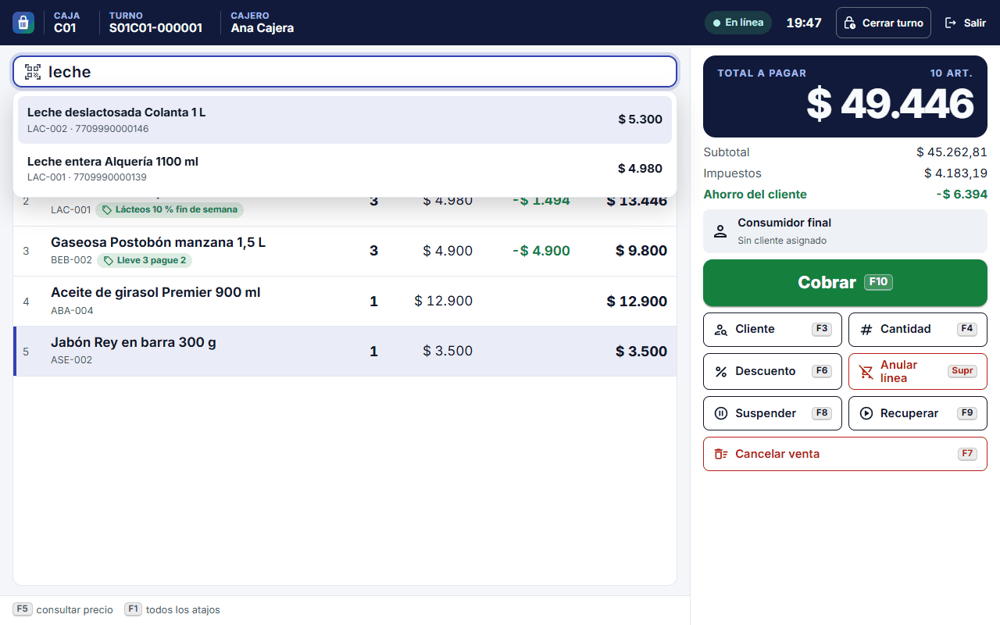

### Elegir una línea y cambiar la cantidad (F4)

- Con la lista de sugerencias cerrada, `↑` y `↓` mueven la **línea seleccionada** de la venta. También puede hacer clic en la línea.
- **F4** abre **Cambiar cantidad** para la línea seleccionada: escriba la nueva cantidad y pulse **Enter** (o **Aplicar**).

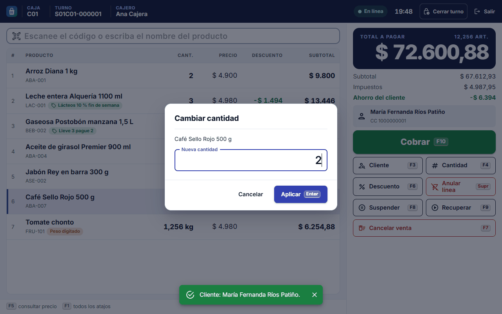

### Consultar un precio sin vender (F5)

Cuando un cliente pregunta un precio, pulse **F5**. Escanee el producto o escriba su nombre y elija con `↑` `↓` y Enter. La caja muestra
el precio en grande, si es por unidad o por kilo, el IVA y, si su usuario puede verlas, las existencias. **No se agrega a la venta** y
puede consultar uno tras otro. **Esc** cierra la consulta.

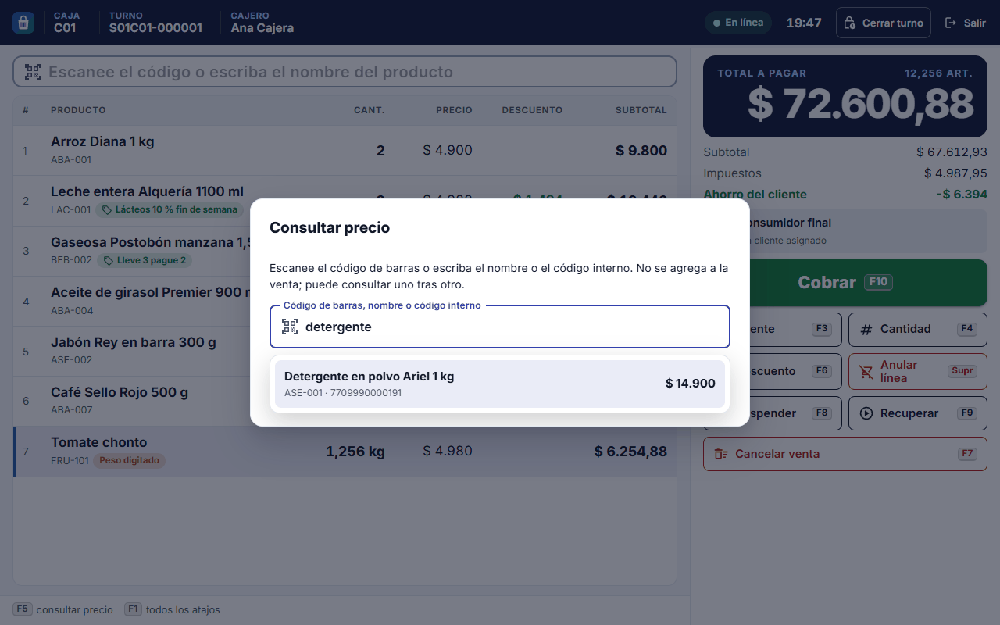

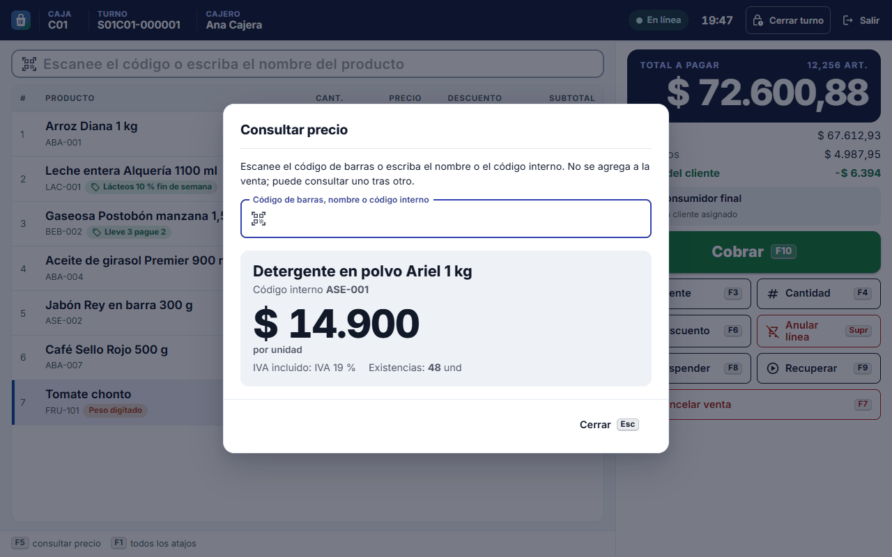

## 5. Cliente de la venta (F3)

Por defecto la venta es a **Consumidor final**. Asigne un cliente cuando pida factura a su nombre o cuando tenga precios especiales (por
ejemplo, empleados o mayoristas): la venta usa sus precios.

1. Pulse **F3**.
2. Escriba la cédula, el NIT, el nombre o el celular (al menos 2 letras o números).
3. Haga clic en el cliente. Aparece "Cliente: …" y su nombre queda en el panel derecho.

Para volver a consumidor final, pulse F3 y elija **Consumidor final**. Si el cliente no existe, la caja dice "No encontramos clientes
con ese dato": los clientes nuevos se crean en la administración (Clientes).

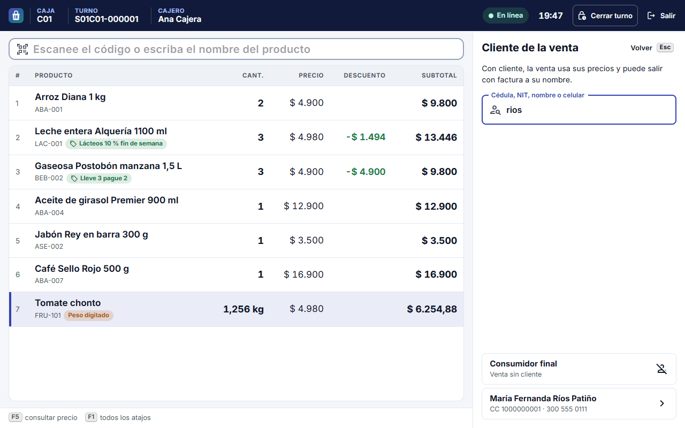

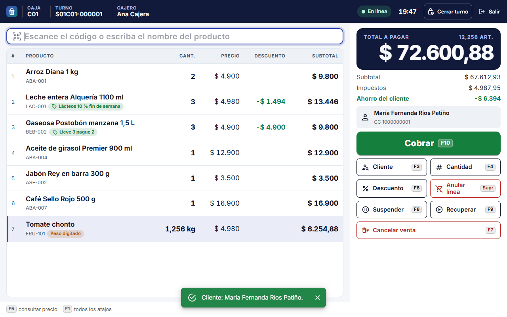

## 6. Descuentos y autorización del supervisor (F6)

1. Seleccione la línea (si el descuento es para un producto) y pulse **F6**.
2. Elija **A la línea seleccionada** o **A toda la venta**.
3. Elija **Porcentaje (%)** o **Valor en pesos ($)** y escriba el valor.
4. Escriba el **Motivo** (es obligatorio) y pulse **Aplicar descuento**.

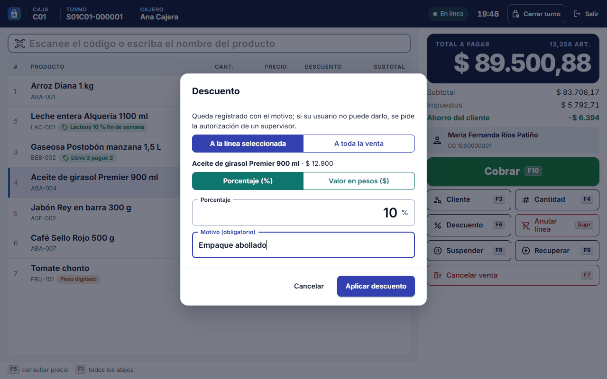

Si su usuario no tiene permiso para dar ese descuento, aparece **Autorización de supervisor** con el aviso de la acción que se va a
autorizar. El supervisor escribe su **código** y su **PIN** (quedan ocultos), opcionalmente un motivo, y pulsa **Autorizar** (o Enter).
La acción se completa sola y queda registrada con el nombre de quien autorizó.

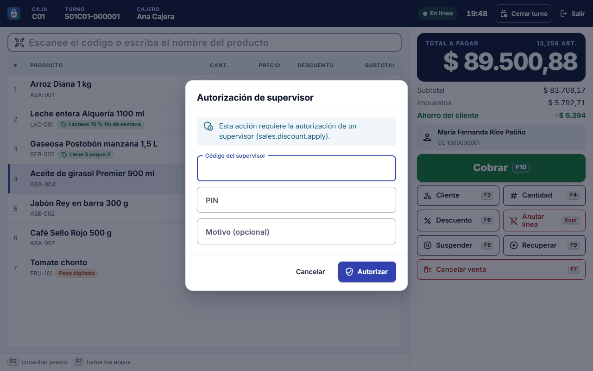

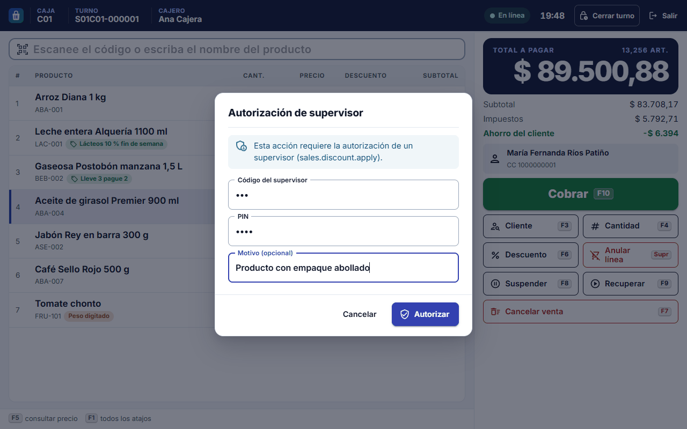

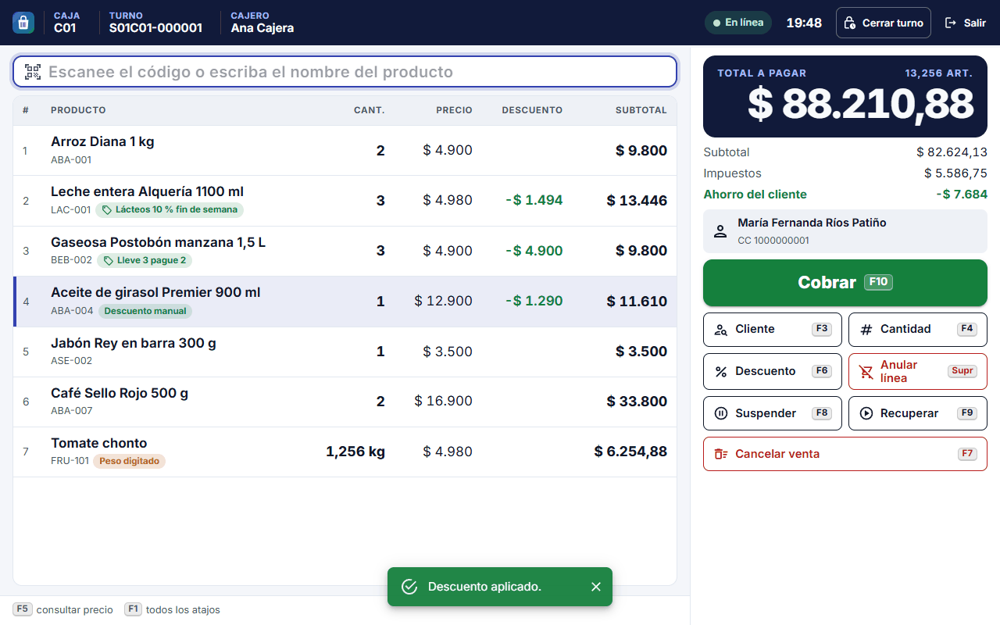

La misma ventana de autorización aparece en cualquier acción que su usuario no pueda hacer solo: cancelar una venta, anular una línea,
vender un lote vencido, digitar un peso, reiniciar o vincular la báscula, o no usar un crédito de Sistecrédito ya aprobado, según los
permisos que le haya dado el administrador. Si el PIN es incorrecto, la caja lo
avisa y borra el PIN para escribirlo de nuevo. **Cancelar** (o Esc) cierra la ventana sin hacer la acción.

## 7. Cobrar (F10)

Pulse **F10** (o el botón **Cobrar**). El panel derecho cambia a **Cobrar**: arriba el **Total a pagar**, el **Recibido** y lo que
**Falta** (en naranja) o el **Cambio** (en verde); en el centro los botones de los medios de pago; abajo el valor recibido y el botón
**Confirmar cobro F10**. **Esc** (o **Volver**) regresa a la venta sin cobrar.

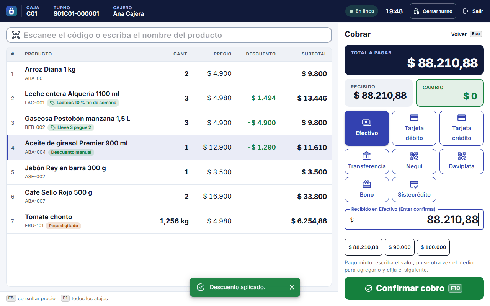

### Efectivo

1. **Efectivo** viene elegido y el valor recibido ya tiene el total exacto.
2. Escriba lo que le entregó el cliente (por ejemplo 100000) o pulse uno de los **valores rápidos** (el exacto y los billetes que cubren
   el total).
3. Pulse **Enter** o **F10**. La caja muestra el **Cambio** en grande y queda lista para el siguiente cliente. El tiquete se imprime solo.

Si la tienda tiene facturación electrónica, debajo del cambio aparece el estado del documento: "validada por la DIAN", "en proceso" (se
envía en segundo plano), "en contingencia" (se enviará cuando haya conexión) o "con problema" (la administración debe revisarla). En
todos los casos la venta ya quedó cobrada: entregue el tiquete y siga vendiendo.

Cuando hay productos por peso, el total puede tener centavos; al cobrar en efectivo se redondea y la diferencia aparece como
**Redondeo** en el panel y como ajuste en el tiquete.

### Tarjeta débito o crédito (datáfono)

1. En el cobro pulse **Tarjeta débito** o **Tarjeta crédito**.
2. Pase la tarjeta por el datáfono por el valor del total.
3. Escriba en **Referencia (aprobación del datáfono)** el número de aprobación del voucher.
4. Pulse **F10**. El cambio queda en $ 0.

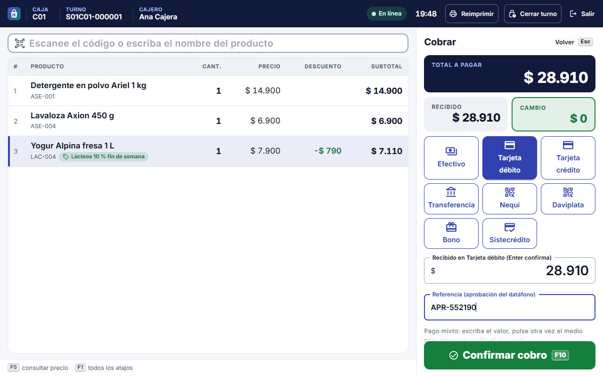

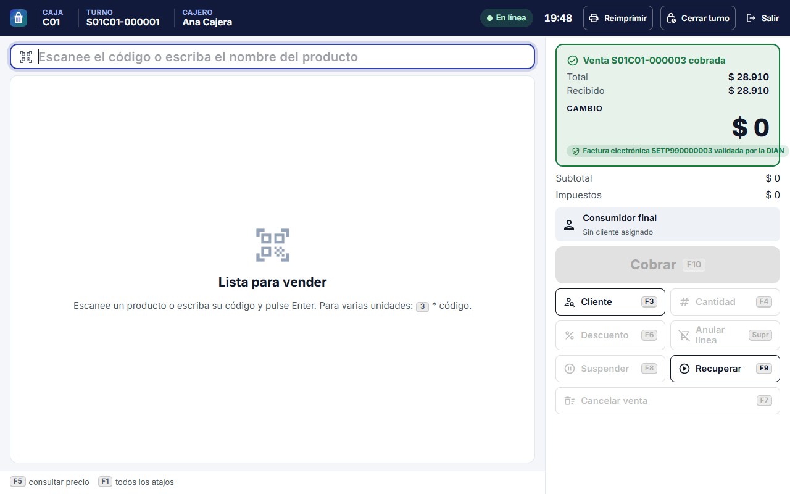

Los medios que piden referencia (datáfono, y según la configuración de la tienda también transferencias o billeteras como Nequi) no se
agregan sin ella: la caja avisa "Escriba la referencia del pago". Un medio distinto del efectivo no puede pasar del total (no da cambio).

### Pago mixto (dos o más medios)

Cuando el cliente paga una parte con un medio y el resto con otro:

1. Pulse el primer medio (por ejemplo **Nequi**), escriba el valor que paga con él y, si la pide, la referencia.
2. Pulse **otra vez el mismo botón** para agregarlo. Queda en la lista de pagos y la caja muestra lo que **Falta**.
3. Pulse el siguiente medio (por ejemplo **Efectivo**): el valor ya trae lo que falta. Cámbielo si le entregan más (para el cambio) y
   pulse **otra vez ese botón** para agregarlo.
4. Cuando lo recibido cubre el total, pulse **F10** para confirmar.

> **Importante:** en el pago mixto cada medio se agrega pulsando su botón dos veces (una para elegirlo y otra para agregarlo). Si
> escribe el último valor y pulsa F10 sin agregarlo, la caja no cobra porque todavía "falta".

Para quitar un pago mal agregado, pulse la **X** al lado de ese pago.

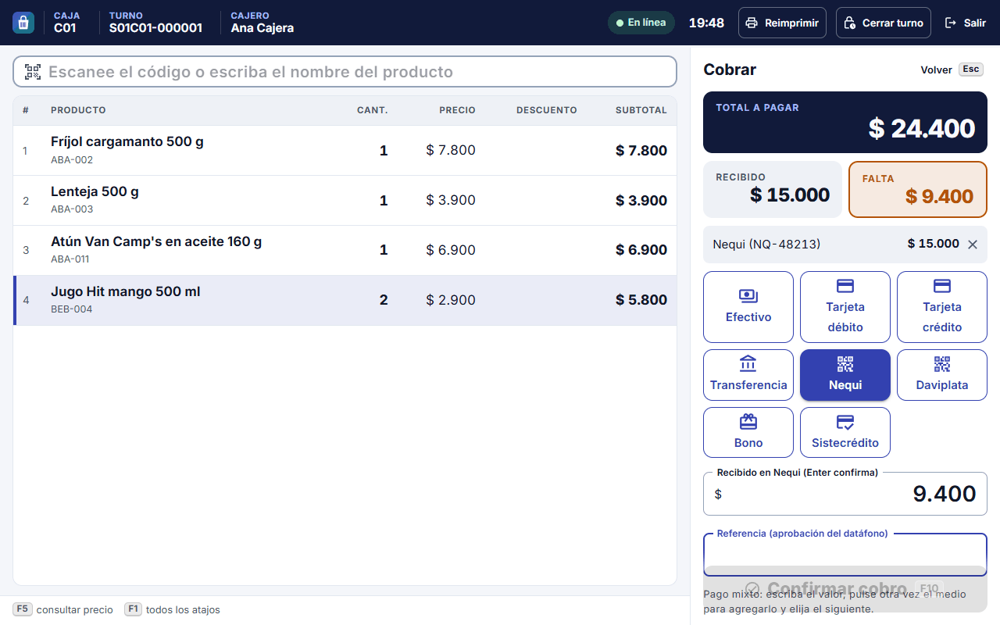

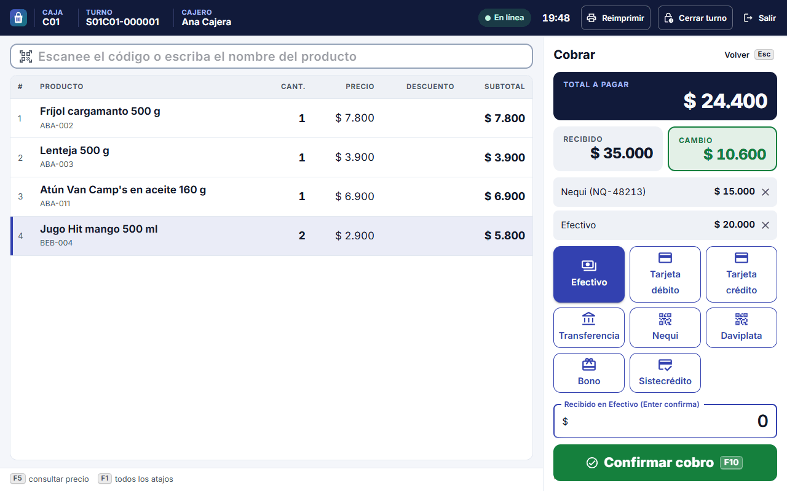

### Sistecrédito

Con Sistecrédito el cliente paga **a cuotas** con su crédito. Solo aparece si la tienda conectó su cuenta de aliado (lo hace el
administrador). Se necesita **Internet en el momento del cobro**; si no hay, cobre con otro medio.

1. En el cobro pulse **Sistecrédito**. El valor trae lo que falta; puede cobrar todo o una parte (pago mixto).
2. Elija el tipo de documento (**CC**, CE, NIT, PA o TI) y escriba el **número de documento del cliente**. Si la venta tiene cliente
   asignado, el documento ya aparece.
3. Pulse **Generar cobro de $ …**. Aparece un **código QR** con el mensaje "Escanee con su celular, elija las cuotas y confirme con el
   código que le llega".
4. El cliente escanea el QR con su celular y confirma. La caja se actualiza sola cada pocos segundos.
5. Cuando Sistecrédito **aprueba**, aparece "Sistecrédito aprobó el crédito…" y la venta se completa sola (o, en pago mixto, la caja deja
   listo el valor que falta para cobrarlo con otro medio).
6. Si Sistecrédito **no aprueba** o el cobro vence, la caja muestra el motivo: pulse **Intentar de nuevo** o elija otro medio.

Para dejar de esperar, pulse **Cancelar** debajo del QR. Si el cliente igual aprueba después, el sistema lo detecta y la administración lo
revisa ("Cobro cancelado: la administración debe revisarlo").

Sistecrédito cobra **pesos enteros**: si el total tiene centavos (productos por peso), la caja propone el valor sin centavos y avisa
"Sistecrédito cobra pesos enteros: … los centavos van con otro medio de pago".

**Un crédito aprobado no se quita con la X sin más: «No usar este crédito».** Cuando Sistecrédito aprueba, el pago queda en la lista de
pagos del cobro. Como el cliente ya quedó con ese crédito, la **X** de un pago de Sistecrédito aprobado no lo borra: abre
**Autorización de supervisor** para **«No usar este crédito»**. Con la autorización, el crédito queda **en revisión** para que la
administración lo reverse en el portal de Sistecrédito, y la caja dice "Crédito de Sistecrédito no usado: quedó en revisión para que la
administración lo reverse. Cobre con otro medio." Si Sistecrédito ya no reporta aprobado ese pago, la X lo quita directamente.

Mientras la venta tenga un crédito aprobado sin usar:

- **No puede quedar por debajo del crédito.** Si quita productos, baja cantidades o da un descuento y el total quedaría menor que el
  crédito, la caja lo rechaza: "Esta venta tiene un crédito de Sistecrédito ya aprobado por … y quedaría en …: no puede quedar por debajo
  del crédito. Primero use «No usar este crédito» (con autorización de supervisor) o reabra el cobro." Agregar productos sí se puede.
- **No se puede cancelar con F7.** La caja dice "Esta venta tiene un crédito de Sistecrédito ya aprobado por …: primero use «No usar este
  crédito» (con autorización de supervisor) o complete la venta con él."
- **Si cierra el cobro y lo vuelve a abrir**, la caja revisa los pagos ("Revisando los pagos con Sistecrédito de esta venta: un momento.")
  y recupera el crédito aprobado ("Se recuperó el pago ya aprobado con Sistecrédito por …: cobre solo lo que falta.") o el cobro que seguía
  esperando al cliente ("Hay un cobro con Sistecrédito esperando al cliente: se sigue consultando.").
- **Si la administración desactivó Sistecrédito** con un crédito ya aprobado, la caja avisa "Esta venta tiene un crédito de Sistecrédito
  aprobado por …, pero Sistecrédito está inactivo." con el botón **No usar este crédito** (con supervisor).

### Reimprimir el tiquete

El botón **Reimprimir** de la barra superior vuelve a imprimir el tiquete de la **última venta** (sale marcado como copia). Según los
permisos de su usuario, puede pedir la autorización del supervisor.

## 8. Anular una línea (Supr)

Si registró un producto por error o el cliente ya no lo quiere:

1. Seleccione la línea con `↑` `↓` o con un clic.
2. Pulse **Supr** (o el botón **Anular línea**). Según los permisos, la caja puede pedir la autorización del supervisor.

La línea no desaparece: queda en la lista con la etiqueta **Anulada** y en $ 0, para que quede registro.

## 9. Suspender y recuperar una venta (F8 y F9)

Cuando un cliente olvidó algo y va a buscarlo, suspenda su venta para atender al siguiente:

1. Pulse **F8**. Aparece "Venta suspendida. Recupérela con F9." y la caja queda vacía. En la barra superior aparece el aviso
   **"1 suspendida"**.
2. Atienda al siguiente cliente normalmente.
3. Cuando el primer cliente vuelva, pulse **F9** (o el aviso de la barra). Aparece la lista de **Ventas suspendidas** con la hora, la
   cantidad de artículos y el total.
4. Haga clic en la venta: vuelve con todas sus líneas y puede seguir registrando o cobrar.

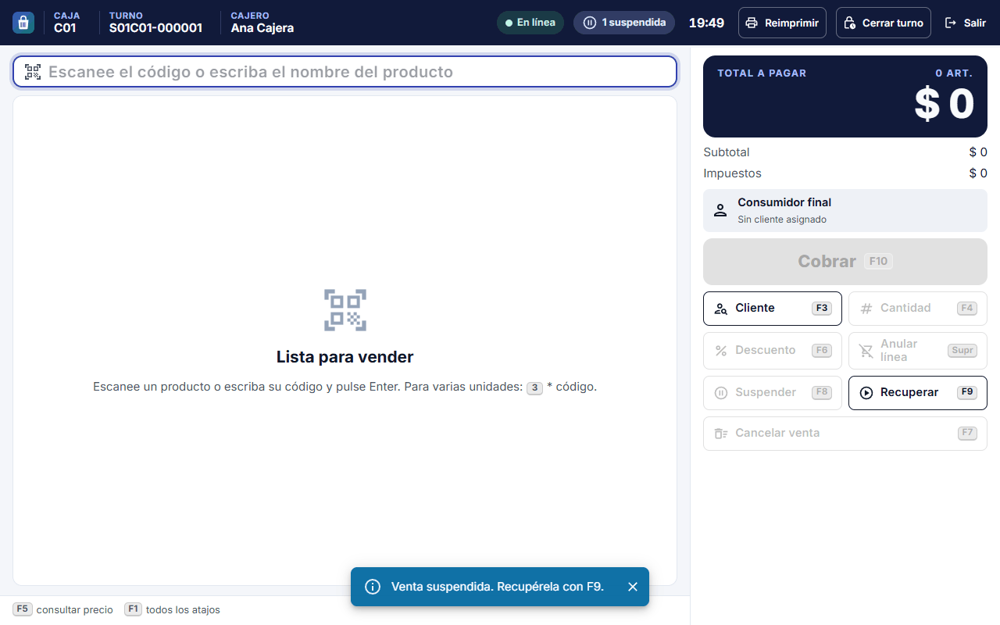

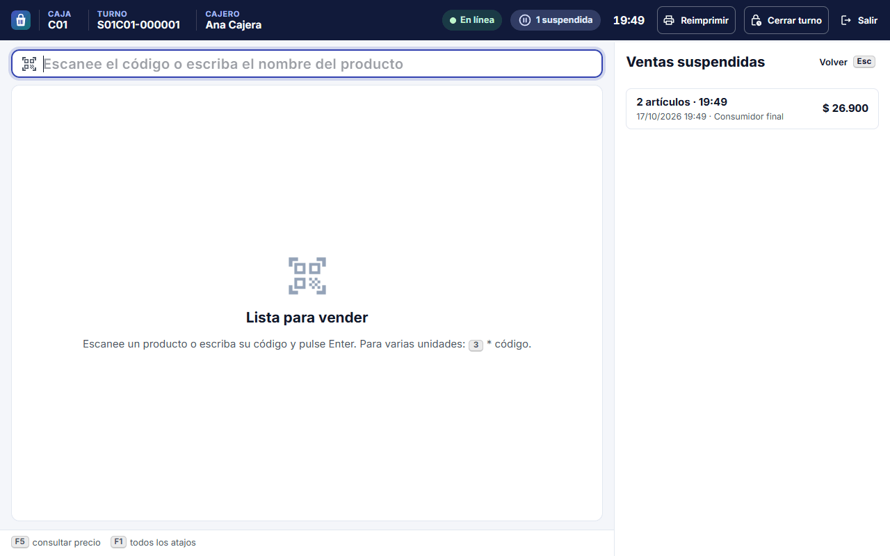

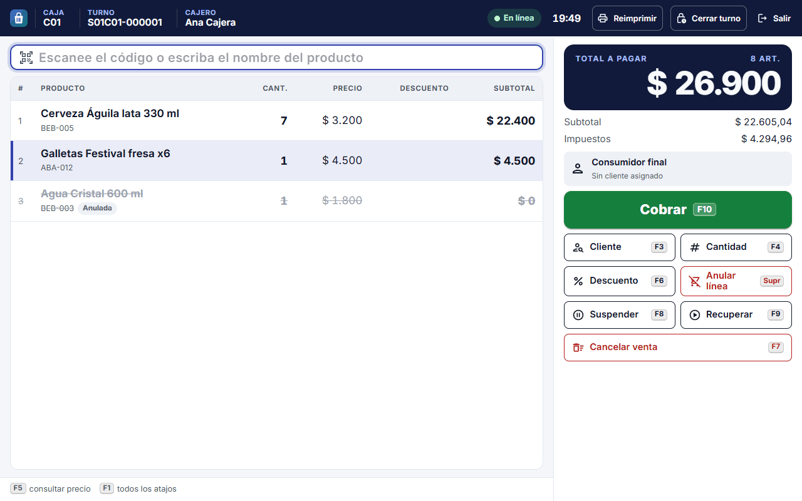

**Ventas suspendidas con un crédito de Sistecrédito.** Si la venta suspendida ya tiene un crédito de Sistecrédito aprobado, en la lista de
F9, debajo de la venta, aparece el botón **No usar el crédito de Sistecrédito ($ …)**: pide la autorización del supervisor y deja el
crédito en revisión. Si al recuperar la venta su total quedó por debajo del crédito (por ejemplo, porque terminó una promoción), la caja
lo explica y ofrece **No usar este crédito** en el mismo aviso; después de autorizarlo, la venta se recupera.

> **Importante:** no cierre el turno con ventas suspendidas olvidadas: recupérelas y cóbrelas o cancélelas.

## 10. Cancelar la venta (F7)

Si el cliente desiste de toda la compra:

1. Pulse **F7** (o **Cancelar venta**).
2. La caja pregunta "¿Cancelar la venta?" con la cantidad de productos y el valor. Pulse **Sí, cancelar venta**, o **No, seguir vendiendo**
   (o Esc) para volver.
3. Según los permisos, la caja pide la autorización del supervisor. Aparece "Venta cancelada." y queda registrada en la auditoría.

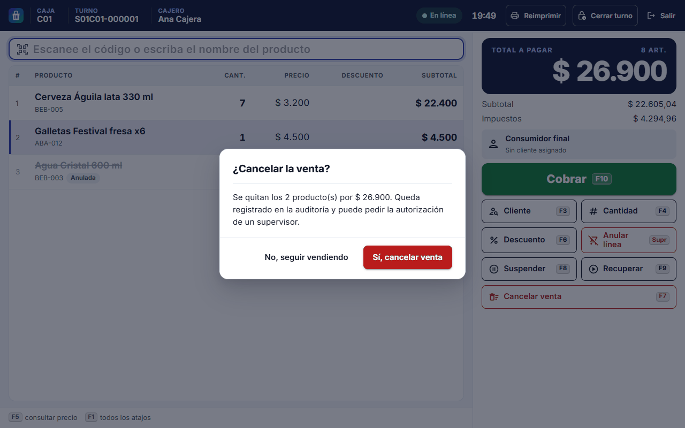

Cancelar una venta **en curso** es distinto de anular una venta ya cobrada: una venta cobrada no se anula desde la caja.

## 11. Cerrar el turno y el reporte Z

Al terminar su turno:

1. Cobre, suspenda o cancele la venta en curso (si hay una, la caja avisa "Cobre, suspenda o cancele la venta en curso antes de cerrar").
2. Pulse **Cerrar turno** en la barra superior.
3. Cuente el efectivo del cajón y escriba **cuánto dinero hay de cada valor**, igual que al abrir. El cierre es **ciego**: la caja no le
   muestra cuánto debería haber; compara cuando usted confirma.
4. Escriba el total de cada uno de los **demás medios** (tarjetas, Nequi, Sistecrédito…): súmelos con los vouchers del datáfono y los
   comprobantes del día.
5. Si en el turno hubo cobros de Sistecrédito que no se usaron en una venta (o que Sistecrédito aprobó tarde), aparece el aviso
   "Cobros con Sistecrédito de este turno que la administración debe revisar (no usados en la venta, aprobados tarde…): no son plata de
   la caja", con los valores y el documento del cliente (oculto en parte), separados en
   **Por revisar y reversar en el portal de Sistecrédito** y **Ya revisados por la administración**. No los sume en el total de Sistecrédito: solo cuente los créditos que sí
   pagaron ventas.
6. Si sabe de una diferencia, explíquela en **Nota sobre la diferencia** (por ejemplo, "faltaron $ 2.000 en monedas").
7. Pulse **Confirmar cierre**. Si quiere seguir vendiendo, pulse **Volver a vender**.

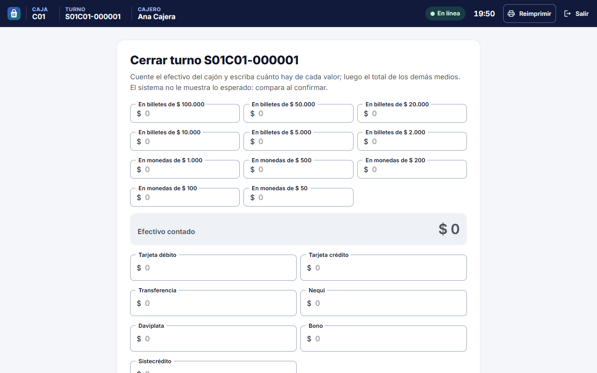

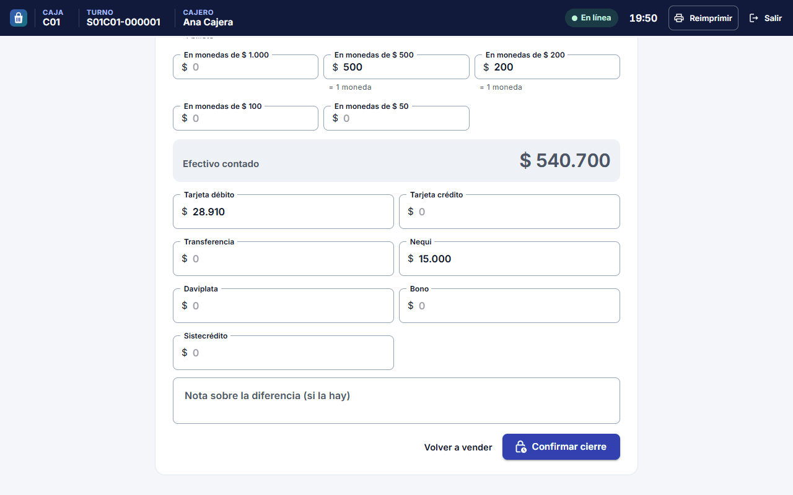

Al confirmar aparece **Turno cerrado · Reporte Z (cierre)** en pantalla y el reporte Z se imprime solo ("Reporte Z enviado a la
impresora."). Guarde el reporte impreso con el efectivo. Si la impresora falló, pulse **Reimprimir Z**. Pulse **Terminar** para salir.

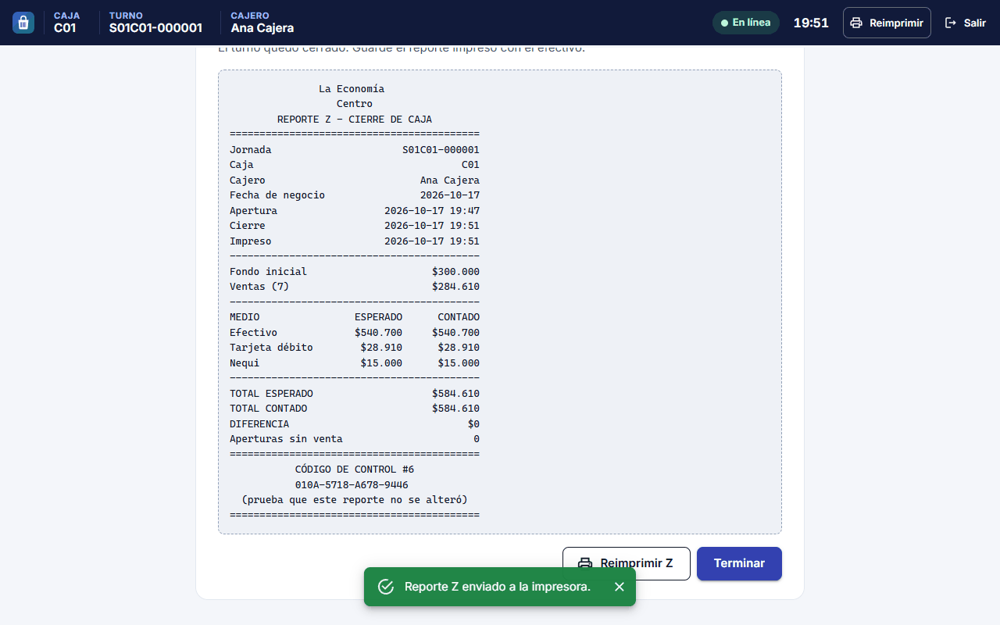

Si hubo cobros de Sistecrédito por revisar, el reporte Z (y el reporte X que se consulta en la administración) trae el bloque
**SISTECREDITO A REVISAR**, con cuántos son, el total y cada uno con el documento del cliente y su estado (**por revisar**, **no usado** o
**revisado**), y la nota "No es plata de la caja: la administración lo revisa y lo reversa en el portal de Sistecrédito".

Si un turno quedó abierto (por ejemplo, el cajero se fue sin cerrar), un supervisor lo puede cerrar desde la administración.

## 12. Lo que cambia según el tipo de negocio

BusinessPost sirve para cualquier comercio. Al instalar, el dueño elige el **tipo de negocio** (supermercado, fruver o carnicería,
droguería, ropa y calzado, ferretería u otro) y en la administración enciende o apaga funciones como la báscula, los lotes y
vencimientos, la venta por fracción o el precio abierto. Todo lo explicado hasta aquí funciona igual en todos los tipos; esta sección
explica solo lo que cambia en la caja.

### Supermercado o minimercado

Funciona todo lo anterior. Si la tienda tiene sección de fruver o carnes, mire también la báscula (abajo); si vende productos con fecha
de vencimiento, mire la parte de lotes (droguería).

### Fruver o carnicería: báscula

Hay dos formas de vender por peso:

- **Etiqueta de báscula:** la báscula etiquetadora imprime una etiqueta con código de barras (empieza por 20 a 28) que ya trae el peso o el
  precio. Se escanea como cualquier producto; la línea queda con la etiqueta **Etiqueta**.
- **Báscula conectada a la caja:** la báscula de mostrador está conectada al computador de la caja y BusinessPost lee el peso solo. Lo
  que sigue es para esta forma.

#### Vincular la báscula con la caja (una sola vez, con un supervisor)

Para que el servidor de la tienda acepte los pesos, el programa de la caja **firma** cada lectura de la báscula. Por eso la báscula de
cada caja se **vincula** una vez, en la pantalla de venta de esa misma caja. Mientras no esté vinculada, al entrar la caja avisa
"Báscula no vinculada: vincule con F1 → Vincular báscula (con un supervisor). Mientras tanto el servidor no acepta sus pesos." y, al
registrar un producto de báscula, solo deja digitar el peso (si la caja lo permite).

1. En la caja, pulse **F1**. Debajo de la lista de atajos aparecen los botones **Vincular báscula** (o **Volver a vincular báscula** si
   ya estaba vinculada) y **Reiniciar báscula**.
2. Pulse **Vincular báscula**. Si su usuario no tiene el permiso de vincular la báscula, aparece **Autorización de supervisor**: el
   supervisor escribe su código y su PIN y pulsa **Autorizar**.
3. Aparece "Báscula vinculada con esta caja." Desde ese momento la caja pesa normalmente.

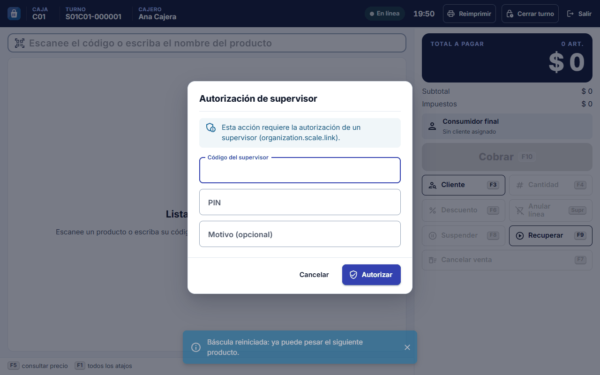

> **Importante:** vincule siempre **en el computador de esa caja**: el servidor solo acepta la vinculación desde la pantalla de venta de
> esa caja. Queda en la auditoría y el Tablero de la administración lo muestra unos días ("La clave de la báscula de la caja … cambió").

Si la vinculación se interrumpe (por ejemplo, se cortó la red justo al final), la caja dice "El servidor ya tiene la clave nueva;
reinicie el programa de la caja y pulse F1 → Completar vinculación". Al volver a entrar también avisa "La vinculación de la báscula quedó
a medias: pulse F1 → Completar vinculación". Pulse **F1 → Completar vinculación**: solo confirma lo que ya quedó registrado, sin
supervisor.

Hay que **volver a vincular** cuando la caja lo pide, por ejemplo después de reinstalar el programa de la caja, cambiar el computador o
restaurarlo: la caja dice "…vuelva a vincular la báscula (F1 → Vincular báscula)" o "…vuelva a vincular la báscula (F1)". Después de
algunas actualizaciones de BusinessPost también hay que vincular de nuevo cada caja.

#### Cómo se pesa

No hay botón "Pesar":

1. Ponga el producto en la báscula.
2. Escanee o escriba el código del producto (o búsquelo por nombre) y pulse **Enter**.
3. Se abre una ventana con el nombre del producto, el peso en vivo y un aviso. En cuanto el peso queda **estable**, BusinessPost lee el
   peso y agrega la línea con el peso, el precio por kilo y la etiqueta **Báscula**.

Con el cobro u otra ventana abierta no se empieza a pesar: la caja dice, por ejemplo, "… se vende por báscula: cierre el cobro (Esc)
antes de pesarlo". Con los productos de báscula no escriba cantidad con `3*`: deje que la báscula pese. **Esc** (o **Cancelar**) cierra
la ventana sin agregar nada.

Los avisos de la ventana:

| Aviso | Qué pasa y qué hacer |
|---|---|
| **"Ponga el producto en la báscula"** | La báscula está en cero. La caja espera unos segundos; si no llega peso, dice "No llegó peso a la báscula: no se agregó nada". |
| **"Esperando peso estable…"** | El producto se está moviendo. Cuando el peso se queda quieto, la línea se agrega sola. Si no se queda quieto, dice "El peso no se quedó quieto: no se agregó. Vuelva a registrar el producto". |
| **"Retire el producto de la báscula"** | Después de cada pesada la báscula debe **volver a cero** antes de pesar el siguiente producto (vea abajo). |
| **"Quite la tara de la báscula (tecla de tara) para continuar"** | Alguien puso la tara con la tecla de la báscula. Quítela en la báscula y use **Ins** en la caja. |
| "El peso no supera la tara del producto (… g): ponga el producto en la báscula." | El peso es menor o igual que la tara del producto: ponga el producto. |
| Sobrepeso o peso negativo | La ventana muestra el aviso de la báscula; no se agrega nada. |

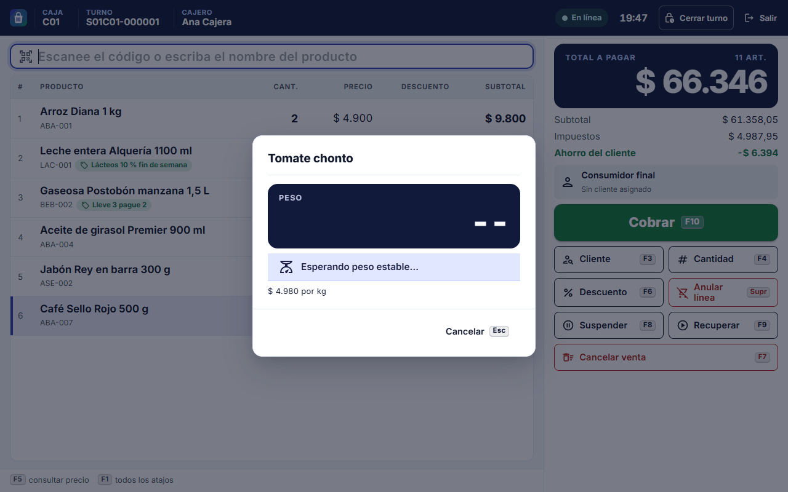

> En el equipo de pruebas de estos manuales no hay una báscula real vinculada, así que no hay imagen de una línea agregada por la báscula:
> se ve igual que las demás, con el peso en kilos y la etiqueta **Báscula**.

#### Retorno a cero: "Retire el producto de la báscula"

Después de cada pesada, la siguiente solo vale si la báscula **quedó vacía** (marca cero o menos del **peso mínimo** que configuró el
administrador). Cambiar un producto por otro sin vaciar la báscula no sirve: la caja muestra **"Retire el producto de la báscula"** y
espera. Retire todo lo que haya sobre la báscula y la lectura sigue sola. Si la báscula no queda vacía a tiempo, dice "La báscula no quedó
vacía después de la pesada anterior: no se agregó. Retire el producto y vuelva a registrarlo".

Esta regla también la revisa el servidor de la tienda: recargar la pantalla o empezar otra venta no la salta. Así nunca se cobra el peso
del producto anterior.

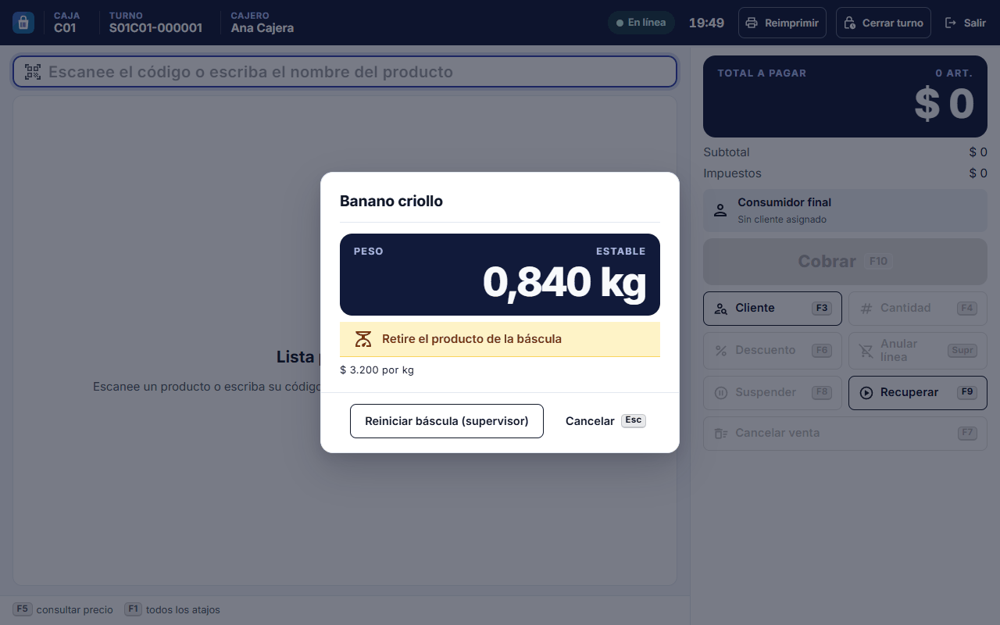

**Reiniciar báscula.** Si el aviso no se quita aunque la báscula ya está vacía, pulse **Reiniciar báscula (supervisor)** en la ventana, o
**F1 → Reiniciar báscula**. Necesita el permiso de reiniciar la báscula o la autorización del supervisor, y queda en la auditoría.
Aparece "Báscula reiniciada: ya puede pesar el siguiente producto".

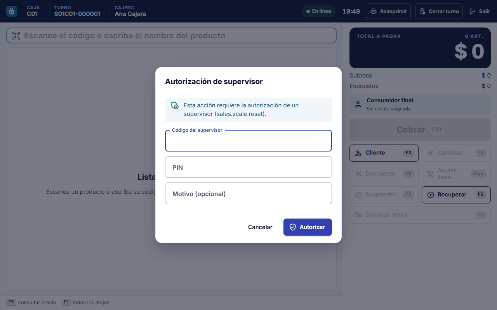

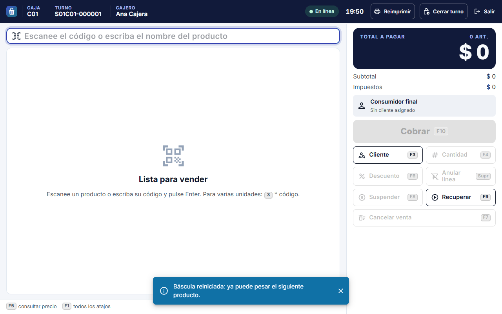

**Eliminar una pesada para volver a pesar.** Si se equivocó, seleccione la línea y pulse **Supr**. La caja avisa una de estas:

- "Pesada eliminada: puede volver a pesar el producto." (era la última pesada de la caja);
- "Pesada eliminada. La última pesada de la caja era otra: retire el producto de la báscula antes de pesar el siguiente.";
- "Pesada eliminada. No se pudo confirmar la báscula con el servidor: si al pesar pide retirar el producto, retírelo."

#### Tara

- **Tara del producto:** si el producto se empaca siempre en la misma bolsa o bandeja, el administrador le pone su **tara** y la caja la
  descuenta sola (la ventana muestra "tara … g"). Se descuenta una sola vez.
- **Tara manual con Ins:** para una bolsa o bandeja distinta, póngala vacía en la báscula y pulse **Ins**: aparece "Tara tomada: … kg."
  Ese peso se descuenta de la **siguiente pesada**, en lugar de la tara del producto. La tara manual se quita sola al **agregar la línea**
  o al **cancelar** la ventana (Esc o Cancelar); también la quita pulsar **Ins** con la báscula vacía ("Tara quitada."). Si la báscula
  no responde, Ins avisa el problema.

> **Importante:** **no use la tecla de tara de la báscula; use Ins en la caja.** Con la tara puesta en la báscula, muchas básculas
> envían el peso neto sin avisarlo y la caja puede creer que la báscula quedó vacía. Si la báscula sí lo avisa, la caja muestra "Quite
> la tara de la báscula (tecla de tara) para continuar".

#### Corregir un producto pesado (F4)

La cantidad de un producto pesado (por báscula, por etiqueta o con peso digitado) **no se cambia con F4**: la caja dice "La cantidad de
un producto pesado no se cambia: elimine la línea (Supr) y vuelva a pesarlo".

#### Peso digitado

Si la báscula no responde (apagada, desconectada o con el cable suelto) o todavía no está vinculada, y la caja lo permite, se abre
**Digitar el peso** con el mensaje del problema. Escriba el peso **en kilos** (por ejemplo 0,700) y pulse **Enter** o **Agregar**.
Digitar el peso necesita el permiso "Digitar el peso" o la autorización del supervisor; la línea queda marcada **Peso digitado** en la caja
y en el tiquete, y queda en la auditoría. Si la caja no permite digitar el peso, el mensaje termina en "Avise al administrador" y no se
agrega nada.

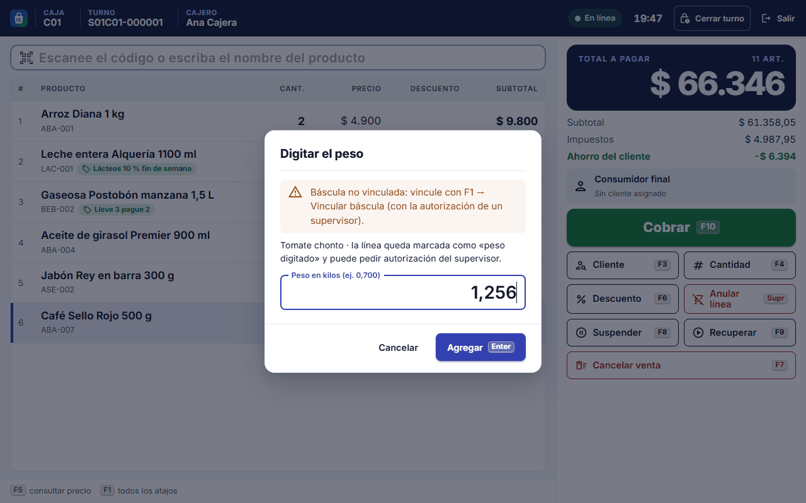

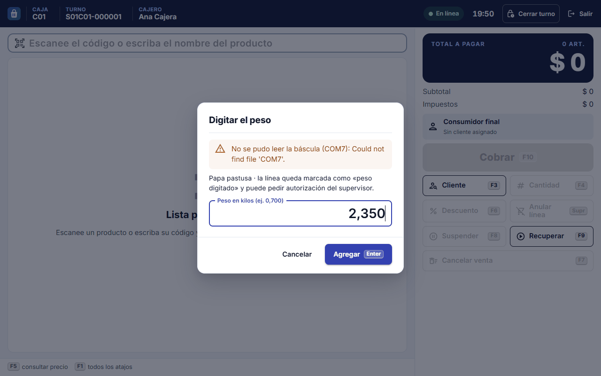

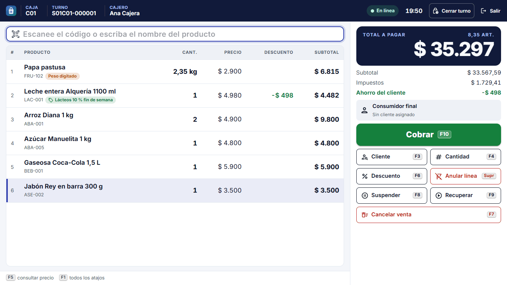

#### Otros mensajes de la báscula

| Mensaje | Qué hacer |
|---|---|
| "La hora de la lectura de la báscula difiere en más de 5 minutos de la del servidor: vuelva a registrar el producto. Si se repite, revise la fecha y hora del computador de la caja." | Vuelva a registrar el producto. Si se repite, avise al administrador para corregir la fecha y la hora de Windows en la caja. |
| "La lectura de la báscula está fuera de orden (…): vuelva a registrar el producto." | Vuelva a registrar el producto. |
| "Esa lectura de la báscula ya se usó en otra línea…" u "Otra pesada de esta caja se registró al mismo tiempo…" | Vuelva a registrar el producto. |
| "El agente de la báscula volvió a un arranque anterior (se reinstaló o se restauró el equipo): vuelva a vincular la báscula (F1 → Vincular báscula)." | Vincule de nuevo con **F1 → Vincular báscula** (con supervisor). |
| "La pantalla de la caja está desactualizada: recárguela (Ctrl+F5) para pesar con la báscula." | Normalmente la caja se recarga sola; si no, pulse **Ctrl+F5**. |
| "La báscula de esta caja está en prueba (Configuración → Cajas e impresoras): detenga la prueba para pesar." | Alguien está probando la báscula en la administración de ese computador: pulse **Detener prueba** allí. |
| "Actualice el programa de la caja (agente de BusinessPost): esta versión no puede vincular la báscula." | El programa de la caja es de una versión anterior: avise al administrador. |

### Droguería: lotes y vencimientos

En los productos que manejan lotes y fecha de vencimiento, **el cajero no elige el lote**: la caja descuenta primero el lote que vence
antes. Se vende igual que cualquier producto.

Si el producto tiene existencias de un **lote vencido**, la caja avisa "El producto tiene existencias de un lote vencido: venderlo
requiere autorización… Retire los vencidos de la góndola." y abre la **Autorización de supervisor**. El supervisor decide si autoriza la
venta; si no, pulse Cancelar y no lo venda. En cualquier caso, avise para que retiren los vencidos de la góndola.

### Ferretería, papelería o miscelánea: fracción y precio abierto

**Venta por metro o fracción.** En los productos que el administrador marcó con "Permite cantidades con decimales" (cable, manguera,
cadena, tela…) la cantidad puede llevar decimales:

- `1,5*` y el código → 1,5 metros.
- O registre el producto y cambie la cantidad con **F4** (por ejemplo 2,25).

En los productos que no lo permiten, la caja rechaza la cantidad con decimales ("Cantidad inválida: mayor que cero y entera si el
producto no se vende por fracciones").

**Precio abierto.** Hay productos sin precio fijo que el administrador marca con "Permite precio abierto en la caja". Si un producto así
no tiene precio, al registrarlo entra en $ 0 y el panel derecho muestra el aviso "…: fije el precio (precio abierto) antes de cobrar".
**En esta versión la pantalla de la caja todavía no tiene el campo para escribir el precio**, y la venta no se puede cobrar con un
producto en $ 0 ("Hay productos sin precio"). Mientras tanto: anule esa línea con **Supr**, cobre el resto y pida al administrador que le
ponga precio al producto en **Productos y precios**.

### Ropa, calzado y deportes

Las **tallas y colores** (variantes) todavía no existen en BusinessPost: la función aparece como "Disponible en una próxima versión".
Hoy la caja vende la ropa y el calzado igual que cualquier producto, con su código de barras.

### Otro tipo de negocio

La caja funciona con lo básico de este manual: escanear o buscar, cantidades, cliente, descuentos, cobro y cierre.

## 13. Atajos de teclado

En cualquier momento, **F1** muestra la lista de atajos en pantalla.

Con báscula conectada y activa, la ventana de F1 tiene además los botones **Vincular báscula** (o **Volver a vincular báscula**),
**Reiniciar báscula** y, si una vinculación quedó a medias, **Completar vinculación** (sección 12).

| Tecla | Qué hace | Cuándo funciona |
|---|---|---|
| `Enter` | Agrega el código escaneado o escrito (código de barras, código interno o PLU). Con letras, busca por nombre | En el escáner |
| `3*código` o `3*nombre` y Enter | Registra varias unidades (también con decimales: `1,5*código`) | En el escáner |
| `↑` `↓` | Eligen el producto en la lista de sugerencias; sin lista, mueven la línea seleccionada | En el escáner |
| `Enter` (con la lista abierta) | Agrega el producto elegido | Lista de sugerencias |
| `Esc` | Cierra la lista de sugerencias, la ventana abierta o vuelve del panel (cobro, cliente, suspendidas); cancela la lectura de la báscula y quita la tara manual de esa pesada | Siempre (no cierra la pantalla de cierre de turno) |
| `F1` | Abre o cierra la ayuda de atajos; con báscula, ahí están Vincular báscula, Reiniciar báscula y Completar vinculación | Sin ventana abierta (también sin turno) |
| `F2` | Vuelve al escáner | Sin ventana abierta |
| `F3` | Cliente de la venta | Con turno abierto |
| `F4` | Cambiar la cantidad de la línea seleccionada (Enter aplica). No sirve en productos pesados | Con una línea seleccionada |
| `F5` | Consultar precio sin vender | Sin ventana abierta (también sin turno) |
| `F6` | Descuento a la línea o a toda la venta | Con productos en la venta |
| `F7` | Cancelar la venta | Con una venta en curso |
| `F8` | Suspender la venta | Con productos en la venta |
| `F9` | Recuperar una venta suspendida | Con turno abierto |
| `F10` | Abre el cobro; dentro del cobro, confirma el cobro | Con productos en la venta / en el cobro |
| `Enter` | Confirma el cobro | En el campo "Recibido en …" |
| `Supr` | Anular la línea seleccionada | Con una línea seleccionada |
| `Ins` | Tara manual de la báscula (bolsa o bandeja) para la siguiente pesada; con la báscula vacía, la quita | Con báscula activa, sin ventana abierta o con la ventana de la pesada |
| `Enter` | Aplicar la cantidad, agregar el peso digitado o autorizar | Ventanas Cambiar cantidad, Digitar el peso y Autorización de supervisor |

Si empieza a escribir o a escanear con el cursor en otra parte, la caja devuelve el cursor al escáner sola y no se pierde la lectura.

## 14. Problemas comunes y soluciones

| Lo que pasa | Qué hacer |
|---|---|
| La barra dice **Sin conexión** y aparece "Sin conexión con el servidor de la tienda" | La venta en curso no se pierde. La caja reintenta cada 15 segundos y avisa "Se recuperó la conexión". Revise el cable de red o el wifi; si sigue igual, avise al administrador. |
| El producto no se agrega al escanear | Escriba el código a mano y pulse Enter, o búsquelo por nombre. Si aparece "No encontramos productos con …", el producto no está creado: aparte el producto y avise al administrador. |
| "No hay existencias suficientes en la bodega de la caja" | El sistema no tiene existencias registradas de ese producto. Un supervisor puede hacer un ajuste rápido en la administración. |
| Aviso de **lote vencido** | Pida la autorización del supervisor o no venda el producto. Avise para que retiren los vencidos (sección 12, droguería). |
| "Escriba el motivo del descuento" | El motivo es obligatorio en todo descuento. |
| "Escriba la referencia del pago (número de aprobación del datáfono)" | Escriba el número de aprobación del voucher en **Referencia** antes de agregar el pago. |
| El botón **Confirmar cobro** no se ve completo (pantallas pequeñas) | Pulse **F10**: confirma el cobro igual. |
| Aparece "Ocurrió un error inesperado en la pantalla" | Pulse **Recargar** en el aviso o la tecla **Ctrl+F5**. La venta en curso no se pierde. Si se repite, avise al administrador. |
| "No se pudo leer la báscula (COM…)" (a veces con un texto técnico en inglés, como "Could not find file 'COM7'") | La báscula está apagada, desconectada o en otro puerto. Revise que esté encendida y el cable. Mientras tanto puede digitar el peso con autorización (sección 12). |
| "Báscula no vinculada: vincule con F1 → Vincular báscula" | En esa caja pulse **F1 → Vincular báscula** con la autorización del supervisor (sección 12). Mientras tanto, digite el peso si la caja lo permite. |
| "La vinculación de la báscula quedó a medias" o "…pulse F1 → Completar vinculación" | Pulse **F1 → Completar vinculación** (no necesita supervisor). |
| La lectura de la báscula se queda en "Retire el producto de la báscula" | Quite todo lo que haya sobre la báscula hasta que marque cero. Si ya está vacía y el aviso sigue, pulse **Reiniciar báscula (supervisor)**. Si registró mal la última pesada, anúlela con Supr y vuelva a pesar. |
| "Quite la tara de la báscula (tecla de tara) para continuar" | Quite la tara en la báscula; para bolsas o bandejas use **Ins** en la caja. |
| "La hora de la lectura de la báscula difiere en más de 5 minutos…" | Vuelva a registrar el producto. Si se repite, el administrador debe corregir la fecha y la hora del computador de la caja. |
| "…vuelva a vincular la báscula (F1 → Vincular báscula)" | El programa de la caja se reinstaló o el equipo se restauró: vincule otra vez con F1 (con supervisor). |
| "Hay productos sin precio" al cobrar | Hay una línea en $ 0 (precio abierto). Anúlela con Supr y avise al administrador (sección 12, ferretería). |
| El tiquete no se imprimió | La venta sí quedó cobrada. Revise papel, tapa y cable de la impresora y pulse **Reimprimir**. Si aparece un aviso de la impresora, avise al administrador. |
| El reporte Z no se imprimió | Pulse **Reimprimir Z** antes de pulsar Terminar. El administrador también puede imprimirlo desde **Turnos de caja**. |
| "Su usuario no puede buscar clientes" | Pida ayuda al supervisor. |
| Sistecrédito no genera el cobro | Sistecrédito necesita Internet en el momento del cobro. Cobre con otro medio. |
| La X no quita un pago de Sistecrédito y pide supervisor | El crédito ya está aprobado: es «No usar este crédito» (sección 7). Con la autorización queda en revisión para la administración. |
| "…no puede quedar por debajo del crédito" o no deja cancelar la venta | La venta tiene un crédito de Sistecrédito aprobado. Complete la venta con él o use «No usar este crédito» con el supervisor. |
| "Cobre, suspenda o cancele la venta en curso antes de cerrar" | Termine la venta que está en pantalla antes de cerrar el turno. |
| "No hay un medio de pago en efectivo activo" al abrir el turno | El administrador debe activar el medio Efectivo en la configuración. |
| El supervisor escribió mal el PIN | La caja avisa y borra el PIN: escríbalo de nuevo. |
| Aviso "La licencia está restringida" | Algunas funciones pueden no estar disponibles. Avise al administrador o al dueño. |
| Diferencia de dinero al cerrar | Escriba la explicación en **Nota sobre la diferencia**. El administrador revisa las diferencias en **Turnos de caja**. |

## 15. Hoja de atajos para imprimir

Recorte esta página y péguela junto a la caja.

| Tecla | Para qué |
|---|---|
| `Enter` | Agregar el producto escaneado, escrito o elegido en la lista |
| `3*` + código | Varias unidades (decimales: `1,5*` + código) |
| Nombre + `↑` `↓` + `Enter` | Buscar por nombre y agregar |
| `↑` `↓` | Elegir la línea de la venta |
| `F1` | Ver todos los atajos |
| `F2` | Volver al escáner |
| `F3` | Cliente de la venta |
| `F4` | Cambiar cantidad |
| `F5` | Consultar precio (sin vender) |
| `F6` | Descuento (con motivo) |
| `F7` | Cancelar la venta |
| `F8` | Suspender la venta |
| `F9` | Recuperar una venta suspendida |
| `F10` | Cobrar / confirmar el cobro |
| `Supr` | Anular la línea seleccionada |
| `Ins` | Tara manual de la báscula (solo para la siguiente pesada) |
| `Esc` | Cerrar, volver o cancelar la lectura de la báscula |
| `F1` → Vincular báscula | Vincular la báscula con esta caja (con supervisor) |
| `F1` → Reiniciar báscula | Si sigue "Retire el producto" con la báscula vacía (con supervisor) |

**Cobro rápido:** `F10` → escriba lo recibido → `Enter`. **Pago mixto:** medio → valor → mismo medio otra vez → siguiente medio → valor → ese medio otra vez → `F10`.

**Báscula:** producto en la báscula → código → `Enter`. Antes del siguiente, retire el producto: la báscula debe volver a cero. No use
la tecla de tara de la báscula: use `Ins`. Un producto pesado no se corrige con `F4`: `Supr` y vuelva a pesar.

**Cierre:** Cerrar turno → contar el efectivo por valor → demás medios → Confirmar cierre → guardar el reporte Z con el efectivo.
