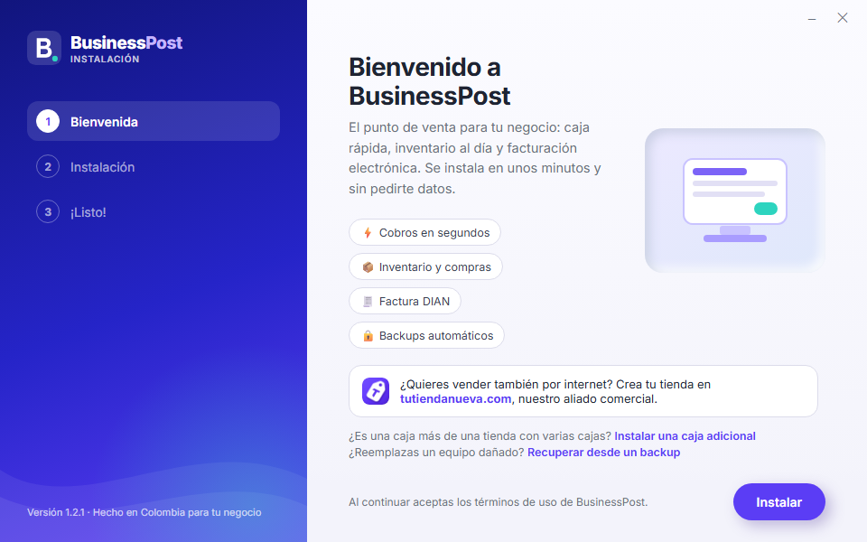
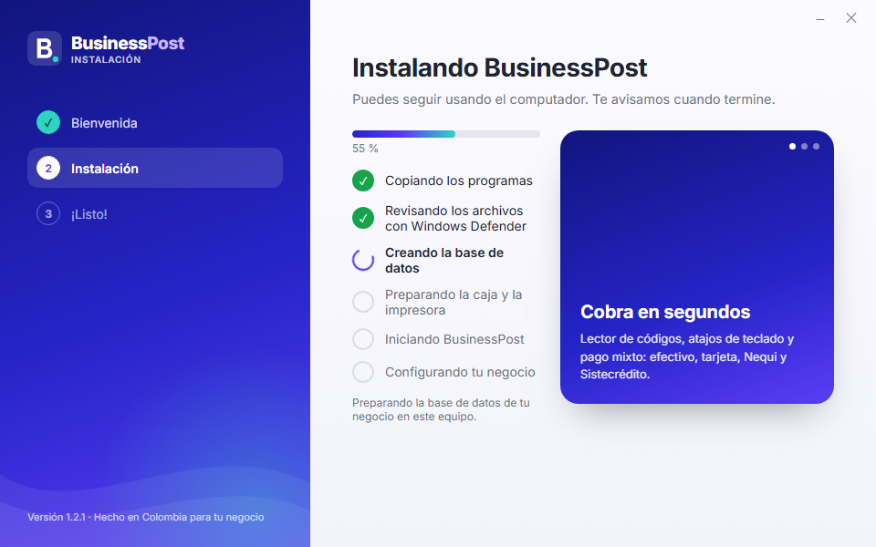
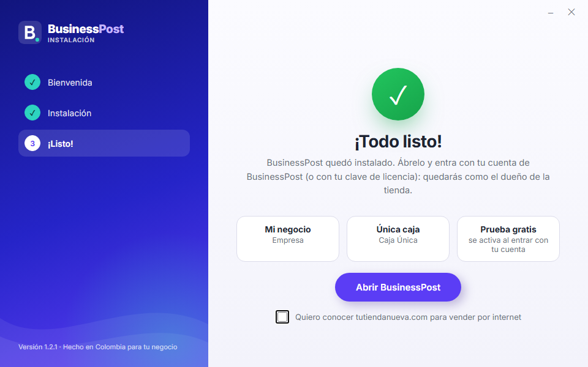
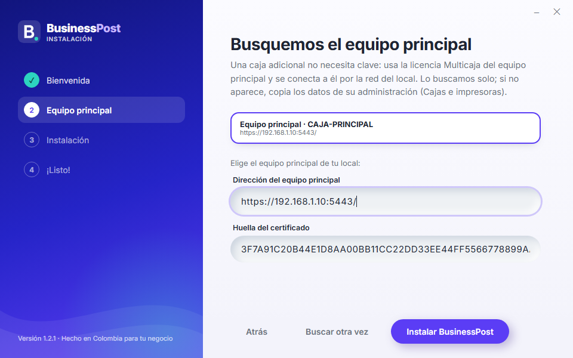
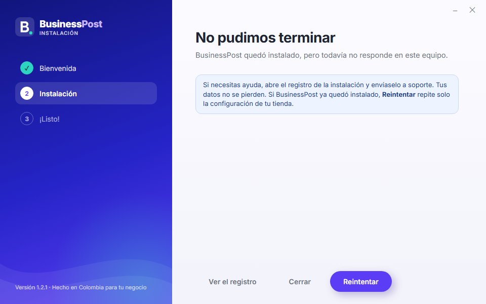
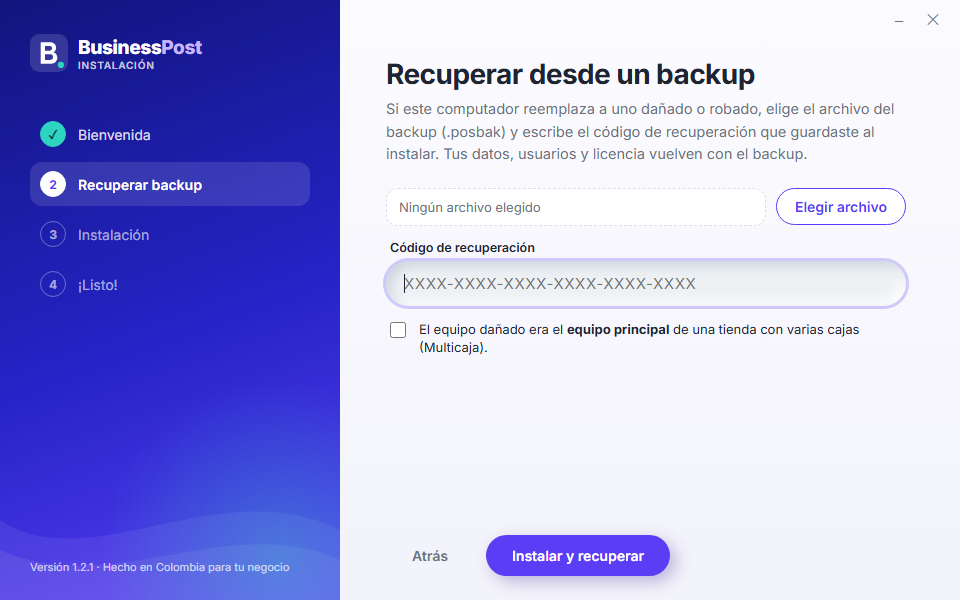

# Manual de instalación de BusinessPost

Este manual explica, paso a paso, cómo instalar BusinessPost en los computadores de su tienda y cómo dejarlo listo para vender. No
necesita conocimientos técnicos: siga los pasos en orden. Las imágenes muestran cada pantalla tal como la verá (con datos de ejemplo).

> Este mismo manual está en el portal de BusinessPost, en **Descargas → Ver el manual**. Desde ahí también puede descargarlo en PDF o imprimirlo.

## Inicio rápido

¿Tiene afán? Estos son los pasos completos en una página. El detalle de cada uno está más abajo.

1. Tenga a mano el **correo y la contraseña de su cuenta de BusinessPost** (la del portal businesspost.tutiendanueva.com) y, si ya
   compró la licencia, su **clave** (empieza por `POS-`).
2. En el portal de BusinessPost abra **Descargas** y pulse **Descargar instalador**.
3. Haga doble clic en `BusinessPost-Setup-….exe`. Si Windows muestra **"Windows protegió su PC"**, pulse **Más información → Ejecutar de todas formas**. Cuando Windows pregunte si permite cambios, pulse **Sí**.
4. En el instalador pulse **Instalar**. No le pide ningún dato.
5. Espere a que termine. La primera vez **puede tardar varios minutos** mientras Windows Defender revisa los archivos. No apague el computador.
6. Pulse **Abrir BusinessPost** y entre con su **cuenta de BusinessPost** (o con su **clave de licencia** y la cuenta con la que la
   compró). Ese primer ingreso lo deja como **Propietario** de la tienda; si su cuenta tiene licencia, se activa sola.
7. Complete los datos de su empresa en **Administración → Configuración** (el Tablero se lo recuerda) y cree a sus cajeros en
   **Administración → Usuarios** (con código de caja y PIN). ¡Listo para vender!

## 1. Antes de empezar

Revise que tiene todo esto:

- Un computador con **Windows 10 o Windows 11 de 64 bits**, con las actualizaciones de Windows al día.
- Un **usuario administrador** del computador (el instalador le pedirá permiso para hacer cambios en el equipo).
- **Internet** para el primer ingreso (se valida su cuenta) y para activar la licencia. Después la tienda puede vender aunque se
  caiga el Internet.
- Su **cuenta de BusinessPost** (el correo y la contraseña del portal businesspost.tutiendanueva.com). Si todavía no tiene licencia,
  BusinessPost funciona en prueba gratis durante 30 días.

¿Cuántas cajas tiene el local?

- **Una sola caja:** instale BusinessPost en ese computador con el botón **Instalar**.
- **Varias cajas (Multicaja):** instale primero en el **equipo principal** (el que guarda los datos) y después en cada **caja
  adicional** con el enlace **Instalar una caja adicional** de la Bienvenida. Todos los equipos deben estar en la misma red del local.

## 2. Descargar el instalador

1. Entre al portal de BusinessPost con su correo y su contraseña.
2. En el menú de la izquierda, en **Personal**, abra **Descargas**.
3. Pulse el botón **Descargar instalador**. Se descarga un archivo con un nombre parecido a `BusinessPost-Setup-1.2.3.exe`
   (el número es la versión).
4. Si va a instalar en otro computador, copie ese archivo en una memoria USB.

Si la página dice "Aún no hay una versión publicada para descargar", espere un rato y vuelva a intentarlo, o comuníquese con
BusinessPost.

## 3. Instalar el programa

Desde la versión 1.2.1 el instalador **no pide ningún dato**: solo instala y muestra el avance. Son tres pantallas: **Bienvenida →
Instalación → ¡Listo!** La tienda queda lista así: tipo de negocio **Supermercado**, la sucursal **Principal** y la **Caja 1**, con
datos provisionales de la empresa y **sin dueño todavía**: el primer ingreso a BusinessPost lo crea (sección 4).

### Abrir el instalador

1. Haga doble clic en el archivo `BusinessPost-Setup-….exe`.
2. Si aparece el aviso azul **"Windows protegió su PC"** (SmartScreen), pulse **Más información** y luego
   **Ejecutar de todas formas**. Este aviso sale porque el instalador todavía no tiene firma digital; el archivo es seguro si lo
   descargó del portal de BusinessPost.
3. Windows pregunta si permite que la aplicación haga cambios en el equipo: pulse **Sí**. Es la única vez que lo pregunta.

### Paso 1: Bienvenida

Pulse **Instalar**. Abajo hay dos enlaces discretos para casos especiales: **Instalar una caja adicional** (una caja más de una tienda
con varias cajas; vea "Caja adicional") y **Recuperar desde un backup** (si reemplaza un computador dañado; sección 9).

### Paso 2: Instalación

Espere. La lista muestra cada paso de verdad: copiando los programas, revisando los archivos con Windows Defender, creando la base
de datos, preparando la caja y la impresora, iniciando BusinessPost y configurando su negocio. La revisión de Windows Defender **la
primera vez puede tardar varios minutos**: es normal. Puede seguir usando el computador; no lo apague ni cierre el instalador. A la
derecha pasan algunas novedades de BusinessPost (cada una dura unos segundos; si pasa el mouse por encima, se detiene).

### Paso 3: ¡Todo listo!

Pulse **Abrir BusinessPost**. Si quiere vender también por internet, marque **"Quiero conocer tutiendanueva.com"** antes de pulsar
el botón (es opcional; viene sin marcar).

En el escritorio queda el acceso directo **BusinessPost**. BusinessPost se inicia solo cada vez que se enciende el computador.

La ventana del instalador se ajusta a la pantalla: con el escalado de Windows al 125 % o 150 % en una pantalla pequeña se dibuja un
poco más pequeña para que los botones de abajo siempre se vean.

### Caja adicional

En la Bienvenida pulse **Instalar una caja adicional**. Una caja adicional **no lleva clave**: usa la licencia Multicaja del equipo
principal. El instalador busca solo el equipo principal en la red del local y lo muestra: elíjalo y pulse **Instalar BusinessPost**.
Si no aparece, pulse **Buscar otra vez** o escriba la **dirección** y la **huella del certificado**, que se ven en la administración
del equipo principal, en **Administración → Cajas e impresoras**. Al terminar, empareje la caja (sección 5).

### Si algo sale mal durante la instalación

El instalador muestra **"No pudimos terminar"** con el paso que falló. Pulse **Ver el registro** para abrir el detalle y envíelo a
soporte. Si BusinessPost ya quedó instalado y solo faltó dejar lista la tienda, aparece **Reintentar**: repite solo ese paso, sin
volver a instalar. Sus datos no se pierden.

Si el equipo no tiene el componente de Windows que usa la ventana del instalador (WebView2, viene con Windows 10 y 11 actualizados),
se abre el instalador clásico: siga sus páginas.

## 4. El primer ingreso: queda como Propietario

Al abrir BusinessPost por primera vez, la pantalla de ingreso muestra **"Es la primera vez que se abre BusinessPost en este equipo"**
con dos opciones:

1. **Mi cuenta de BusinessPost:** escriba el **correo y la contraseña** de su cuenta del portal (businesspost.tutiendanueva.com). La
   cuenta debe existir en el portal. Ese primer ingreso lo deja como **Propietario** de la tienda, con el correo como usuario y la
   **misma contraseña** del portal. Si su empresa tiene una **licencia** en el portal, **se activa sola** y la tienda toma la razón
   social y el NIT de su empresa; si no, empieza la **prueba gratis de 30 días**. Si en el portal tiene activo el **código de
   verificación** (doble factor), se lo pide.
2. **Tengo una clave de licencia:** escriba la **clave** que acaba de comprar y el correo y la contraseña de la cuenta del portal
   con la que la compró. Queda como Propietario y la licencia se activa.

Después de ese primer ingreso no se le vuelve a pedir nada: entra a la administración. El ingreso se hace en el mismo computador
donde se instaló (el equipo principal o la única caja).

Los datos de la empresa quedan **provisionales** (razón social, NIT y dirección): el **Tablero** muestra el aviso **"Complete los datos
de su empresa (necesarios para facturar)"**. Complételos en **Administración → Configuración** (pestaña **Empresa**). Mientras el NIT
sea el provisional, ahí mismo puede escribir el NIT real (el dígito de verificación sale solo); después ya no se cambia. El tipo de
negocio se cambia en **Configuración → Funciones del negocio**.

Solo si instaló con el **instalador clásico** (equipos sin WebView2), al terminar se abre en el navegador la **Configuración
inicial**: elija qué tipo de negocio tiene, complete la empresa, la sucursal y el propietario; luego la licencia (o **Seguir en
demostración**) y, por último, genere el **código de recuperación**, guárdelo fuera del local y confírmelo.

### Su usuario de propietario

- Su usuario es **el correo de su cuenta de BusinessPost** y su contraseña, **la misma del portal**. Entra a la administración aunque
  no haya Internet. Si después cambia la contraseña en el portal, en BusinessPost siga usando la que tenía (por ahora no se cambia
  sola; cámbiela también en BusinessPost).
- **Código de recuperación de los backups:** créelo en **Administración → Backups** después del primer ingreso, imprímalo y guárdelo
  fuera del local. Es la única forma de abrir sus backups en otro computador.
- El usuario propietario entra a la **administración**. Para vender en la caja se necesita un usuario con **código de caja y PIN**:
  créelo en **Administración → Usuarios → Nuevo usuario** (sección 5). Por ahora el código y el PIN se ponen al crear el usuario y
  no se pueden agregar después a uno que ya existe; si el dueño también va a vender, créese un usuario de caja aparte.

## 5. Entrar a BusinessPost

La pantalla de ingreso tiene dos formas de entrar:

- **Caja:** escriba el **código de cajero** y el **PIN** y pulse **Entrar a la caja**. Es para vender.
- **Administración:** escriba el **usuario** y la **contraseña** y pulse **Entrar**. Es para productos, precios, inventario,
  reportes, usuarios y configuración.

### Crear cajeros y otros usuarios

1. Entre a la administración con el usuario del propietario.
2. Abra **Administración → Usuarios** y pulse **Nuevo usuario**.

3. Escriba el usuario, el nombre completo y una contraseña inicial (la persona la cambia la primera vez que entra).
4. Elija el **rol**: por ejemplo **Cajero** (vende y opera su caja), **Supervisor de caja**, **Administrador**, **Inventario**,
   **Compras** o **Contador**. Cada rol solo ve lo que necesita.
5. Para que pueda vender, escriba un **código de caja** (3 a 6 números) y un **PIN de caja** (4 a 6 números).
6. Pulse **Crear**.

### Agregar cajas (Multicaja)

1. Instale BusinessPost en la caja nueva con el enlace **Instalar una caja adicional** de la Bienvenida (sección 3).
2. En el equipo principal, entre a **Administración → Cajas e impresoras** y pulse **Emparejar equipo** en la caja que va a usar.
3. En la caja nueva, abra BusinessPost, elija **Emparejar este equipo** y escriba el código que le mostró el equipo principal.

## 6. Activar la licencia después

Si empezó en demostración:

1. Entre a la administración con el usuario del propietario.
2. Abra **Administración → Licencia**.
3. Pegue la clave en **Clave de licencia** y pulse **Activar** (necesita Internet).

## 7. Pagar la mensualidad en línea

Cuando se acerca el vencimiento, en **Administración → Licencia** aparece el recuadro **Pagar mensualidad**. Pulse el botón
**Pagar mensualidad** y pague con Nequi, PSE, tarjeta o Bancolombia; también puede escanear el código QR con el celular. Al
aprobarse el pago, la licencia se renueva sola.

También puede pagar desde el portal de BusinessPost, en **Personal → Mi suscripción**, con el botón **Pagar**.

## 8. Si algo falla

### Al descargar o abrir el instalador

- **"Windows protegió su PC" (SmartScreen):** pulse **Más información → Ejecutar de todas formas**. Sale porque el instalador aún
  no tiene firma digital.
- **El navegador dice que el archivo "no se descarga con frecuencia":** abra la lista de descargas del navegador, elija el archivo
  y pulse **Conservar**.
- **El antivirus bloquea o borra el instalador:** Windows Defender lo acepta; si usa otro antivirus, permita el archivo
  descargado del portal o desactive el antivirus solo mientras instala.
- **Windows no pide permiso o dice que no tiene permisos:** entre a Windows con un usuario **administrador** y vuelva a abrir el
  instalador.

### Durante la instalación

- **Se queda mucho tiempo en "Revisando los archivos con Windows Defender":** es normal la primera vez (puede tardar varios
  minutos). No cierre el instalador; la lista muestra en qué paso va.
- **"No pudimos terminar":** pulse **Ver el registro** y envíelo a soporte. Sus datos no se pierden.
- **La caja adicional no encuentra el equipo principal:** revise que el equipo principal esté encendido y que ambos computadores estén conectados a la **misma red**
  del local. Si sigue sin aparecer, escriba la dirección y la huella que se ven en el equipo principal (**Administración → Cajas e impresoras**).

### Al abrir BusinessPost

- **La primera vez tarda en abrir:** verá **"Iniciando BusinessPost…"**. Después de instalar puede tardar unos minutos mientras
  Windows revisa los archivos. Espere; no hace falta abrirlo dos veces.
- **BusinessPost no abre o dice que no responde:** espere unos minutos. Si pasan más de 5, pulse **Reintentar** o
  **Cómo resolverlo**. Si sigue igual, **reinicie el computador**: BusinessPost se inicia solo al encender.
- **Un usuario quedó bloqueado** por equivocarse varias veces: el propietario pulsa **Desbloquear** en
  **Administración → Usuarios**.

### Pedir ayuda a soporte

Comuníquese con soporte de BusinessPost. En el equipo principal (o el de la única caja) abra el menú Inicio de Windows, busque la
carpeta **BusinessPost** y abra **Paquete de soporte**. En el escritorio aparece un archivo `soporte-….zip` con la información que
soporte necesita para ayudarle (sin contraseñas ni datos de clientes); envíelo cuando se lo pidan.

## 9. Si el computador se daña o se lo roban

Abra el instalador en el computador nuevo y, en la Bienvenida, pulse **Recuperar desde un backup**. Pulse **Elegir archivo**, busque
el archivo del backup (termina en `.posbak`), escriba el **código de recuperación** que guardó, marque la casilla si el equipo dañado
era el **equipo principal** de una tienda con varias cajas y pulse **Instalar y recuperar**. Sus datos, usuarios y
licencia vuelven con el backup; si la licencia pide activarse de nuevo, use su clave en **Administración → Licencia**. Si no tiene
el archivo del backup, comuníquese con soporte antes de instalar.

## 10. La ventana de BusinessPost

BusinessPost se abre en **su propia ventana** (con su ícono y su nombre en la barra de tareas), no en el navegador. Mientras el sistema
arranca verá la pantalla **"Iniciando BusinessPost…"**; la primera vez después de instalar puede tardar unos minutos. Si lleva más de 5
minutos, use **"Reintentar"** o **"Cómo resolverlo"**. En la caja, **F11** pone la ventana en pantalla completa (vuelva a pulsar F11 para
salir). Los enlaces a otras páginas, como pagar la mensualidad, se abren en su navegador de siempre.

## 11. Desinstalar BusinessPost

Abra **Configuración de Windows → Aplicaciones → Aplicaciones instaladas**, busque **BusinessPost** y pulse **Desinstalar**. Se abre
la ventana de BusinessPost (Windows pide permiso una vez):

1. Lea qué **se quita** (los programas, sus servicios, los accesos directos y la regla del firewall) y qué **se conserva** (sus
   ventas, inventario, clientes y backups, en `C:\ProgramData\BusinessPost`; si vuelve a instalar, BusinessPost los usa de nuevo).
2. Recomendado: pulse **Hacer un backup final**. El backup queda en **Documentos → "BusinessPost - backup final"**; cópielo a una
   memoria USB. Para abrirlo en otro computador necesita su código de recuperación.
3. Solo si de verdad quiere borrar todo, marque **"Borrar también los datos del negocio"**: el instalador le pide confirmar dos
   veces (la segunda escribiendo **BORRAR**). No se puede deshacer.
4. Si va a usar su clave en otro computador, en **"Liberar este equipo de la licencia"** escriba su usuario y su contraseña de
   BusinessPost (necesita Internet). Si no lo hace aquí, puede liberarlo después desde el portal.
5. Opcional: cuéntenos por qué desinstala. El motivo solo se envía si marca **"Enviar el motivo a BusinessPost"** (viaja con la
   liberación del equipo).
6. Pulse **Desinstalar** y confirme.
