# Manual de instalación de BusinessPost

Este manual explica, paso a paso, cómo instalar BusinessPost en los computadores de su tienda y cómo dejarlo listo para vender. No
necesita conocimientos técnicos: siga los pasos en orden. Las imágenes muestran cada pantalla tal como la verá (con datos de ejemplo).

> Este mismo manual está en el portal de BusinessPost, en **Descargas → Ver el manual**. Desde ahí también puede descargarlo en PDF o imprimirlo.

## Inicio rápido

¿Tiene afán? Estos son los pasos completos en una página. El detalle de cada uno está más abajo.

1. Tenga a mano su **correo y contraseña del portal**, su **clave de licencia** (empieza por `POS-`) y los datos de su empresa (NIT, municipio, dirección).
2. En el portal de BusinessPost abra **Descargas** y pulse **Descargar instalador**.
3. Haga doble clic en `BusinessPost-Setup-….exe`. Si Windows muestra **"Windows protegió su PC"**, pulse **Más información → Ejecutar de todas formas**. Cuando Windows pregunte si permite cambios, pulse **Sí**.
4. En el instalador: **Comenzar** → elija **Es la única caja** (o la opción de su local) → escriba la **clave de licencia** → entre con su **cuenta del portal** → revise **Tu negocio** → **Instalar BusinessPost**.
5. Espere a que termine. La primera vez **puede tardar varios minutos** mientras Windows Defender revisa los archivos. No apague el computador.
6. **Imprima o anote el código de recuperación** y guárdelo fuera del local. Se muestra una sola vez.
7. Pulse **Abrir BusinessPost** y entre a **Administración** con el correo y la contraseña de su portal.
8. Cree a sus cajeros en **Administración → Usuarios** (con código de caja y PIN). ¡Listo para vender!

## 1. Antes de empezar

Revise que tiene todo esto:

- Un computador con **Windows 10 o Windows 11 de 64 bits**, con las actualizaciones de Windows al día.
- Un **usuario administrador** del computador (el instalador le pedirá permiso para hacer cambios en el equipo).
- **Internet** para activar la licencia. Después la tienda puede vender aunque se caiga el Internet.
- Su **usuario del portal de BusinessPost** (el correo y la contraseña que le entregamos) para descargar el instalador.
- Su **clave de licencia** (empieza por `POS-`). Si todavía no la tiene, puede instalar y usar BusinessPost en demostración
  durante 30 días.
- Los datos de su empresa a la mano: razón social, NIT, si es responsable de IVA, municipio, dirección y teléfono.

¿Cuántas cajas tiene el local?

- **Una sola caja:** instale BusinessPost en ese computador y elija **Es la única caja**.
- **Varias cajas (Multicaja):** instale primero en el **equipo principal** (el que guarda los datos; casi siempre el de la
  oficina o la caja principal) y después en cada **caja adicional**. Todos los equipos deben estar en la misma red del local.

## 2. Descargar el instalador

1. Entre al portal de BusinessPost con su correo y su contraseña.
2. En el menú de la izquierda, en **Personal**, abra **Descargas**.
3. Pulse el botón **Descargar instalador**. Se descarga un archivo con un nombre parecido a `BusinessPost-Setup-1.2.3.exe`
   (el número es la versión).
4. Si va a instalar en otro computador, copie ese archivo en una memoria USB.

Si la página dice "Aún no hay una versión publicada para descargar", espere un rato y vuelva a intentarlo, o comuníquese con
BusinessPost.

## 3. Instalar el programa

El instalador de BusinessPost es una ventana que lo guía paso a paso. A la izquierda verá siempre en qué paso va; con **Atrás**
puede devolverse a corregir algo antes de instalar.

### Abrir el instalador

1. Haga doble clic en el archivo `BusinessPost-Setup-….exe`.
2. Si aparece el aviso azul **"Windows protegió su PC"** (SmartScreen), pulse **Más información** y luego
   **Ejecutar de todas formas**. Este aviso sale porque el instalador todavía no tiene firma digital; el archivo es seguro si lo
   descargó del portal de BusinessPost.
3. Windows pregunta si permite que la aplicación haga cambios en el equipo: pulse **Sí**. Es la única vez que lo pregunta.

### Paso 1: Bienvenida

Pulse **Comenzar**.

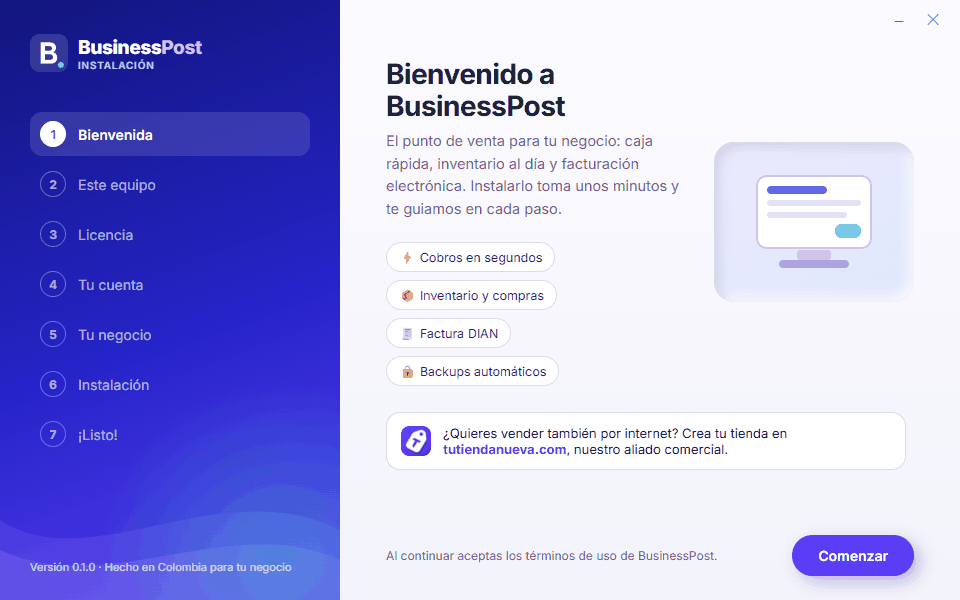

### Paso 2: Este equipo

La pantalla pregunta **"¿Cómo usarás este equipo?"**. Elija una tarjeta y pulse **Continuar**:

- **Es la única caja:** el local tiene una sola caja. Es la opción más común (plan Caja Única).
- **Es el equipo principal:** el local tiene varias cajas y este es el computador que guarda los datos. Instálelo primero (plan Multicaja).
- **Es una caja adicional:** una caja más de un local que ya tiene instalado el equipo principal (vea "Caja adicional" más abajo).

Si está reemplazando un computador dañado o robado, use el enlace **Recuperar desde un backup** (sección 9).

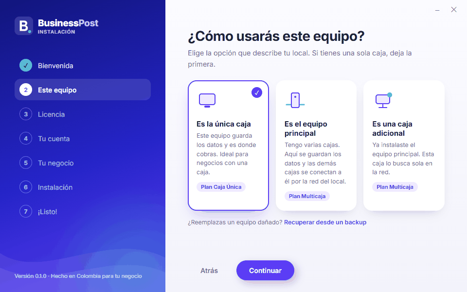

> **Tipo de negocio (próximamente):** en una próxima versión el instalador también le preguntará qué tipo de negocio tiene
> (supermercado, minimercado, droguería…) para dejar BusinessPost ajustado a él. Si su instalador ya lo pregunta, elija el que
> más se parezca a su negocio; lo puede cambiar después.

### Paso 3: Licencia

Escriba su clave (`POS-XXXXX-XXXXX-XXXXX-XXXXX`). Con Internet, el instalador muestra enseguida la **razón social, el NIT, el plan
y hasta cuándo está vigente**. Revise que sea su empresa y pulse **Continuar**.

- ¿Aún no tiene clave? Pulse **Probar gratis 30 días**. Todo funciona y puede activar la clave después (sección 6).
- Si su plan es **Caja Única**, en el paso anterior debe elegir **Es la única caja**; el instalador se lo recuerda.

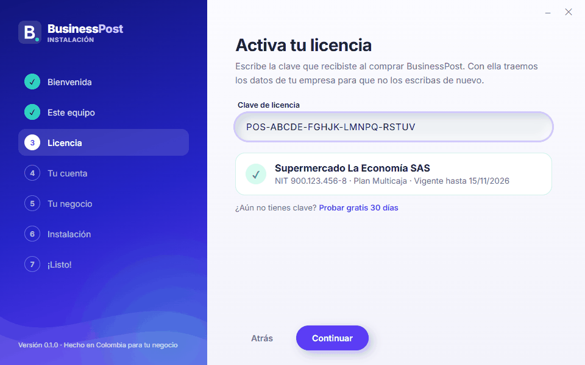

### Paso 4: Tu cuenta

- **Con clave:** escriba el **correo y la contraseña de su portal de BusinessPost** (los mismos con los que descargó el
  instalador). Con esa misma cuenta entrará a la administración de BusinessPost, también sin Internet. Si en el portal tiene
  activo el **código de verificación** (doble factor), el instalador se lo pide: escriba los 6 números de su aplicación.
- Si siempre entra al portal con Google y no recuerda su contraseña, en el portal vaya a **Mi cuenta → Cambiar contraseña** y
  vuelva al instalador (el botón "Continuar con Google" del instalador todavía no está disponible).
- **En prueba de 30 días:** escriba su nombre, su correo y una contraseña de mínimo 10 caracteres (dos veces).

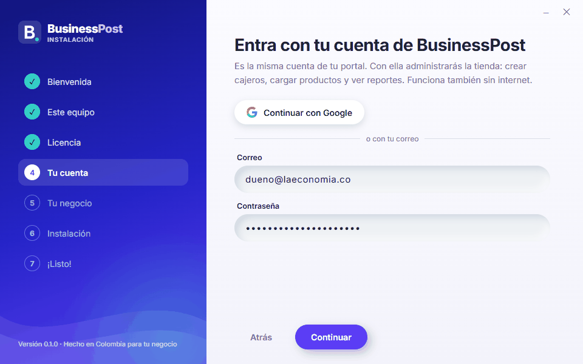

### Paso 5: Tu negocio

Con la clave, la razón social y el NIT ya vienen llenos. Complete el **nombre comercial** (el de su aviso), el **tipo de persona**,
si es **responsable de IVA**, el **municipio** (escriba y elíjalo de la lista que aparece), la **dirección**, el teléfono y el correo
del negocio (se usa en la factura electrónica). El **dígito de verificación del NIT se calcula solo**.
Pulse **Instalar BusinessPost**.

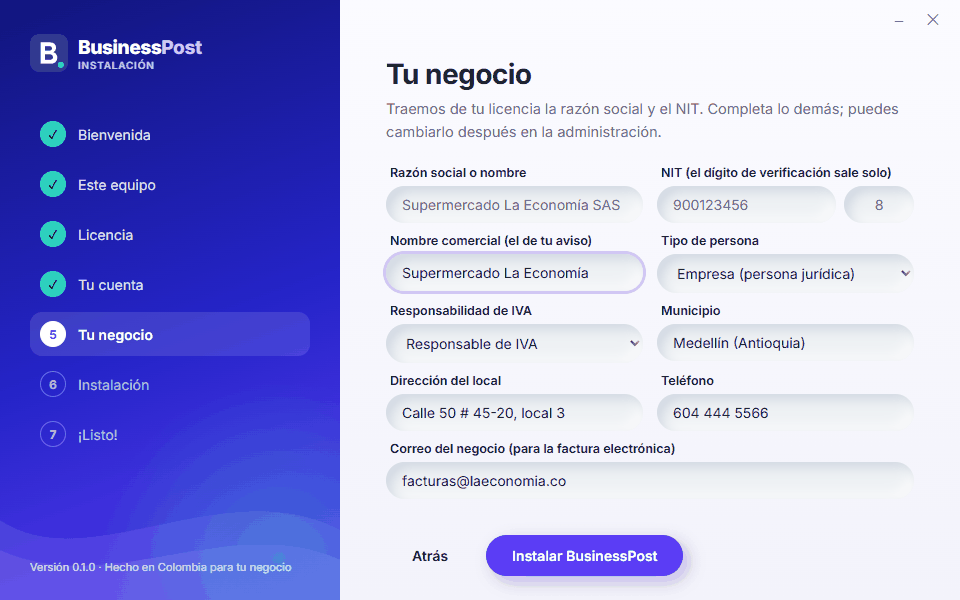

### Paso 6: Instalación

Espere. La lista muestra cada paso de verdad: copiando los programas, revisando los archivos con Windows Defender, creando la base
de datos, preparando la caja y la impresora, iniciando BusinessPost y configurando su negocio. La revisión de Windows Defender **la
primera vez puede tardar varios minutos**: es normal. Puede seguir usando el computador; no lo apague ni cierre el instalador.

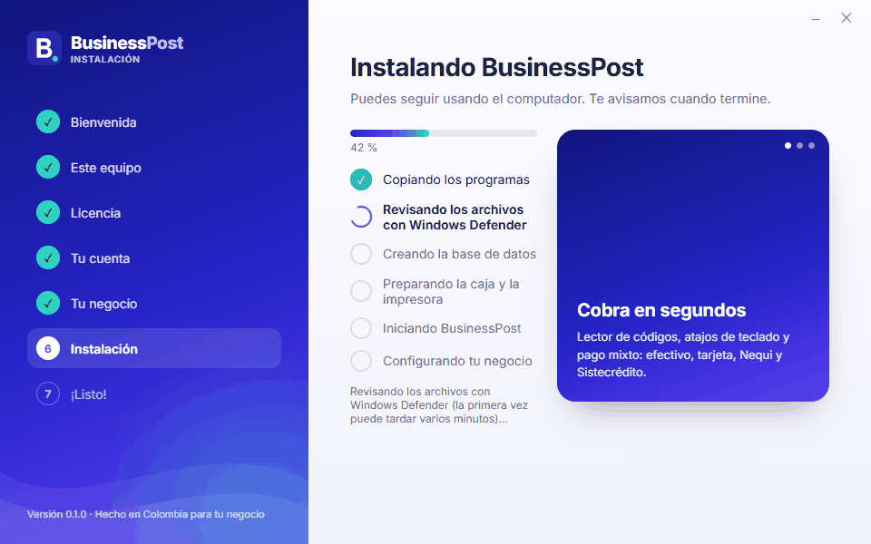

### Paso 7: Código de recuperación

El instalador muestra el código de los backups. Es la única forma de abrir los backups de su negocio en otro computador si este
se daña o se lo roban.

- **Se muestra una sola vez.** Pulse **Imprimir** o anótelo con cuidado.
- **Guárdelo fuera del local** (por ejemplo, en su casa). No lo deje pegado en el computador.
- Marque **"Ya lo imprimí o lo anoté…"** y pulse **Continuar**.

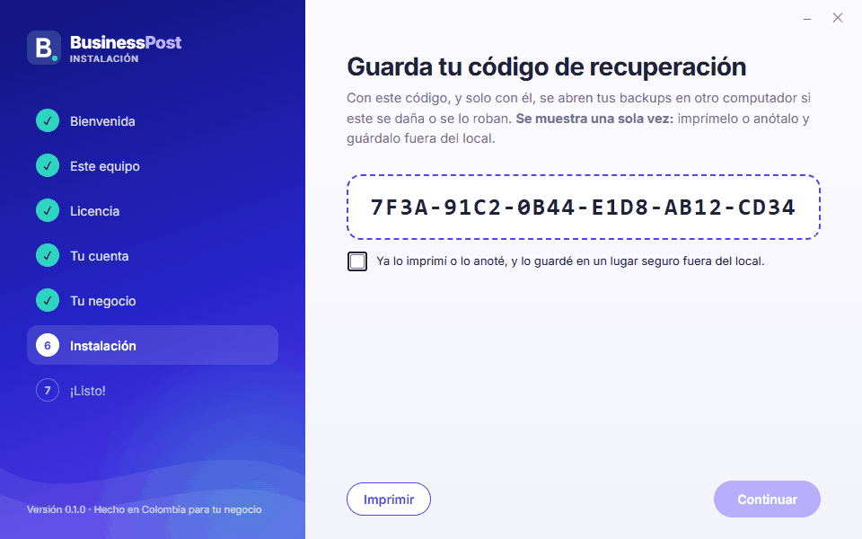

### Paso 8: ¡Todo listo!

Verá el resumen (empresa, tipo de equipo y licencia). Pulse **Abrir BusinessPost**. Si quiere vender también por internet, marque
**"Quiero conocer tutiendanueva.com"** antes de pulsar el botón (es opcional; viene sin marcar).

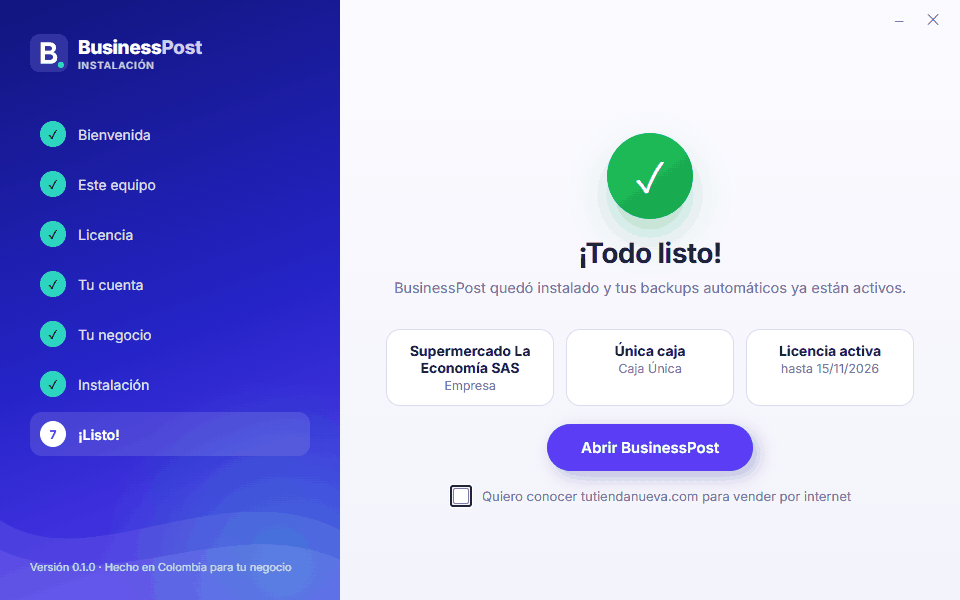

En el escritorio queda el acceso directo **BusinessPost**. BusinessPost se inicia solo cada vez que se enciende el computador.

### Caja adicional

En el paso 2 elija **Es una caja adicional** y pulse **Continuar**. El instalador busca solo el equipo principal en la red del
local y lo muestra: elíjalo y pulse **Instalar BusinessPost**. Si no aparece, pulse **Buscar otra vez** o escriba la **dirección** y
la **huella del certificado**, que se ven en la administración del equipo principal, en **Administración → Cajas e impresoras**.
Al terminar, empareje la caja (sección 5).

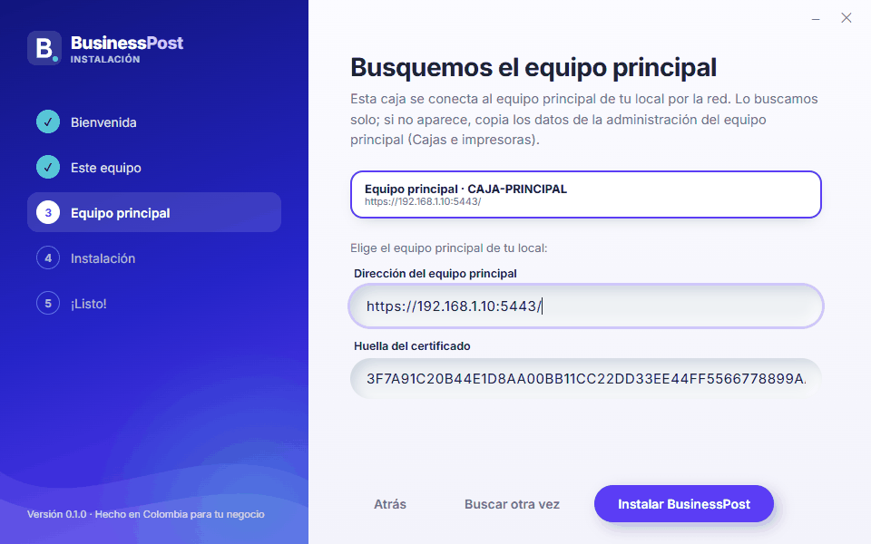

### Si algo sale mal durante la instalación

El instalador muestra **"No pudimos terminar"** con el paso que falló. Pulse **Ver el registro** para abrir el detalle y envíelo a
soporte. Sus datos no se pierden y puede volver a abrir el instalador.

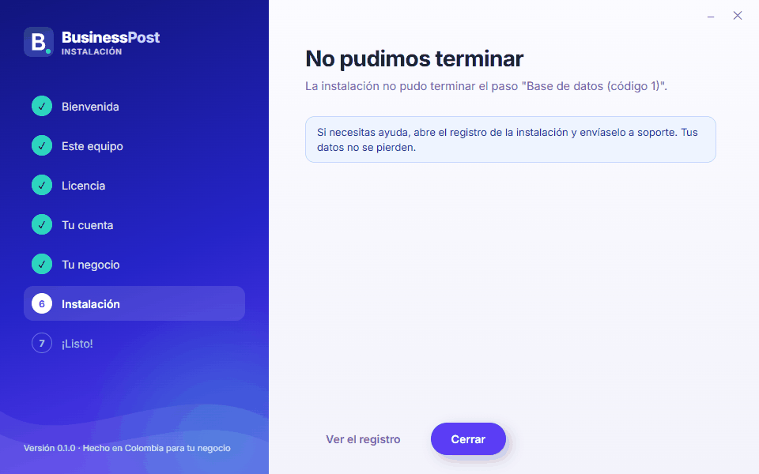

Si el equipo no tiene el componente de Windows que usa la ventana del instalador (WebView2, viene con Windows 10 y 11 actualizados),
se abre el instalador clásico: siga sus páginas, son las mismas preguntas.

## 4. Configurar la tienda la primera vez

Con el instalador de la sección 3 **no hay que hacer nada más**: la empresa, la sucursal "Principal", la "Caja 1", su usuario
de propietario, la licencia y el código de recuperación quedan listos durante la instalación. Los datos de la empresa se pueden
revisar y cambiar después en **Administración → Configuración** (pestaña **Empresa**).

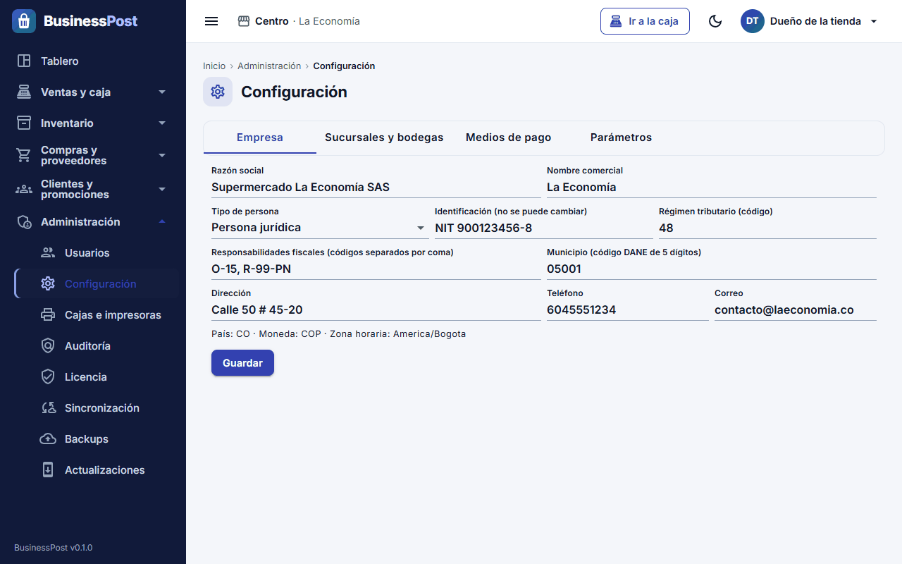

Solo si instaló con el **instalador clásico** (equipos sin WebView2), al terminar se abre en el navegador la **Configuración
inicial**: complete la empresa, la sucursal, la caja y el propietario; luego la licencia (o **Seguir en demostración**) y, por
último, genere el **código de recuperación**, guárdelo fuera del local y confírmelo.

### Su usuario de propietario

- Si instaló **con clave**, su usuario es **el correo de su portal** y su contraseña, **la misma del portal**. Entra a la
  administración aunque no haya Internet. Si después cambia la contraseña en el portal, en BusinessPost siga usando la que
  tenía (por ahora no se cambia sola; cámbiela también en BusinessPost).
- Si instaló **en prueba**, su usuario es el correo que escribió y la contraseña que eligió.
- Para vender en la caja con **código y PIN**, créelos en **Administración → Usuarios** (en su usuario: código de caja y PIN).

## 5. Entrar a BusinessPost

La pantalla de ingreso tiene dos formas de entrar:

- **Caja:** escriba el **código de cajero** y el **PIN** y pulse **Entrar a la caja**. Es para vender.
- **Administración:** escriba el **usuario** y la **contraseña** y pulse **Entrar**. Es para productos, precios, inventario,
  reportes, usuarios y configuración.

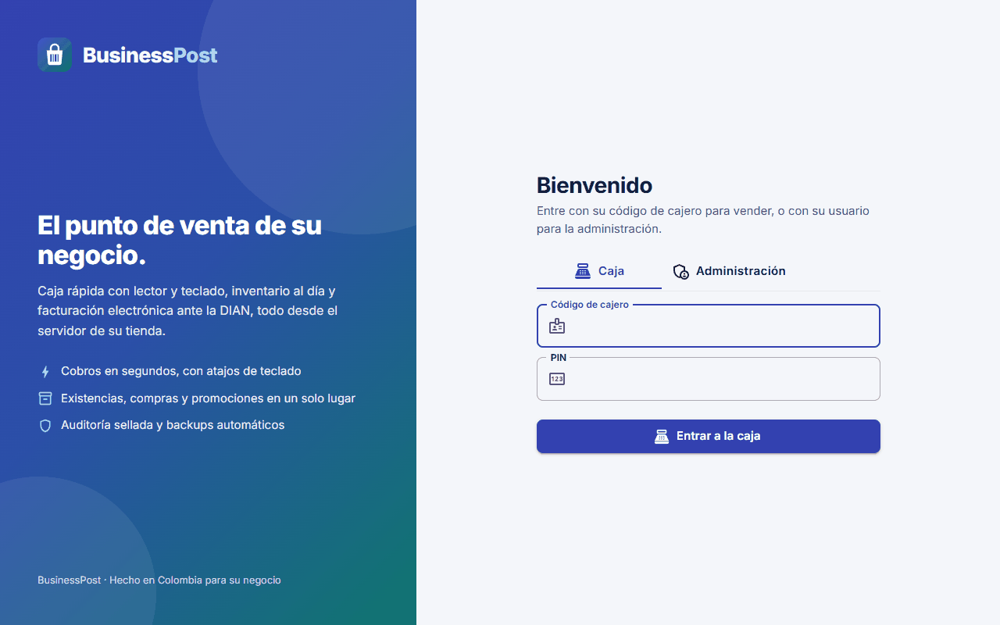

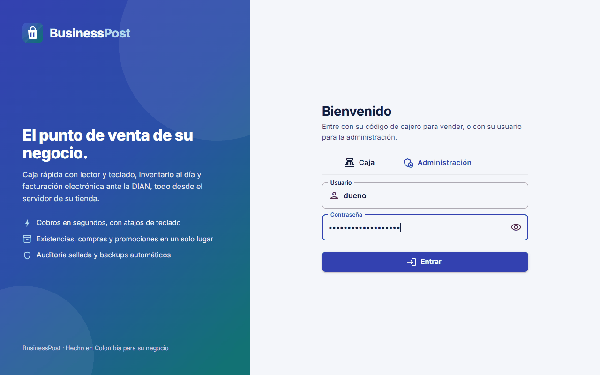

### Crear cajeros y otros usuarios

1. Entre a la administración con el usuario del propietario.
2. Abra **Administración → Usuarios** y pulse **Nuevo usuario**.

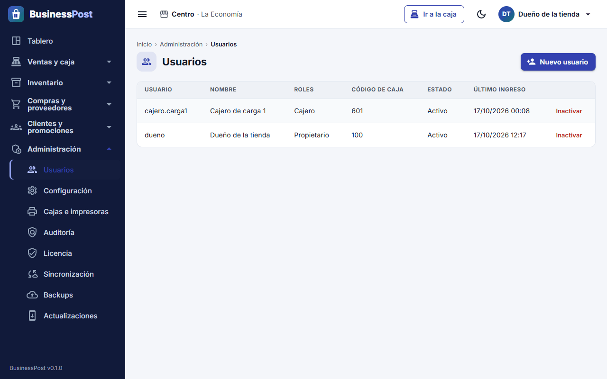

3. Escriba el usuario, el nombre completo y una contraseña inicial (la persona la cambia la primera vez que entra).
4. Elija el **rol**: por ejemplo **Cajero** (vende y opera su caja), **Supervisor de caja**, **Administrador**, **Inventario**,
   **Compras** o **Contador**. Cada rol solo ve lo que necesita.
5. Para que pueda vender, escriba un **código de caja** (3 a 6 números) y un **PIN de caja** (4 a 6 números).
6. Pulse **Crear**.

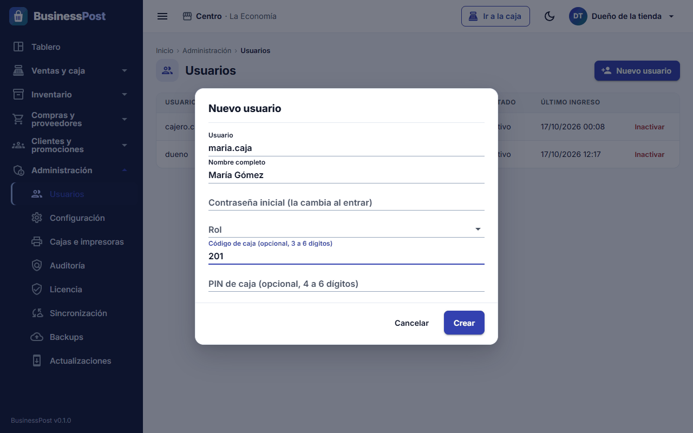

### Agregar cajas (Multicaja)

1. Instale BusinessPost en la caja nueva con la opción **Es una caja adicional** (sección 3).
2. En el equipo principal, entre a **Administración → Cajas e impresoras** y pulse **Emparejar equipo** en la caja que va a usar.
3. En la caja nueva, abra BusinessPost, elija **Emparejar este equipo** y escriba el código que le mostró el equipo principal.

## 6. Activar la licencia después

Si empezó en demostración:

1. Entre a la administración con el usuario del propietario.
2. Abra **Administración → Licencia**.
3. Pegue la clave en **Clave de licencia** y pulse **Activar** (necesita Internet).

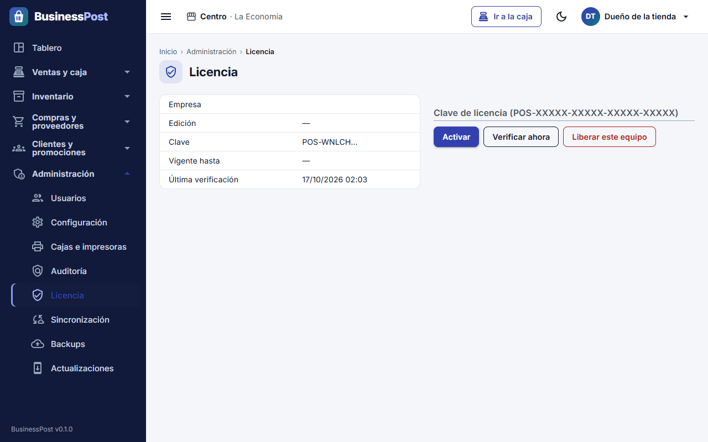

## 7. Pagar la mensualidad en línea

Cuando se acerca el vencimiento, en **Administración → Licencia** aparece el recuadro **Pagar mensualidad**. Pulse el botón
**Pagar mensualidad** y pague con Nequi, PSE, tarjeta o Bancolombia; también puede escanear el código QR con el celular. Al
aprobarse el pago, la licencia se renueva sola.

También puede pagar desde el portal de BusinessPost, en **Personal → Mi suscripción**, con el botón **Pagar**.

## 8. Si algo falla

### Al descargar o abrir el instalador

- **"Windows protegió su PC" (SmartScreen):** pulse **Más información → Ejecutar de todas formas**. Sale porque el instalador aún
  no tiene firma digital.
- **El navegador dice que el archivo "no se descarga con frecuencia":** abra la lista de descargas del navegador, elija el archivo
  y pulse **Conservar**.
- **El antivirus bloquea o borra el instalador:** Windows Defender lo acepta; si usa otro antivirus, permita el archivo
  descargado del portal o desactive el antivirus solo mientras instala.
- **Windows no pide permiso o dice que no tiene permisos:** entre a Windows con un usuario **administrador** y vuelva a abrir el
  instalador.

### Durante la instalación

- **Se queda mucho tiempo en "Revisando los archivos con Windows Defender":** es normal la primera vez (puede tardar varios
  minutos). No cierre el instalador; la lista muestra en qué paso va.
- **"No pudimos terminar":** pulse **Ver el registro** y envíelo a soporte. Sus datos no se pierden.
- **La caja adicional no encuentra el equipo principal:** revise que el equipo principal esté encendido y que ambos computadores estén conectados a la **misma red**
  del local. Si sigue sin aparecer, escriba la dirección y la huella que se ven en el equipo principal (**Administración → Cajas e impresoras**).

### Al abrir BusinessPost

- **La primera vez tarda en abrir:** verá **"Iniciando BusinessPost…"**. Después de instalar puede tardar unos minutos mientras
  Windows revisa los archivos. Espere; no hace falta abrirlo dos veces.
- **BusinessPost no abre o dice que no responde:** espere unos minutos. Si pasan más de 5, pulse **Reintentar** o
  **Cómo resolverlo**. Si sigue igual, **reinicie el computador**: BusinessPost se inicia solo al encender.
- **Un usuario quedó bloqueado** por equivocarse varias veces: el propietario pulsa **Desbloquear** en
  **Administración → Usuarios**.

### Pedir ayuda a soporte

Comuníquese con soporte de BusinessPost. En el equipo principal (o el de la única caja) abra el menú Inicio de Windows, busque la
carpeta **BusinessPost** y abra **Paquete de soporte**. En el escritorio aparece un archivo `soporte-….zip` con la información que
soporte necesita para ayudarle (sin contraseñas ni datos de clientes); envíelo cuando se lo pidan.

## 9. Si el computador se daña o se lo roban

Instale BusinessPost en el computador nuevo. En **"Este equipo"** elija la misma opción que tenía el anterior y pulse
**Recuperar desde un backup** (debajo de las tarjetas). Pulse **Elegir archivo**, busque el archivo del backup (termina en
`.posbak`), escriba el **código de recuperación** que guardó al instalar y pulse **Instalar y recuperar**. Sus datos, usuarios y
licencia vuelven con el backup; si la licencia pide activarse de nuevo, use su clave en **Administración → Licencia**. Si no tiene
el archivo del backup, comuníquese con soporte antes de instalar.

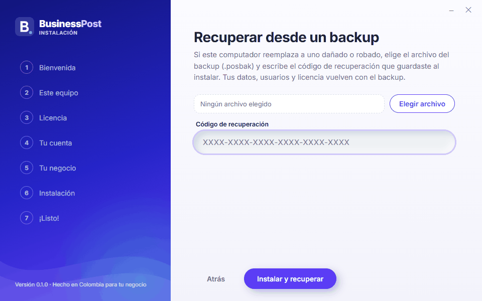

## 10. La ventana de BusinessPost

BusinessPost se abre en **su propia ventana** (con su ícono y su nombre en la barra de tareas), no en el navegador. Mientras el sistema
arranca verá la pantalla **"Iniciando BusinessPost…"**; la primera vez después de instalar puede tardar unos minutos. Si lleva más de 5
minutos, use **"Reintentar"** o **"Cómo resolverlo"**. En la caja, **F11** pone la ventana en pantalla completa (vuelva a pulsar F11 para
salir). Los enlaces a otras páginas, como pagar la mensualidad, se abren en su navegador de siempre.

## 11. Desinstalar BusinessPost

Abra **Configuración de Windows → Aplicaciones → Aplicaciones instaladas**, busque **BusinessPost** y pulse **Desinstalar**. Se abre
la ventana de BusinessPost (Windows pide permiso una vez):

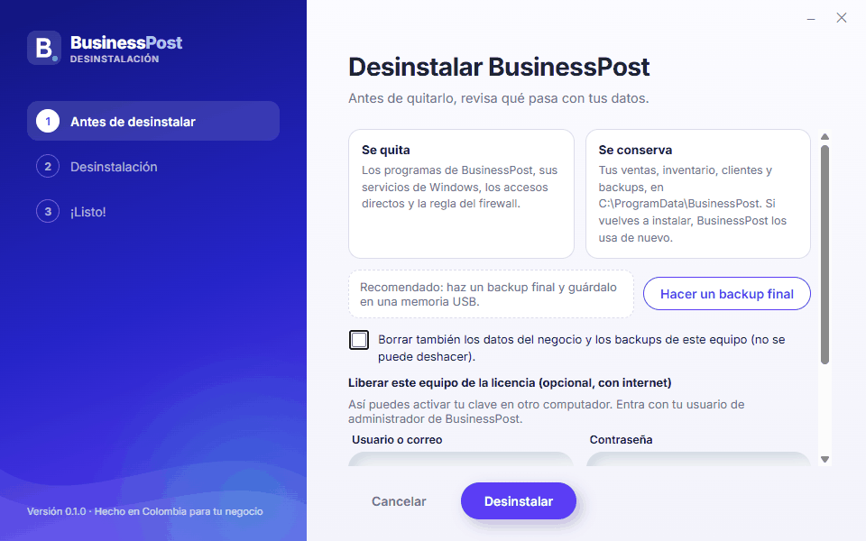

1. Lea qué **se quita** (los programas, sus servicios, los accesos directos y la regla del firewall) y qué **se conserva** (sus
   ventas, inventario, clientes y backups, en `C:\ProgramData\BusinessPost`; si vuelve a instalar, BusinessPost los usa de nuevo).
2. Recomendado: pulse **Hacer un backup final**. El backup queda en **Documentos → "BusinessPost - backup final"**; cópielo a una
   memoria USB. Para abrirlo en otro computador necesita su código de recuperación.
3. Solo si de verdad quiere borrar todo, marque **"Borrar también los datos del negocio"**: el instalador le pide confirmar dos
   veces (la segunda escribiendo **BORRAR**). No se puede deshacer.
4. Si va a usar su clave en otro computador, en **"Liberar este equipo de la licencia"** escriba su usuario y su contraseña de
   BusinessPost (necesita Internet). Si no lo hace aquí, puede liberarlo después desde el portal.
5. Opcional: cuéntenos por qué desinstala. El motivo solo se envía si marca **"Enviar el motivo a BusinessPost"** (viaja con la
   liberación del equipo).
6. Pulse **Desinstalar** y confirme.
