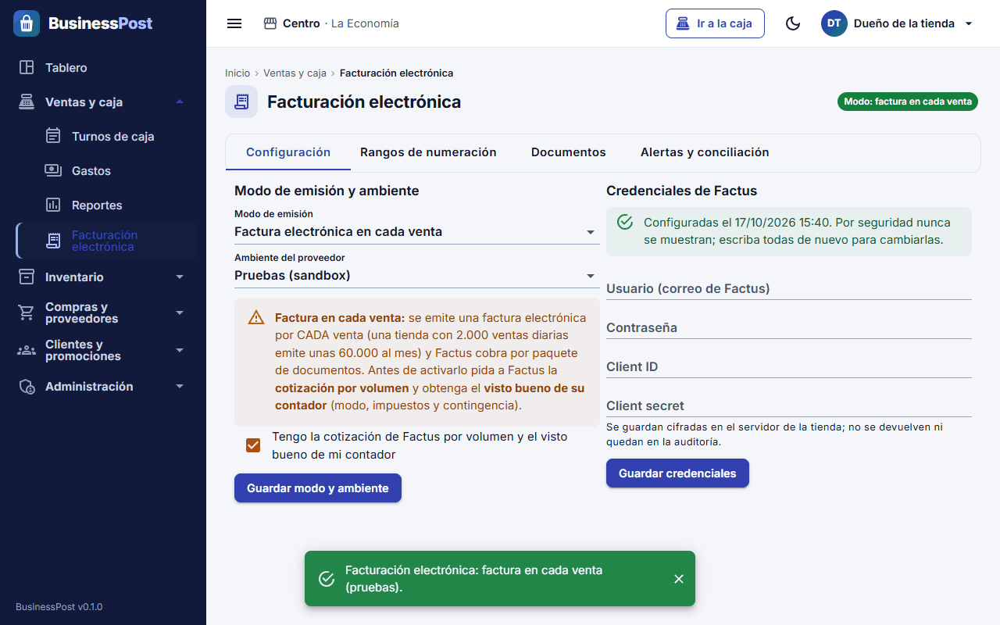
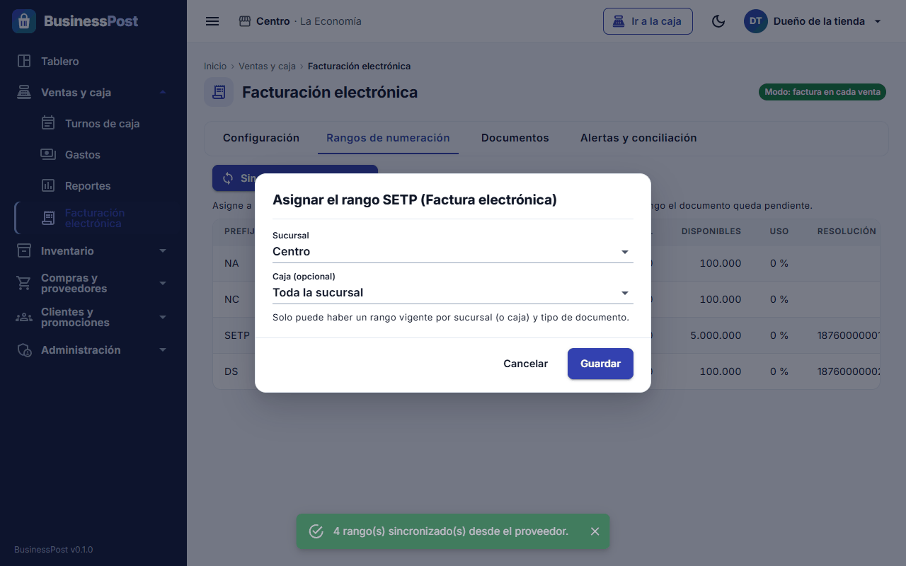
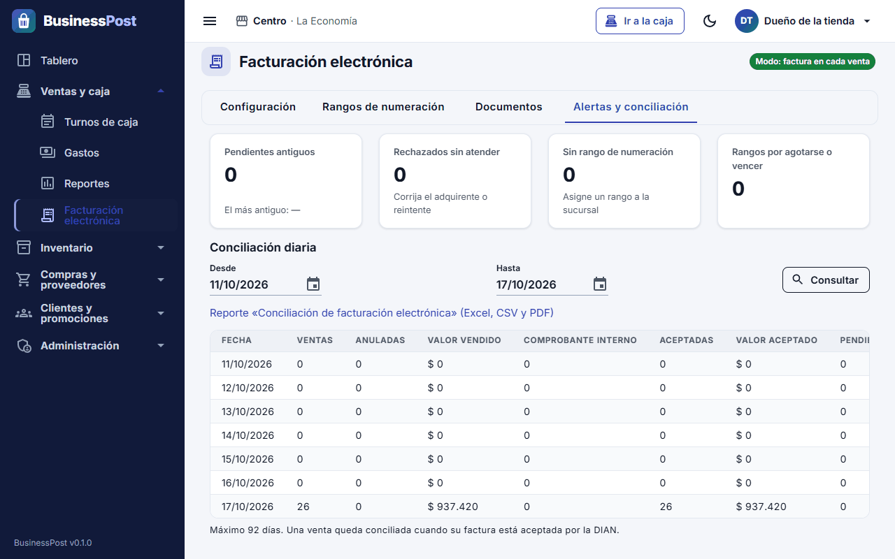
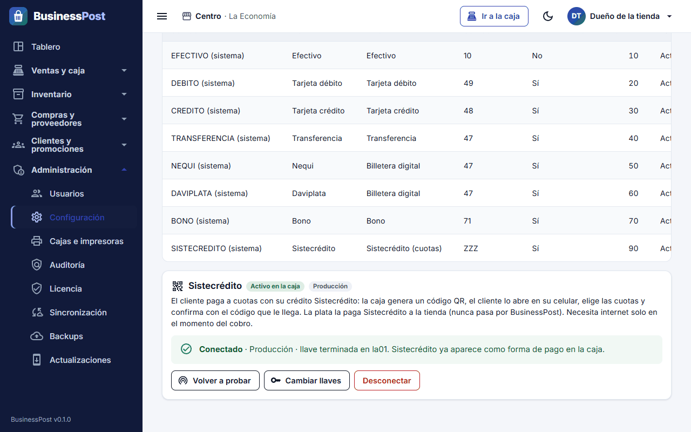
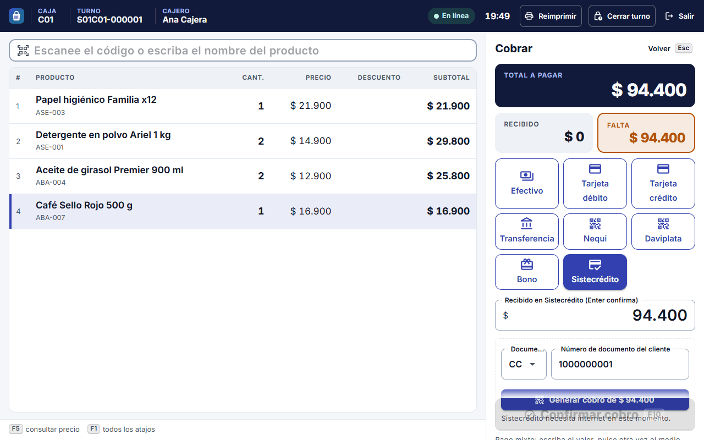
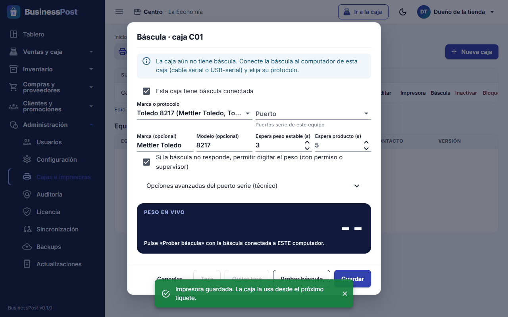
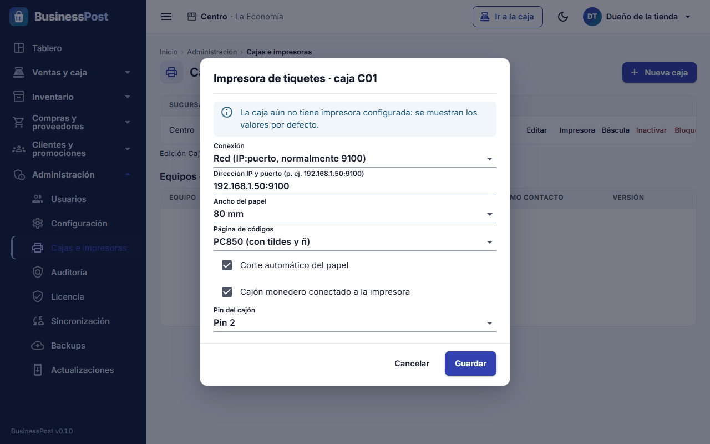
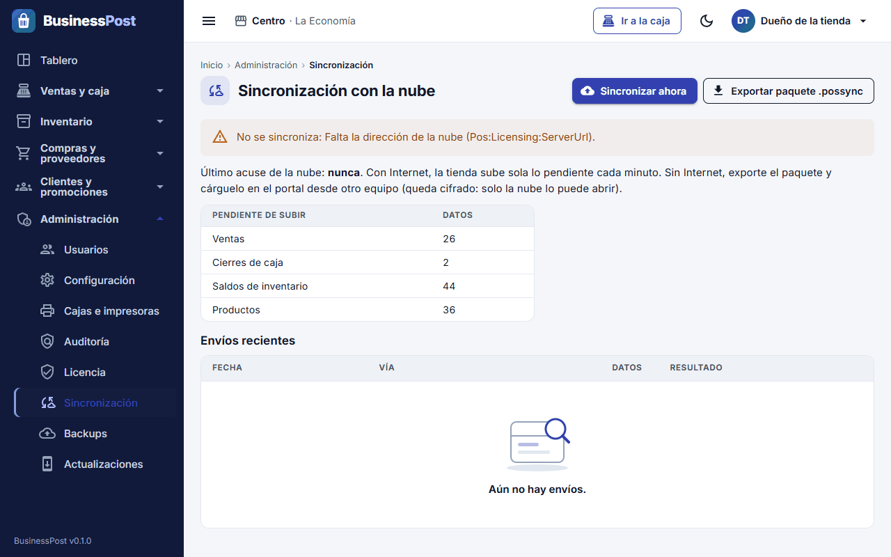
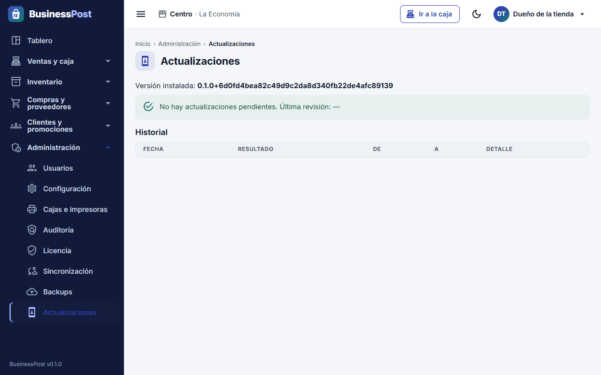

# Manual de integraciones y facturación de BusinessPost

Este manual explica cómo conectar BusinessPost con los servicios y equipos que usa su negocio: la facturación electrónica de la DIAN,
Sistecrédito, la báscula, la impresora y el cajón, la nube y el portal, el pago de la mensualidad y las actualizaciones. No necesita
conocimientos técnicos: siga los pasos en orden. Cada sección tiene tres partes: **Antes de empezar** (lo que necesita tener a mano),
**Paso a paso** y **Si algo falla**.

> Las rutas del menú se escriben así: **Grupo → Opción**. Por ejemplo, **Administración → Licencia** quiere decir: en el menú de la
> izquierda de la administración, abra el grupo *Administración* y pulse *Licencia*. Si una opción no le aparece, su usuario no tiene
> permiso para verla: entre con el usuario del dueño o del administrador.

> **Tipo de negocio y funciones del negocio.** Al instalar, usted eligió el **tipo de negocio** (supermercado, fruver, droguería…).
> Con eso BusinessPost dejó encendidas unas **funciones del negocio**, que puede revisar y cambiar en **Administración → Configuración**,
> pestaña **Funciones del negocio**. De las integraciones de este manual, solo la **báscula** depende de ellas (función **Báscula y
> PLU**, sección 3). La facturación electrónica, Sistecrédito, la impresora, la nube, el pago en línea y la licencia funcionan igual en
> cualquier tipo de negocio. Apagar una función solo la quita de los menús y formularios: **no se borra ningún dato**.

## Contenido

1. [Facturación electrónica DIAN con Factus](#1-facturación-electrónica-dian-con-factus)
2. [Cobrar con Sistecrédito](#2-cobrar-con-sistecrédito)
3. [Báscula conectada a la caja](#3-báscula-conectada-a-la-caja)
4. [Impresora de tiquetes y cajón monedero](#4-impresora-de-tiquetes-y-cajón-monedero)
5. [Sincronización con la nube y portal del cliente](#5-sincronización-con-la-nube-y-portal-del-cliente)
6. [Pago de la mensualidad en línea](#6-pago-de-la-mensualidad-en-línea)
7. [Licencia y actualizaciones](#7-licencia-y-actualizaciones)

---

## 1. Facturación electrónica DIAN con Factus

BusinessPost trae la facturación electrónica **lista pero apagada**. Mientras esté apagada, cada venta imprime un **comprobante
interno** (el tiquete dice "No es factura"). Cuando la encienda, BusinessPost envía las facturas a la DIAN por medio de **Factus**, el
proveedor tecnológico, y el tiquete pasa a decir **"Factura electrónica de venta"** con el número, el CUFE y el código QR de la DIAN.

**Comprobante interno o factura electrónica: ¿cuál es la diferencia?**

| | Comprobante interno | Factura electrónica |
|---|---|---|
| Qué es | Un recibo de la tienda, sin valor ante la DIAN | Documento válido ante la DIAN, emitido por Factus |
| Cuándo sale | Con el modo **Apagada** | Con el modo **Factura electrónica en cada venta** (o cuando el cliente la pide, ver abajo) |
| Qué dice el tiquete | "No es factura" | "Factura electrónica de venta", número, CUFE y QR |
| Necesita Internet | No | Para enviarse a la DIAN; si no hay, se envía después (contingencia) |
| Costo | Ninguno | Cada factura y cada nota crédito consume un documento de su paquete de Factus |

> Importante: Factus emite **una factura electrónica por cada venta** (a "Consumidor final" cuando el cliente no se identifica). No emite
> el "documento equivalente POS". Una tienda con 2.000 ventas al día emite unas **60.000 facturas al mes**. Antes de encender la
> facturación en cada venta, pida a Factus la **cotización por volumen** y el visto bueno de su **contador**.

### Antes de empezar

- Un contrato con **Factus** y la cotización por volumen aprobada.
- La **resolución de numeración de la DIAN** (prefijo, desde, hasta y vigencia). Factus le ayuda a habilitarse como facturador y a crear
  los rangos de factura y de nota crédito.
- Las **credenciales de Factus**: usuario (correo), contraseña, **Client ID** y **Client secret**. Las de pruebas (sandbox) y las de
  producción son distintas. Guárdelas en un lugar seguro: BusinessPost no las vuelve a mostrar.
- Los datos de cada sucursal completos en **Administración → Configuración → Sucursales y bodegas** (nombre, dirección, teléfono, correo,
  municipio). Si falta alguno, la factura sale sin los datos del establecimiento.
- Que soporte de BusinessPost haya **activado el conector de Factus** en el servidor de su tienda. Es un ajuste técnico que se hace una
  sola vez. Para saber si ya está hecho, abra **Ventas y caja → Facturación electrónica**, pestaña **Configuración**: debajo del botón
  *Guardar modo y ambiente* debe decir **"adaptador activo: FACTUS"**.
- Un usuario **dueño** o **administrador** (son los únicos que pueden cambiar la configuración de la facturación).

### Paso a paso: encender la facturación electrónica

**A. Escribir las credenciales**

1. Abra **Ventas y caja → Facturación electrónica**.
2. Entre a la pestaña **Configuración**.
3. En el cuadro **Credenciales de Factus** escriba el **Usuario (correo de Factus)**, la **Contraseña**, el **Client ID** y el
   **Client secret**. Empiece con las credenciales de **pruebas (sandbox)**.
4. Pulse **Guardar credenciales**. Debe aparecer el aviso verde "Configuradas el …". Por seguridad las credenciales nunca se vuelven a
   mostrar: para cambiarlas hay que escribir las cuatro de nuevo.

**B. Elegir el ambiente de pruebas**

5. En el cuadro **Modo de emisión y ambiente**, en **Ambiente del proveedor**, elija **Pruebas (sandbox)**.
6. Deje el **Modo de emisión** en **Apagada: comprobante interno (como hoy)** por ahora.
7. Pulse **Guardar modo y ambiente**.

**C. Traer y asignar los rangos de numeración**

8. Entre a la pestaña **Rangos de numeración**.
9. Pulse **Sincronizar desde Factus**. Aparecen los rangos de su resolución con el prefijo, desde, hasta, el número actual, la
   resolución, la vigencia, cuántos quedan disponibles y el porcentaje de uso. (BusinessPost los vuelve a sincronizar solo cada 24 horas.)
10. En cada rango que vaya a usar, pulse **Asignar**.
11. Elija la **Sucursal**. Si Factus le dio un rango por caja, elija también la **Caja (opcional)**; si no, deje **Toda la sucursal**.
12. Pulse **Guardar**. Cada sucursal necesita un rango vigente de **factura** y otro de **nota crédito**.

**D. Probar en el sandbox**

13. Vuelva a **Configuración**, elija el modo **Factura electrónica en cada venta**, marque la casilla **"Tengo la cotización de Factus
    por volumen y el visto bueno de mi contador"** y pulse **Guardar modo y ambiente**.
14. Haga ventas de prueba en una caja: una a consumidor final en efectivo, una a un cliente con NIT y correo, una con productos con
    IVA distintos, una con un producto pesado y una con dos medios de pago.
15. Revise cada una en la pestaña **Documentos**: debe estar **Aceptado**, con número fiscal y CUFE. Compare los valores con el panel
    del sandbox de Factus y anote cualquier diferencia, aunque sea de $1.
16. Muéstrele a su contador las facturas de prueba antes de pasar a producción.

**E. Pasar a producción**

17. En **Configuración**, escriba las **credenciales de producción** de Factus y pulse **Guardar credenciales**.
18. Elija el ambiente **Producción (documentos reales ante la DIAN)** y el modo **Factura electrónica en cada venta**. Pulse
    **Guardar modo y ambiente**.
19. En **Rangos de numeración**, pulse **Sincronizar desde Factus** y **asigne** los rangos de producción a cada sucursal (o caja).
20. Haga una venta real pequeña y verifique que quede **Aceptado** y que el tiquete traiga número, CUFE y QR.

Arriba a la derecha de la pantalla siempre verá en qué modo está la facturación (por ejemplo, "Modo: …"). Para volver al comprobante
interno, elija el modo **Apagada** y guarde. Los documentos ya enviados no cambian.

**Modo "Solo cuando el cliente pide factura (transición)"**

Este modo sirve solo mientras hace el cambio: las ventas normales siguen con comprobante interno y solo se factura electrónicamente a los
clientes marcados con **"Siempre pide factura"** en **Clientes y promociones → Clientes** (ficha del cliente). En la caja, al asignar
ese cliente a la venta, la factura sale sola. Si al cliente le faltan datos fiscales, la caja no deja terminar la venta y dice qué falta.
Ojo: el comprobante interno **no** cumple la obligación de facturar electrónicamente; confirme con su contador cuánto tiempo puede usarlo.

### Cómo se ve en la caja

Después de cobrar, la caja muestra el estado del documento de la última venta:

| Mensaje en la caja | Qué significa |
|---|---|
| "Factura electrónica … validada por la DIAN" | Todo bien: el tiquete trae número, CUFE y QR |
| "Factura electrónica en proceso: se envía a la DIAN en segundo plano" | Se está enviando; la venta ya quedó guardada |
| "Factura electrónica en contingencia: se enviará cuando haya conexión" | No hay Internet o Factus no responde; se envía después |
| "Factura electrónica con problema: la administración debe revisarla" | Fue rechazada o tuvo un error: vea "Si algo falla" |

Si la factura no alcanza a llegar en unos segundos, el tiquete imprime **"Factura electrónica en proceso — se enviará a su correo /
reimpresión en caja"**. Cuando ya esté aceptada, pulse **Reimprimir** en la caja para entregar el tiquete con los datos de la DIAN.

### Numeración y rangos de resolución

- La pestaña **Rangos de numeración** muestra cada rango con su estado: **Vigente**, **Por agotarse o vencer**, **No utilizable** o
  **Inactivo**.
- BusinessPost avisa cuando un rango llega al **90 % de uso** o le faltan **30 días** para vencer.
- Cuando reciba el aviso, pida a tiempo una **nueva resolución** a la DIAN (Factus le ayuda), luego pulse **Sincronizar desde Factus** y
  **asigne** el rango nuevo a la sucursal. Solo puede haber un rango vigente por sucursal (o caja) y por tipo de documento: cuando el viejo
  se agote, desasígnelo (en **Asignar**, elija **Sin asignar (desasignar)**).
- Si una sucursal se queda sin rango, **la venta no se detiene**: las facturas quedan pendientes, con alerta, hasta que asigne uno.

### Contingencia: sin Internet o con Factus caído

- **La caja sigue vendiendo.** Las facturas quedan **Pendiente** o **En contingencia** y se envían **solas y en orden** cuando vuelve la
  conexión, sin duplicarse. No tiene que hacer nada en la caja.
- El tiquete de esas ventas dice "Factura electrónica en proceso". Cuando la factura quede aceptada, puede reimprimirla.
- Si hay documentos pendientes desde hace mucho, la pestaña **Alertas y conciliación** lo muestra en **Pendientes antiguos**. Revise el
  Internet del servidor de la tienda.
- La norma exige transmitir lo antes posible: el plazo lo define su contador.

### Notas crédito

Las notas crédito **no se hacen a mano**: BusinessPost las genera solas y las envía a Factus cuando se anula una venta que ya tenía
factura o cuando se registra un cambio de mercancía o una garantía. En el tiquete aparecen como **"Nota crédito electrónica"**. Si la
venta se anula antes de que su factura salga, la factura queda **Cancelado** y no se envía.

> **Próximamente en la caja:** anular una venta ya cobrada, registrar cambios o devoluciones y registrar garantías **todavía no
> tienen pantalla en la caja**. Cuando lleguen, la nota crédito se generará sola como se explica arriba; usted no tendrá que hacer nada
> en la pantalla de facturación. Lo que sí puede hacer el cajero hoy, **antes de cobrar**, es quitar un producto de la venta con
> **Anular línea** (tecla **Supr**); eso no genera nota crédito (la venta aún no tiene factura) y queda registrado en la auditoría.

En la pestaña **Documentos** puede filtrar por **Tipo** (Factura electrónica, Nota crédito, …) y por **Origen** (Venta, Anulación,
Cambio o garantía, Compra) para revisarlas.

### Revisión diaria (conciliación)

1. Al cierre del día, abra la pestaña **Alertas y conciliación**.
2. Revise las tarjetas: **Pendientes antiguos**, **Rechazados sin atender**, **Sin rango de numeración** y **Rangos por agotarse o
   vencer**. Lo ideal es que todas estén en 0.
3. En **Conciliación diaria**, elija las fechas (máximo 92 días) y pulse **Consultar**. Compare las ventas con las facturas aceptadas.
   La columna **Sin documento** debe quedar en 0.
4. Si necesita el reporte en Excel, CSV o PDF, use el enlace **Reporte «Conciliación de facturación electrónica»** (lleva a
   **Ventas y caja → Reportes**).

### Si algo falla

| Síntoma | Qué hacer |
|---|---|
| La pestaña Configuración dice "Sin credenciales: la facturación electrónica no se puede encender" | Escriba las cuatro credenciales de Factus y pulse **Guardar credenciales** |
| Debajo de *Guardar modo y ambiente* no dice "adaptador activo: FACTUS" | El conector de Factus no está activado en el servidor. Comuníquese con soporte de BusinessPost |
| No puede pulsar **Guardar modo y ambiente** con el modo "en cada venta" | Marque la casilla de la cotización y el visto bueno del contador |
| "No hay rangos" en Rangos de numeración | Revise las credenciales y pulse **Sincronizar desde Factus**. Si sale "Última sincronización: …" en rojo, lea el mensaje y revise el Internet |
| Un documento aparece **Rechazado** | Pestaña **Documentos** → **Ver** → lea el motivo del rechazo. Si el problema son los datos del cliente (NIT, dígito de verificación, nombre, correo, municipio), pulse **Corregir comprador**, corrija y pulse **Guardar y reenviar**. Si no, corrija la causa y pulse **Reintentar envío**. La venta no cambia |
| Las facturas quedan pendientes y no salen, y Factus habla de "un documento pendiente por enviar a la DIAN" | Hay un documento rechazado que se canceló en el POS y sigue bloqueando a Factus. Entre al panel de Factus, elimine ese documento y luego pulse **Reintentar envío** (o espere el siguiente ciclo) |
| Muchos documentos **En contingencia** | Revise el Internet del servidor de la tienda. Salen solos al volver la conexión |
| Alerta "Sin rango de numeración" | Pestaña **Rangos de numeración** → **Asignar** un rango vigente a la sucursal |
| Restauró la base de datos en otro computador y Factus no responde | Las credenciales se guardan cifradas para cada equipo: escríbalas de nuevo en **Configuración** |
| El cliente no recibió la factura en su correo | Revise en **Documentos → Ver** que esté **Aceptado** y que el correo del adquirente sea correcto. También puede abrir el PDF desde el enlace **Abrir el PDF** |

---

## 2. Cobrar con Sistecrédito

Con Sistecrédito el cliente paga **a cuotas** con su crédito. La caja genera un **código QR**, el cliente lo abre en su celular, elige
las cuotas y confirma con el código que le llega. La plata la paga Sistecrédito directamente a la tienda: **nunca pasa por
BusinessPost**. Se necesita Internet **solo en el momento del cobro**; sin Internet, cobre con otro medio y siga vendiendo.

### Antes de empezar

- El **convenio de aliado** de su tienda con Sistecrédito.
- Las **tres llaves** que le envía Sistecrédito por correo: **llave de suscripción (Subscription Key)**, **ApplicationKey** y
  **ApplicationToken**. Hay unas llaves de **pruebas (Staging)** y otras de **producción**; cada ambiente tiene las suyas.
- Internet en el servidor de la tienda.
- Un usuario que pueda entrar a **Administración → Configuración** (dueño o administrador).

### Paso a paso: conectar Sistecrédito (una sola vez)

1. Abra **Administración → Configuración**.
2. Entre a la pestaña **Medios de pago** y baje hasta la tarjeta **Sistecrédito**.
3. Pegue la **Llave de suscripción (Subscription Key)**, la **ApplicationKey** y el **ApplicationToken**. Si al copiar del correo se
   arrastra la etiqueta ("Key", "ID"), no pasa nada: se guarda solo el código.
4. En **Ambiente** elija **Producción (cobros reales)** (viene así) o **Pruebas (Staging)** si va a usar las llaves de pruebas.
5. Pulse **Conectar**. BusinessPost guarda las llaves cifradas, prueba la conexión con Sistecrédito y, solo si responde bien, activa la
   forma de pago.
6. Debe aparecer **"¡Conectado! Sistecrédito ya aparece como forma de pago en la caja."** y la tarjeta queda en **Conectado**, con la
   etiqueta **Activo en la caja** y el final de la llave ("llave terminada en …").

En la tarjeta conectada tiene tres botones:

- **Volver a probar**: comprueba otra vez la conexión.
- **Cambiar llaves**: para escribir llaves nuevas (por ejemplo, al pasar de pruebas a producción). Deje vacía una llave para conservar la
  que ya está guardada.
- **Desconectar**: Sistecrédito deja de aparecer en la caja. Las llaves quedan guardadas.

**Recomendación:** haga primero una prueba con las llaves de **Pruebas (Staging)**: una venta pequeña aprobada, un rechazo y un
"Cancelar". Después cambie a **Producción** con las llaves de producción.

### Paso a paso: cobrar en la caja

1. Registre los productos y pulse **Cobrar** (**F10**).
2. Pulse el botón del medio **Sistecrédito**.
3. Escriba el valor: todo lo que falta o solo una parte (para un pago mixto).
4. Elija el tipo de **Documento** (**CC** viene por defecto; también CE, NIT, PA y TI) y escriba el **Número de documento del cliente**.
   Si la venta ya tiene un cliente asignado, el documento aparece solo.
5. Pulse **Generar cobro de $…**. Aparece un **código QR** con el mensaje "Escanee con su celular, elija las cuotas y confirme con el
   código que le llega".
6. Pídale al cliente que escanee el código con su celular, elija las cuotas y confirme. La caja se actualiza sola cada pocos segundos.
7. Cuando Sistecrédito aprueba, la caja muestra "Sistecrédito aprobó el crédito…" y agrega el pago:
   - si cubre todo, la venta se completa sola;
   - si es un pago mixto, la caja le deja listo el valor que falta para cobrarlo con otro medio.
8. Si Sistecrédito **no aprueba** o el cobro **vence**, la caja muestra el motivo. Pulse **Intentar de nuevo** o elija otro medio de pago.

Para detener la espera, pulse **Cancelar** debajo del QR. Si el cliente igual aprueba después, el sistema lo detecta solo.

**En el cierre de caja**, Sistecrédito sale como un medio aparte (no es efectivo), igual que el datáfono. Cuadre con las transacciones
aprobadas del día en el portal de Sistecrédito.

**Devoluciones:** el dinero se devuelve en el portal de Sistecrédito. Registrar la devolución o el cambio en la caja de BusinessPost
está **Próximamente en la caja**: por ahora no tiene pantalla. Si necesita dejar constancia, comuníquese con soporte de BusinessPost.

### Cobros por revisar

Si Sistecrédito aprobó un cobro pero la venta no se completó en la caja (por ejemplo, se canceló la venta o se cerró la pantalla), arriba
de la administración aparece el aviso **"1 cobro de Sistecrédito por revisar"**. La plata del cliente no se pierde. Para resolverlo:

1. Pulse el aviso (lo lleva a **Administración → Configuración**) y abra la pestaña **Medios de pago**.
2. En la tarjeta Sistecrédito, en **Cobros por revisar**, busque el cobro (fecha, transacción, cliente, valor y motivo).
3. Complete la venta en la caja o **reverse el pago en el portal de Sistecrédito**.
4. Pulse **Marcar revisado**, escriba en **¿Qué se hizo?** lo que hizo (por ejemplo, "Reversado en el portal de Sistecrédito") y pulse
   **Guardar nota**.

### Si algo falla

| Síntoma | Qué hacer |
|---|---|
| El botón **Conectar** no se deja pulsar | Falta alguna de las tres llaves. Péguelas de nuevo |
| "No se pudo conectar: …" | Lea el mensaje. Revise que copió bien las llaves y que el **Ambiente** corresponde a esas llaves. Si dice que las llaves funcionan en el otro ambiente, cambie el ambiente y pulse **Conectar** otra vez |
| "Sin conexión con el servidor de la tienda." | El navegador no llega al servidor de BusinessPost. Revise que el servidor esté encendido y en la red |
| El medio Sistecrédito no aparece en la caja | En la tarjeta Sistecrédito debe decir **Conectado** y **Activo en la caja**. Si dice **Inactivo**, conéctelo de nuevo |
| El QR no aparece ("Preparando el código QR de Sistecrédito…") | Espere unos segundos: la caja sigue consultando. Si dice "Sin conexión con Sistecrédito", revise el Internet o cobre con otro medio |
| Sistecrédito no aprobó el cobro | Es una decisión de Sistecrédito sobre el crédito del cliente. Cobre con otro medio |
| Aviso "cobro de Sistecrédito por revisar" | Siga los pasos de "Cobros por revisar" de esta sección |

---

## 3. Báscula conectada a la caja

La báscula de mostrador se conecta al computador de la caja. Cuando el cajero registra un producto marcado **"Se vende por báscula"**
(escanea o escribe el código y pulsa Enter), BusinessPost **lee el peso solo** y agrega la línea (por ejemplo, 0,700 kg × $3.000/kg =
$2.100). No hay que pulsar ningún botón para pesar. Las etiquetas impresas por una báscula etiquetadora siguen funcionando igual.

### Antes de empezar

- La función **Báscula y PLU** encendida. Viene encendida si al instalar eligió **Supermercado o minimercado** o **Fruver o
  carnicería**. Para revisarla, abra **Administración → Configuración**, pestaña **Funciones del negocio** (lo puede cambiar el dueño o
  el administrador). Con la función apagada:
  - en **Cajas e impresoras** no sale el botón **Báscula** (salvo en las cajas que ya tenían una báscula configurada);
  - en la ficha del producto no salen el **PLU de báscula**, **Se vende por báscula** ni la **Tara (g)** (salvo en los productos que ya
    los tenían);
  - la caja **no lee la báscula**, aunque esté configurada.

  Apagarla no borra la configuración: al encenderla de nuevo todo vuelve a funcionar.
- Una báscula con **salida serial RS-232** que hable el protocolo **Toledo 8217** (lo traen como opción la mayoría de Torrey, Moretti,
  CAS y Dibal) o el formato **CAS de 22 bytes**. Pregunte al vendedor por "protocolo 8217" o "salida para PC/ECR".
- El **cable de datos** de esa báscula (a veces es especial: no sirve cualquier cable serial).
- Si el computador no tiene puerto COM: un **adaptador USB a serial** (chip FTDI o Prolific) con el controlador del fabricante
  instalado. BusinessPost no instala controladores.
- En el menú técnico de la báscula:
  - **Toledo 8217:** protocolo 8217 o "ECR Toledo", 9600 baudios, 7 bits, paridad par, 1 bit de parada, envío "a pedido".
  - **CAS:** formato de 22 bytes, 9600 baudios, 8 bits, sin paridad, 1 bit de parada, envío continuo.
  - Unidad en **kilogramos**.
- Hacer la configuración **desde el computador de la caja** donde está conectada la báscula.

### Paso a paso

1. En el computador de la caja, abra el **Administrador de dispositivos** de Windows → **Puertos (COM y LPT)** y anote el número del
   puerto de la báscula (por ejemplo, COM3).
2. Abra **Administración → Cajas e impresoras**.
3. En la fila de la caja, pulse **Báscula**.
4. Marque **Esta caja tiene báscula conectada**.
5. En **Marca o protocolo** elija **Toledo 8217 (Mettler Toledo, Torrey, Moretti y compatibles)**, **CAS (formato ST/US de 22 bytes)** u
   **Otra (genérica: número y unidad)**.
6. En **Puerto** elija el puerto que anotó. Los valores del puerto serie se ponen solos según el protocolo; si su báscula usa otros,
   cámbielos en **Opciones avanzadas del puerto serie (técnico)**.
7. Si quiere que el cajero pueda escribir el peso cuando la báscula no responda, marque **Si la báscula no responde, permitir digitar el
   peso (con permiso o supervisor)**.
8. Pulse **Probar báscula** y ponga un peso conocido. En **Peso en vivo** debe verse el peso y la palabra **Estable** cuando quede quieto.
   Pruebe **Tara** con una bandeja (debe descontarla) y **Quitar tara**. Luego pulse **Detener prueba**.
9. Pulse **Guardar**.
10. Marque los productos que se pesan: abra **Inventario → Productos y precios**, entre al producto, elija como **Unidad base** una
    unidad de peso (Kilogramo, Gramo o **Libra (500 g)**) y marque **Se vende por báscula (la caja lee el peso al registrarlo)**. Si se
    empaca en bolsa o bandeja, escriba su peso en **Tara (g)**. Guarde.

**En la caja:**

- Producto en movimiento: la ventana dice **"Esperando peso estable…"**.
- Báscula vacía: dice **"Ponga el producto en la báscula"**. Si no llega peso a tiempo, no se agrega nada.
- Los tiempos de espera se cambian en la ventana **Báscula** de la caja (**Espera peso estable (s)** y **Espera producto (s)**).
- Tecla **Ins**: tara manual (una bolsa o bandeja que no está registrada en el producto). Tecla **Esc**: cancela la lectura.
- Si la báscula no responde y la caja lo permite, aparece la ventana **Digitar el peso**: escriba el peso en kilos (ej. 0,700) y pulse
  **Agregar**. Puede pedir el permiso o la autorización del supervisor; la línea queda marcada **"Peso digitado"** en la venta y en el
  tiquete, y queda registrada en la auditoría.

### Si algo falla

| Síntoma | Qué hacer |
|---|---|
| "No se pudo leer el agente de este equipo" al elegir el puerto | Está configurando desde un computador que no es el de la caja, o el agente de caja no está funcionando. Hágalo desde el computador de la caja (vea la sección 4, "Si algo falla") o escriba el puerto en **Opciones avanzadas** |
| La prueba no muestra peso | Revise que la báscula esté encendida, el cable, el número de puerto y que ningún otro programa esté usando ese puerto |
| Mensaje "respondió, pero no en el formato…" | El protocolo o la velocidad no coinciden. Compare **Velocidad**, **Bits de datos**, **Paridad** y **Bits de parada** con el menú técnico de la báscula |
| "El peso no supera la tara del producto…" | El peso en la báscula es menor o igual a la **Tara (g)** del producto. Ponga el producto o corrija la tara en la ficha del producto |
| "No llegó peso a la báscula: no se agregó nada." | Ponga el producto antes y espere a que quede quieto. Si pasa seguido, aumente **Espera producto (s)** |
| La caja no lee el peso de un producto | Verifique en la ficha del producto que la unidad base sea de peso y que esté marcado **Se vende por báscula** |
| No aparece el botón **Báscula** en Cajas e impresoras, o la casilla **Se vende por báscula** en el producto | La función **Báscula y PLU** está apagada. Enciéndala en **Administración → Configuración**, pestaña **Funciones del negocio** |
| Aviso "Esta función está apagada; los datos se conservan" en la ventana Báscula o en el producto | Igual que arriba: la configuración sigue guardada, pero la caja no lee la báscula hasta que encienda **Báscula y PLU** |

---

## 4. Impresora de tiquetes y cajón monedero

En cada caja funciona un pequeño programa de BusinessPost, el **agente de caja** (servicio de Windows *BusinessPost-TerminalAgent*). Él
es quien envía el tiquete a la impresora, abre el cajón monedero y lee la báscula. Se instala solo con BusinessPost en cada caja y solo
atiende a ese mismo computador.

El cajón se conecta a la impresora (no al computador) y **se abre solo** cuando la venta se cobra con un medio que mueve efectivo.

### Antes de empezar

- Una impresora térmica de tiquetes **ESC/POS** de 80 mm o 58 mm, conectada por red, por USB (instalada en Windows) o por puerto serie.
- Si es de red: su **dirección IP** (normalmente el puerto es 9100). Si está instalada en Windows: su **nombre** exacto, como aparece en
  *Impresoras y escáneres*. Si es serie: el **puerto** (por ejemplo, COM3).
- El cajón monedero conectado a la impresora con su cable, y saber si usa el **pin 2** o el **pin 5** (viene en el manual del cajón; casi
  siempre es el pin 2).
- La caja ya creada en **Administración → Cajas e impresoras**.

### Paso a paso

1. Abra **Administración → Cajas e impresoras**.
2. En la fila de la caja, pulse **Impresora**. Se abre la ventana **Impresora de tiquetes · caja …**.
3. En **Conexión** elija una opción:
   - **Red (IP:puerto, normalmente 9100)**: escriba la dirección, por ejemplo `192.168.1.50:9100`.
   - **Impresora instalada en Windows**: escriba el nombre de la impresora en Windows.
   - **Puerto serie o USB virtual (COMx)**: escriba el puerto, por ejemplo `COM3`.
   - **Archivo (pruebas o caja sin impresora)**: no imprime en papel; sirve para probar.
4. En **Ancho del papel** elija **80 mm** o **58 mm**.
5. En **Página de códigos** deje **PC850 (con tildes y ñ)**. Use **ASCII (sin tildes)** solo si su impresora imprime símbolos raros en
   las tildes.
6. Deje marcada **Corte automático del papel** si su impresora corta el papel.
7. Si tiene cajón, marque **Cajón monedero conectado a la impresora** y elija el **Pin del cajón** (**Pin 2** o **Pin 5**).
8. Pulse **Guardar**.
9. Pruebe: haga una venta pequeña en efectivo en esa caja. Debe imprimirse el tiquete, cortarse el papel y abrirse el cajón.

Para volver a imprimir el tiquete de la última venta, use el botón **Reimprimir** en la pantalla de la caja. Los reportes X y Z de un
turno se reimprimen desde **Ventas y caja → Turnos de caja**, en el detalle del turno, botón **Imprimir**.

### Si algo falla

| Síntoma | Qué hacer |
|---|---|
| "No se pudo hablar con el agente de impresión de esta caja (servicio BusinessPost-TerminalAgent). La venta quedó registrada: reimprima cuando vuelva." | Reinicie el computador de la caja. Si sigue igual, en Windows abra **Servicios**, busque *BusinessPost-TerminalAgent* y verifique que esté **En ejecución**; si no, comuníquese con soporte. La venta no se pierde: pulse **Reimprimir** cuando funcione |
| "La impresora no respondió a tiempo. La venta quedó registrada…" | Revise que la impresora esté encendida, con papel y con la tapa cerrada; revise el cable o la red. Luego pulse **Reimprimir** |
| "La impresora no respondió bien (…)" | Revise la **Conexión** y la dirección en la ventana **Impresora**: IP y puerto, nombre exacto en Windows o puerto COM |
| Las tildes y la ñ salen como símbolos raros | Cambie la **Página de códigos** a **PC850 (con tildes y ñ)**; si su impresora no la soporta, use **ASCII (sin tildes)** |
| El texto sale cortado o muy angosto | Revise el **Ancho del papel** (80 mm o 58 mm) |
| El cajón no abre | Verifique que esté marcado **Cajón monedero conectado a la impresora**, pruebe con el otro **Pin del cajón** y revise el cable entre el cajón y la impresora. El cajón solo abre al cobrar con un medio de efectivo |
| No imprime nada pero tampoco da error | La conexión puede estar en **Archivo (pruebas o caja sin impresora)**. Cámbiela por la conexión real |

---

## 5. Sincronización con la nube y portal del cliente

BusinessPost guarda todo en el servidor de su tienda y **sube una copia a la nube** para que usted consulte sus ventas desde cualquier
lugar en el **portal de BusinessPost**. Con Internet, la tienda sube sola lo pendiente **cada minuto**: ventas (también las anuladas),
cierres de caja, saldos de inventario y productos con su precio. Sin Internet la tienda sigue vendiendo normalmente y sube todo cuando
vuelve la conexión.

### Antes de empezar

- La **licencia activada** (la tienda se identifica ante la nube con su licencia; vea la sección 7).
- Internet en el servidor de la tienda.
- Un **usuario del portal** con el rol **Cliente** (se lo crea BusinessPost) y una aplicación autenticadora en su celular (Google
  Authenticator, Microsoft Authenticator o Aegis): en el portal el doble factor es obligatorio.

### Paso a paso: revisar la sincronización en la tienda

1. Abra **Administración → Sincronización**. La pantalla se llama **Sincronización con la nube**.
2. Revise **Último acuse de la nube**: es la última vez que la nube confirmó que recibió los datos.
3. Revise la tabla **Pendiente de subir** (Ventas, Cierres de caja, Saldos de inventario, Productos). Con Internet, debe bajar a 0 en un
   par de minutos.
4. Si quiere subir ya, pulse **Sincronizar ahora**.
5. En **Envíos recientes** verá cada envío con su fecha, la vía (**En línea** o **Paquete**), la cantidad de datos y el resultado.

### Paso a paso: sincronizar sin Internet (paquete .possync)

Si la tienda pasa muchos días sin Internet, puede llevar los datos a la nube en una memoria USB:

1. En la tienda, abra **Administración → Sincronización** y pulse **Exportar paquete .possync**. Se descarga un archivo con un nombre
   como `tienda-20261017-1830.possync`. Va **cifrado**: solo la nube lo puede abrir.
2. Copie el archivo en una memoria USB y llévelo a un computador con Internet.
3. Entre al portal, abra **Datos de las tiendas** y pulse **Cargar paquete .possync**. Elija el archivo.
4. Las ventas aparecen en el portal con la vía **Paquete**. Lo que ya subió en línea no se repite.

### Paso a paso: consultar sus tiendas en el portal

1. Entre al portal de BusinessPost con su **Correo electrónico** y su **Contraseña** y pulse **Iniciar sesión**.
2. La primera vez, el portal le pide **activar el doble factor**: escanee el código con su aplicación autenticadora, escriba el
   **Primer código** y pulse **Activar y entrar**. Las siguientes veces escriba el **Código de 6 dígitos** y pulse
   **Verificar e ingresar**.
3. En el menú, en **Operación**, abra **Datos de las tiendas**.
4. Elija la **Empresa** y las fechas **Desde** y **Hasta**, y pulse **Actualizar**.
5. Verá las tarjetas **Ventas del periodo**, **Tiquetes**, **Anuladas** y **Sucursales**, el cuadro **Sincronización por sucursal** y
   las pestañas **Ventas por día**, **Ventas recientes**, **Cierres de caja** y **Existencias**.

En el menú **Personal** del portal también tiene **Mi suscripción** (vigencia y pagos, sección 6), **Descargas** (instalador y manual)
y **Mi cuenta**. Por ahora el portal es **solo de consulta**: los productos y precios se cambian en la administración de la tienda.

### Si algo falla

| Síntoma | Qué hacer |
|---|---|
| "No se sincroniza: La licencia no está activada…" | Active la licencia en **Administración → Licencia** (sección 7) |
| "No se sincroniza: Falta la dirección de la nube…" | Es un ajuste de la instalación. Comuníquese con soporte de BusinessPost |
| "El último envío falló: …" | Revise el Internet del servidor de la tienda y pulse **Sincronizar ahora**. Si no hay Internet por varios días, use el paquete .possync |
| Los pendientes no bajan | Revise el Internet y pulse **Sincronizar ahora**. Si sigue igual, exporte el paquete y cárguelo en el portal |
| En el portal dice "Esta empresa aún no ha sincronizado datos." | La tienda todavía no ha subido nada: revise la pantalla **Sincronización** de la tienda |
| En el portal no aparece **Datos de las tiendas** o su empresa | Su usuario del portal no está asociado a su cuenta. Comuníquese con BusinessPost |
| No le llega o no le sirve el código de 6 dígitos | Revise que la hora de su celular esté en automático. Si cambió de celular, pida a BusinessPost que restablezca su doble factor |

---

## 6. Pago de la mensualidad en línea

Puede pagar su suscripción en línea con **Nequi, PSE, tarjeta o Bancolombia**, por medio de la pasarela **Wompi**. BusinessPost nunca ve
ni guarda los datos de su tarjeta o cuenta. Al aprobarse el pago, **la licencia se renueva sola**.

### Antes de empezar

- Que BusinessPost tenga habilitado el pago en línea para su plan. Si no lo está, en el portal verá "Pago en línea no configurado" y
  debe pagar como siempre.
- Para pagar desde la tienda: un usuario que pueda ver **Administración → Licencia** (normalmente el dueño). La pantalla de la caja no
  muestra pagos.
- Internet en el equipo desde el que paga.

### Paso a paso: pagar desde la administración de la tienda

La tarjeta de pago aparece cuando faltan **15 días o menos** para el vencimiento, o cuando la licencia está **en gracia** o
**restringida**.

1. Arriba de la administración aparece el aviso de la licencia con el enlace **Pagar** (se abre en otra pestaña). También puede abrir
   **Administración → Licencia** y buscar la tarjeta **Pagar mensualidad**.
2. Pulse **Pagar mensualidad**. Si prefiere pagar con el celular, escanee el **código QR** de la tarjeta con la cámara del teléfono.
3. En la página **Pagar la suscripción** revise la empresa, la edición y la fecha **Vigente hasta**.
4. En **¿Cuánto quiere pagar? (valores con IVA incluido)** elija el periodo: **1 mes**, **3 meses** o **6 meses** si su plan es mensual,
   o **1 año** si es anual.
5. Pulse **Pagar**. Lo lleva a la página segura de Wompi: elija Nequi, PSE, tarjeta o Bancolombia y termine el pago.
6. Al volver, la página le muestra el resultado (por ejemplo, "Pago aprobado: su suscripción ya quedó renovada…").
7. En la tienda, abra **Administración → Licencia** y pulse **Ya pagué, verificar**. Si el pago ya se aplicó, aparece "Pago recibido: la
   licencia está al día.", cambia la fecha **Vigente hasta** y la tarjeta desaparece. (Si no lo hace, la tienda lo verifica sola una vez
   al día.)

### Paso a paso: pagar desde el portal

1. Entre al portal de BusinessPost.
2. En **Personal**, abra **Mi suscripción**. Verá la **Edición**, la fecha **Vigente hasta**, la fecha **Gracia hasta** y la lista de
   **Pagos en línea**.
3. Pulse **Pagar** y siga los pasos 3 a 7 de arriba.

### Si algo falla

| Síntoma | Qué hacer |
|---|---|
| "Todavía no se ve el pago. Con PSE o Bancolombia puede tardar unos minutos…" | Espere unos minutos y vuelva a pulsar **Ya pagué, verificar**. **No pague dos veces** el mismo mes sin preguntar antes a soporte |
| "Pago en proceso: la pasarela aún no lo confirma…" | Puede cerrar la página. Cuando Wompi confirme, la suscripción se renueva sola |
| "El pago fue rechazado…" o "La pasarela reportó un error…" | Intente de nuevo desde el enlace de pago, con otro medio si es necesario |
| "No se pudo verificar con el servidor de licencias. Revise la conexión a Internet…" | Revise el Internet del servidor de la tienda e intente de nuevo |
| No aparece la tarjeta **Pagar mensualidad** | Su licencia está al día (faltan más de 15 días) o el pago en línea no está habilitado. Si necesita pagar, use **Mi suscripción** en el portal o comuníquese con BusinessPost |
| "Para renovar esta suscripción, comuníquese con BusinessPost." | Su plan no se puede pagar en línea. Comuníquese con BusinessPost |
| Pagó, pero la licencia no se renovó después de un día | Comuníquese con BusinessPost e indique la **referencia** que le mostró Wompi |

---

## 7. Licencia y actualizaciones

### Licencia

La licencia es lo que habilita BusinessPost en su tienda. Se activa con una **clave** que empieza por `POS-`. Sin clave, BusinessPost
funciona completo durante **30 días de demostración**, pero los tiquetes dicen **"DEMOSTRACIÓN"**. BusinessPost verifica la licencia por
Internet **una vez al día**; si no hay Internet, sigue funcionando con normalidad.

**Estados de la licencia** (se ven en **Administración → Licencia**):

| Estado | Qué significa |
|---|---|
| **Demostración** | Sin clave. Funciona completo por 30 días; los documentos impresos dicen "DEMOSTRACIÓN" |
| **Vigente** | Todo al día |
| **Vigente (sin conexión reciente)** | Está al día, pero no se ha podido verificar por falta de Internet. Todo funciona normal |
| **En gracia** | Venció el periodo pagado. Quedan unos días para renovar sin restricciones |
| **Restringida** | Terminó la demostración o la gracia, o hay otro problema (lea el motivo). Se puede seguir vendiendo y cerrar los turnos que ya estaban abiertos, y consultar reportes y hacer backups, pero no abrir turnos nuevos ni administrar |
| **Requiere reactivación** | La base de datos se pasó a otro computador. Hay que activar de nuevo con la clave |

#### Antes de empezar

- Su **clave de licencia** (`POS-XXXXX-XXXXX-XXXXX-XXXXX`). Se la entrega BusinessPost.
- Internet en el servidor de la tienda.
- Entrar con el usuario **dueño** (es el único que puede activar o liberar la licencia).

#### Paso a paso: activar la licencia

1. Abra **Administración → Licencia**.
2. Escriba la clave en **Clave de licencia (POS-XXXXX-XXXXX-XXXXX-XXXXX)**.
3. Pulse **Activar**. Debe aparecer "Licencia activada." y el estado **Vigente**, con la empresa, la **Edición** (Caja Única o
   Multicaja) y la fecha **Vigente hasta**.
4. Para verificarla en cualquier momento (por ejemplo, después de renovar), pulse **Verificar ahora**.

#### Paso a paso: pasar la licencia a otro computador

1. En el computador viejo, abra **Administración → Licencia** y pulse **Liberar este equipo**.
2. Confirme con **Liberar**.
3. En el computador nuevo, active la licencia con la misma clave (pasos de arriba).

Si el computador viejo se dañó o se lo robaron y no pudo liberarlo, comuníquese con soporte de BusinessPost: ellos liberan la licencia
desde el portal.

#### Si algo falla

| Síntoma | Qué hacer |
|---|---|
| Aviso "Modo demostración: quedan … días" | Active la licencia con su clave antes de que terminen los 30 días |
| "El reloj del equipo está atrasado…" | Corrija la fecha y la hora de Windows (pónganlas en automático) y pulse **Verificar ahora** |
| "La suscripción venció y terminaron los días de gracia…" | Pague la mensualidad (sección 6) y pulse **Verificar ahora** |
| "La suscripción está suspendida" o "fue cancelada" o "La licencia fue revocada" | Comuníquese con BusinessPost |
| Estado **Requiere reactivación** | Escriba de nuevo la clave y pulse **Activar** |
| "La licencia fue activada para otro tipo de instalación (Caja Única o Multicaja)…" | Actívela de nuevo con la clave. Si no funciona, comuníquese con BusinessPost para revisar su plan |
| "Este equipo fue liberado de la licencia…" | Active la licencia con la clave en este equipo |
| La última verificación muestra un error | Revise el Internet del servidor de la tienda y pulse **Verificar ahora** |

### Actualizaciones

BusinessPost se **actualiza solo**. Cuando hay una versión nueva, el servidor la descarga y verifica que sea original. Luego la instala
**a las 02:00**, cuando no hay turnos de caja abiertos. Antes de instalar hace un **backup**, y si la versión nueva no arranca bien,
**vuelve sola a la versión anterior**. Las cajas se actualizan solas desde el servidor de la tienda.

#### Antes de empezar

- Internet en el servidor de la tienda.
- Para instalar una versión antes de las 02:00: un usuario con permiso para administrar las actualizaciones (dueño o administrador) y
  **todas las cajas cerradas** (sin turnos abiertos).

#### Paso a paso: revisar e instalar una actualización

1. Cuando hay una versión lista, arriba de la administración aparece **"Nueva versión … disponible. Se instala sola a las 02:00, cuando
   no hay turnos de caja abiertos."** No tiene que hacer nada más: se instala sola.
2. Para ver qué trae, pulse **Ver novedades** (o abra **Administración → Actualizaciones**). Ahí verá la **Versión instalada**, la
   versión nueva con sus novedades y el **Historial** de actualizaciones.
3. Si quiere instalarla ya: cierre todos los turnos de caja y verifique que nadie esté vendiendo.
4. Pulse **Actualizar** en el aviso (o **Instalar ahora (reinicia el servidor)** en la pantalla Actualizaciones).
5. En la ventana de confirmación, pulse **Actualizar y reiniciar**. El servidor se reinicia en el próximo minuto: durante uno o dos
   minutos nadie podrá vender ni consultar.
6. Al volver, abra **Administración → Actualizaciones** y verifique la **Versión instalada**.

#### Si algo falla

| Síntoma | Qué hacer |
|---|---|
| La versión nueva no se instaló a las 02:00 | Probablemente había un turno de caja abierto. Cierre los turnos al final del día; se instalará la siguiente noche, o instálela con **Instalar ahora** |
| "No hay actualizaciones pendientes" y la **Última revisión** muestra un error | Revise el Internet del servidor de la tienda |
| En el **Historial** aparece una actualización fallida o una vuelta atrás | BusinessPost volvió solo a la versión anterior y su información está a salvo. Comuníquese con soporte y envíe el **Paquete de soporte** (en el servidor de la tienda: menú Inicio de Windows → **BusinessPost** → **Paquete de soporte**) |
| Después de actualizar, una caja no abre | Espere unos minutos (la caja se actualiza desde el servidor) y reinicie ese computador. Si sigue igual, comuníquese con soporte |
