# Puesta en marcha de BusinessPost

Esta guía lo acompaña desde que BusinessPost queda instalado hasta que su negocio vende con tranquilidad: qué configurar, en qué
orden y qué revisar los primeros días. Sirve para cualquier comercio: supermercado, fruver o carnicería, droguería, ropa y calzado,
ferretería o papelería, y cualquier otro tipo de tienda.

No necesita conocimientos técnicos. Siga los pasos en orden y marque cada uno en la lista de verificación del final. Las imágenes
muestran las pantallas reales con datos de ejemplo de una tienda ficticia (Supermercado La Economía SAS, sucursal Centro, caja C01).

> Si todavía no ha instalado el programa, empiece por el **Manual de instalación**. Para el trabajo diario después de abrir, use el
> **Manual de administración**; para conectar la báscula, la impresora, la facturación electrónica o Sistecrédito, el **Manual de
> integraciones y facturación**.

## Contenido

1. Cronograma sugerido
2. Antes de abrir: reúna la información
3. La instalación deja la tienda creada
4. Datos de la empresa
5. Sucursales y bodegas
6. Medios de pago
7. Tipo de negocio y funciones del negocio
8. Parámetros
9. Cargar los productos desde Excel o CSV
10. Cargar el inventario inicial
11. Usuarios y roles
12. Cajas, impresora y báscula
13. Facturación electrónica
14. Primera venta de prueba
15. Primer cierre de caja
16. Día 1, semana 1 y mes 1
17. Lista de verificación final

---

## 1. Cronograma sugerido

Este es el orden que mejor funciona en la mayoría de los negocios. Si su tienda es pequeña, puede hacer en un solo día lo que aquí
aparece en dos; si es grande, dese más tiempo para cargar productos y capacitar al personal.

| Momento | Qué hacer | Responsable | Tiempo aproximado |
|---|---|---|---|
| **1 a 2 semanas antes de abrir** | Tener la cuenta del portal de BusinessPost (correo, contraseña y, si lo activó, el código de verificación de doble factor) y la clave de licencia. Reunir la información: datos de la empresa, lista de productos con precios, inventario con costos, proveedores, personal y equipos (sección 2) | Dueño | 2 a 5 días, a ratos |
| **2 a 3 días antes** | Instalar BusinessPost: la instalación deja la tienda creada (sección 3). En Multicaja, instalar y emparejar cada caja adicional. Revisar empresa, sucursales, bodegas, medios de pago, tipo de negocio y parámetros (secciones 4 a 8) | Dueño o administrador | 2 a 3 horas |
| **2 a 3 días antes** | Cargar productos y precios desde Excel, y revisarlos (sección 9) | Administrador o bodega | 1 a 4 horas según el catálogo |
| **1 día antes** | Contar la mercancía y cargar el inventario inicial (sección 10). Imprimir las etiquetas de góndola (sección 9). Crear usuarios (sección 11). Configurar cajas, impresora y báscula (sección 12) | Administrador y bodega | Medio día a un día |
| **1 día antes** | Venta de prueba, cierre de prueba y capacitación de cajeros y supervisores (secciones 14 y 15). Si factura electrónicamente: pasar Factus de pruebas a **producción** (sección 13) | Dueño y cajeros | 1 a 2 horas |
| **Día 1** | Abrir con acompañamiento, corregir productos y precios sobre la marcha, cerrar cada caja y revisar (sección 16) | Todos | Todo el día |
| **Semana 1** | Revisión diaria de cierres, un conteo parcial, la primera compra real y su pago (sección 16) | Administrador | 20 a 30 minutos al día |
| **Mes 1** | Mínimos y máximos, promociones, reportes del mes para el contador, revisión de usuarios y permisos (sección 16). Si instaló en demostración, activar la licencia antes del día 30 | Dueño y administrador | 2 a 3 horas en el mes |

> **Consejo:** no arranque un viernes, un fin de semana ni en quincena. Un martes o un miércoles le dan días tranquilos para
> aprender y corregir antes de los días de más ventas.

## 2. Antes de abrir: reúna la información

Tener todo esto a la mano le ahorra muchas horas frente al computador:

| Qué | Para qué | Dónde se usa |
|---|---|---|
| Razón social, NIT, régimen, municipio, dirección, teléfono y correo | Datos que salen en el tiquete y en la factura electrónica | Instalador (Tu negocio) y Configuración → Empresa |
| Nombre de cada sede (si tiene más de una) y de sus bodegas | Separar inventario y ventas por sede y por bodega | Configuración → Sucursales y bodegas |
| Formas de pago que acepta (efectivo, datáfono, transferencia, Nequi, Daviplata, bonos, Sistecrédito) | Que la caja cuadre por cada medio | Configuración → Medios de pago |
| Lista de productos: código de barras, nombre, categoría, marca, unidad, IVA y precio de venta | Cargar el catálogo de una vez | Inventario → Importar desde Excel |
| Cantidad de cada producto y su costo unitario | Arrancar con las existencias reales y la utilidad bien calculada | Inventario → Importar desde Excel (saldo inicial) |
| Proveedores: NIT, contacto, plazo de pago | Compras y cuentas por pagar | Compras y proveedores → Proveedores |
| Personal: nombre de cada persona y qué hace (cajero, supervisor, bodega, administrador, contador) | Un usuario por persona, con el rol correcto | Administración → Usuarios |
| Equipos: computador de cada caja, impresora de tiquetes, cajón monedero, lector de código de barras y báscula | Dejar cada caja lista para vender | Administración → Cajas e impresoras |
| Su cuenta del portal (correo, contraseña y, si lo usa, el código de doble factor) y su clave de licencia (empieza por `POS-`) | Instalar, activar la licencia y entrar como propietario | Instalador y Administración → Licencia |

> **Importante:** cuente la mercancía lo más cerca posible del día de apertura. Si cuenta con mucha anticipación, lo que venda en
> el sistema anterior mientras tanto hará que las existencias no cuadren.

## 3. La instalación deja la tienda creada

Con el instalador de BusinessPost (el que se descarga del portal), **la tienda queda creada durante la instalación**: el instalador
crea la empresa con los datos de **Tu negocio**, activa la licencia con su clave, crea la sucursal **"Principal"** y la **"Caja 1"**, y
muestra el **código de recuperación** de los backups. El paso a paso está en el **Manual de instalación** (secciones 3 y 4). Lo que
debe tener presente:

- **Su usuario de propietario es la cuenta del portal:** entra a la administración con el **correo y la contraseña de su portal**.
  Si instaló en prueba de 30 días, con el correo y la contraseña que escribió en el instalador.
- **El código de recuperación** se muestra una sola vez al final de la instalación. Imprímalo o anótelo y marque la casilla que
  confirma que lo guardó. No hay que volver a escribirlo.
- **El tipo de negocio** se eligió en la instalación (paso **Tu negocio**). Se puede cambiar después (sección 7).
- Los nombres "Principal" y "Caja 1" se pueden cambiar en **Configuración → Sucursales y bodegas** y en **Cajas e impresoras**.

> **Importante:** guarde el código de recuperación **fuera del local** (por ejemplo, en su casa). Si hay un robo, un incendio o se
> daña el disco, sin ese código las copias de seguridad no se pueden abrir en otro equipo.

> **Importante:** si instaló en **demostración**, active la licencia **antes de que se cumplan 30 días** desde la instalación, en
> **Administración → Licencia** (solo el usuario Propietario puede activarla). Si se vencen, la licencia queda **Restringida** y
> las cajas **no pueden abrir turnos**: puede consultar y exportar su información, pero no vender.

### Multicaja: instale y empareje cada caja adicional

Si su plan es Multicaja, después del equipo principal instale BusinessPost en cada caja con la opción **Es una caja adicional** y
emparéjela desde **Administración → Cajas e impresoras** del equipo principal, con el botón **Emparejar equipo** de la caja (sección 12
y Manual de instalación, "Agregar cajas").

### Camino alterno: el asistente de configuración inicial

Solo si se instaló con el **instalador clásico** (equipos sin el componente WebView2) o si el instalador no pudo terminar de configurar
el servidor, al abrir BusinessPost aparece en el navegador el **asistente de configuración inicial**. Tiene cuatro pasos: Empresa,
Licencia, Código de recuperación y Listo.

1. **Empresa:** elija el **tipo de negocio**, escriba los datos de la empresa (razón social, NIT, régimen, municipio, dirección,
   teléfono y correo), el nombre de la primera sucursal y cree al **propietario** (usuario, nombre y contraseña: el sistema exige al
   menos 8 caracteres y el asistente pide 10). Si el dueño también va a vender, aquí puede ponerle un código de caja y un PIN
   (opcional). Pulse **Guardar y continuar**.

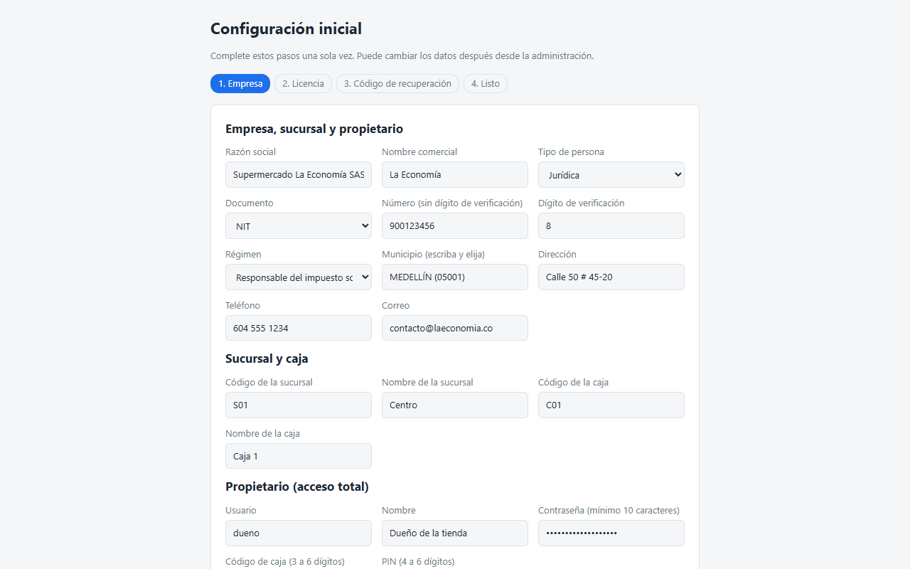

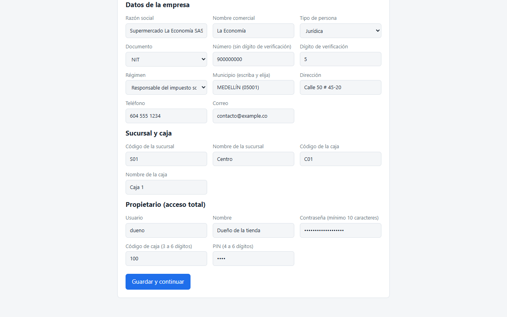

2. **Licencia:** escriba la clave y pulse **Activar**, o pulse **Seguir en demostración** (30 días).

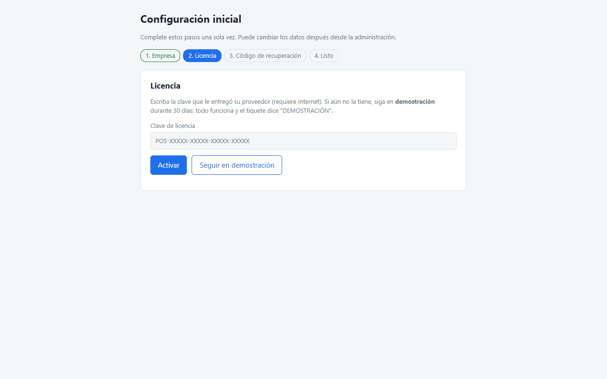

3. **Código de recuperación:** pulse **Generar el código**, anótelo o imprímalo (se muestra una sola vez) y escríbalo de nuevo para
   confirmar que lo guardó.

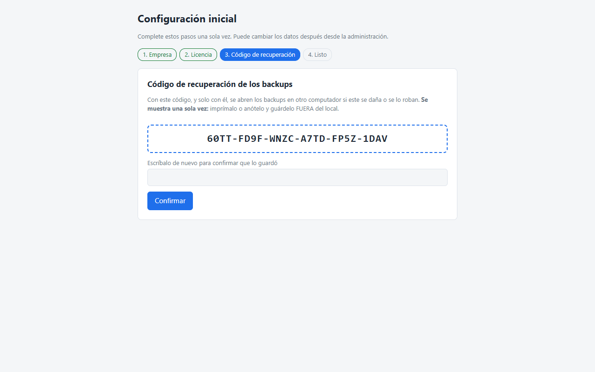

4. **Listo:** pulse **Abrir BusinessPost** y entre a la pestaña **Administración** con el usuario propietario.

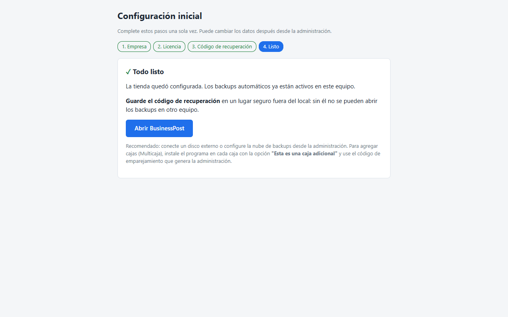

> **Importante:** el usuario propietario puede hacer todo, incluso activar la licencia. Guarde su contraseña en un lugar seguro y no
> la use para el trabajo de todos los días: cree usuarios para cada persona (sección 11).

## 4. Datos de la empresa

En **Administración → Configuración → Empresa** revise que todo esté bien escrito: estos datos salen en los tiquetes y en las
facturas electrónicas. Puede corregir la razón social, el nombre comercial, el régimen, el municipio, la dirección, el teléfono y el
correo. La **identificación (NIT)** no se puede cambiar después de la instalación.

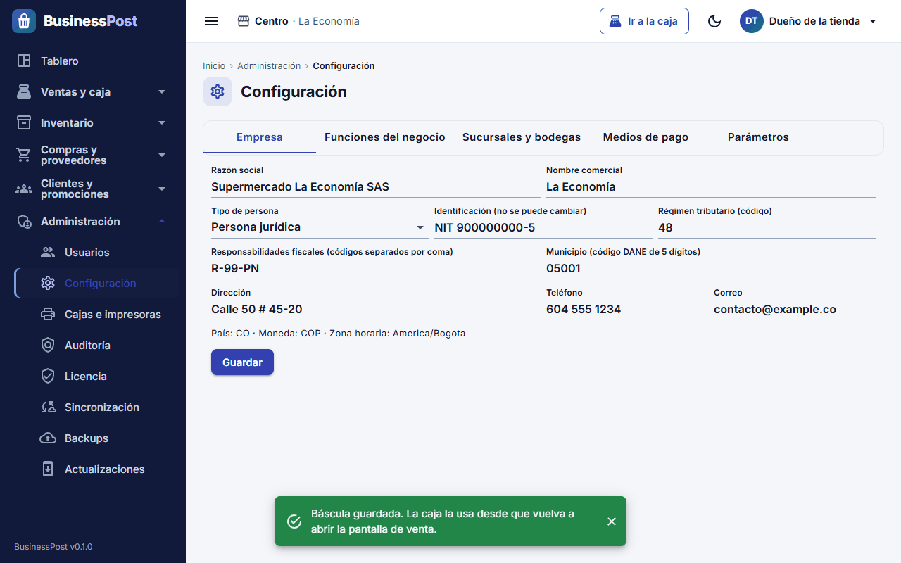

> **Consejo:** pídale a su contador el **régimen** y las **responsabilidades fiscales** exactas antes de encender la facturación
> electrónica. Si quedan mal, la DIAN puede rechazar las facturas.

## 5. Sucursales y bodegas

### Sucursales

En **Configuración → Sucursales y bodegas** está la sucursal que creó la instalación ("Principal"; en las imágenes, la sucursal de ejemplo "Centro"). Puede cambiarle el nombre con **Editar**. Si tiene otra sede, pulse **Nueva sucursal** y
escriba el código (por ejemplo, S02), el nombre, el municipio y la dirección.

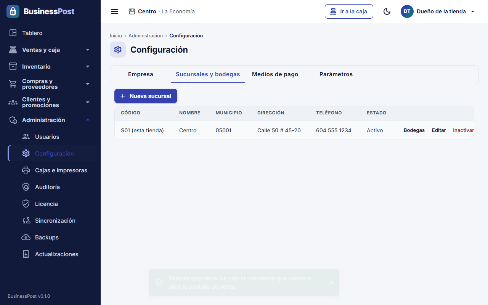

### Bodegas

Cada sucursal tiene sus **bodegas**: lugares donde se guarda la mercancía. Pulse **Bodegas** en la fila de la sucursal para verlas.
Al crear una sucursal, BusinessPost crea tres bodegas:

| Bodega | Para qué sirve |
|---|---|
| **PISO** (Piso de venta) | Lo que está en las góndolas. Es la bodega principal de la sucursal y desde la que **vende** la caja. |
| **AVERIAS** (Averías) | Productos dañados o vencidos, separados para no venderlos. |
| **TRANSITO** (En tránsito) | Mercancía que va de una bodega a otra (la usan los traslados). |

Si tiene un depósito aparte, créelo usted, como la **BOD** (Bodega trasera) de la tienda de ejemplo: lo que llega del proveedor y
todavía no sale a la venta.

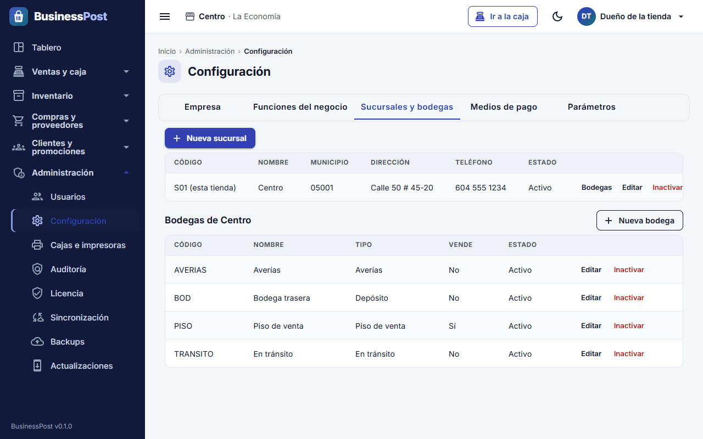

Para crear otra, pulse **Nueva bodega**, escriba el código y el nombre, elija el tipo y marque **Se vende desde esta bodega** solo si
la caja debe descontar de ahí.

> **Consejo:** si su local es pequeño y no separa la bodega del piso de venta, trabaje con una sola bodega de venta. Menos bodegas
> significan menos traslados y menos errores.

## 6. Medios de pago

En **Configuración → Medios de pago** están los medios que verá el cajero al cobrar: Efectivo, Débito, Crédito, Transferencia, Nequi,
Daviplata, Bono y Sistecrédito. Para cada uno se ve el código DIAN, si pide referencia y el orden en que aparece en la caja.

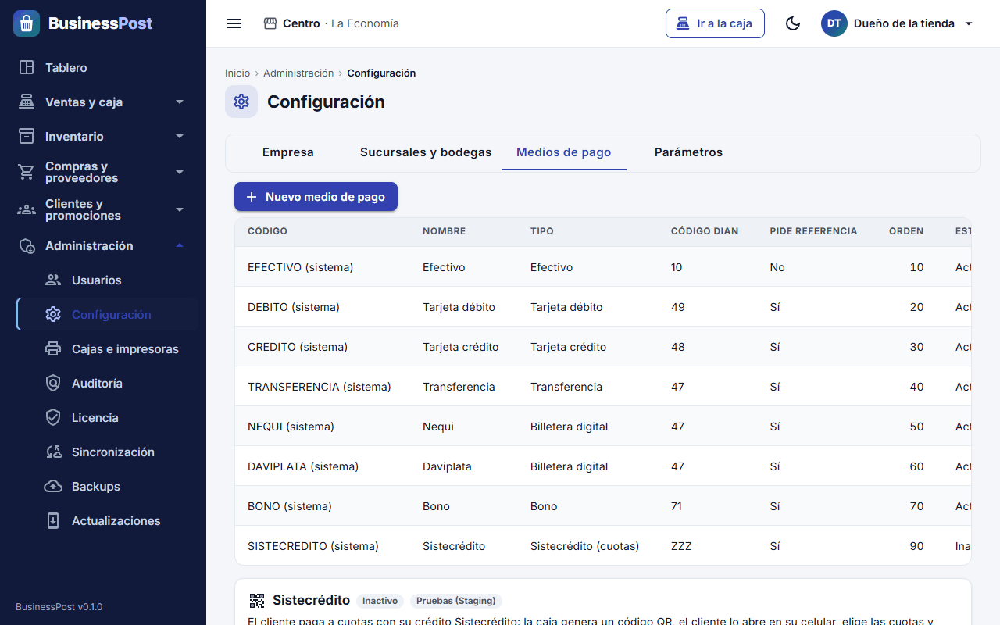

Para agregar uno (por ejemplo, el QR de su banco):

1. Pulse **Nuevo medio de pago**.
2. Escriba un **código** corto (por ejemplo, QR_BANCO), elija el **tipo** y escriba el **nombre** que verá el cajero.
3. Si su contador se lo indica, escriba el **código DIAN** del medio de pago.
4. Elija el **orden en la caja** (los más usados, primero).
5. Marque **Pide referencia** si el cajero debe anotar el número de aprobación del datáfono o de la transferencia.
6. Pulse **Guardar**.

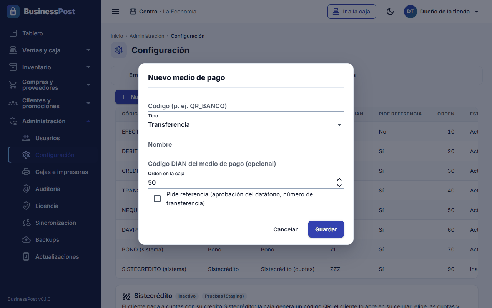

> **Consejo:** marque **Pide referencia** en datáfono y transferencias. Así, al cuadrar con el banco, cada pago tiene su número de
> aprobación y es fácil encontrar el que falta.

Más abajo en la misma pestaña está la tarjeta de **Sistecrédito**, para vender a cuotas. Cómo conectarla se explica en el **Manual de
integraciones y facturación**.

## 7. Tipo de negocio y funciones del negocio

Durante la instalación usted eligió su **tipo de negocio**. Según el tipo, BusinessPost deja a la vista solo las funciones que ese
negocio usa y crea unas categorías de ejemplo. **No es un plan de precios**: todas las funciones vienen incluidas; el tipo solo ordena
los menús y los formularios.

Puede revisarlo o cambiarlo en **Administración → Configuración → Funciones del negocio**: elija otro tipo y pulse **Cambiar el tipo
de negocio**, o encienda y apague cada función con su interruptor.

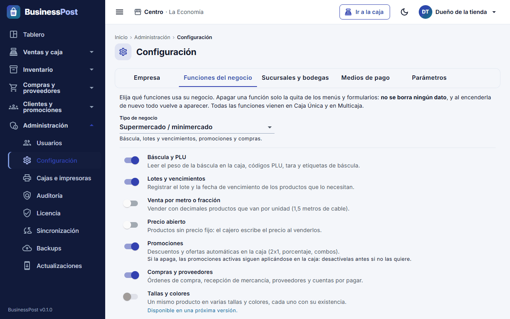

Qué funciones quedan encendidas según el tipo:

| Tipo de negocio | Báscula y PLU | Lotes y vencimientos | Venta por metro o fracción | Precio abierto | Promociones | Compras y proveedores |
|---|---|---|---|---|---|---|
| Supermercado o minimercado | Sí | Sí | No | No | Sí | Sí |
| Fruver o carnicería | Sí | No | No | No | Sí | Sí |
| Droguería | No | Sí | No | No | Sí | Sí |
| Ropa, calzado o deportes | No | No | No | No | Sí | Sí |
| Ferretería, papelería o miscelánea | No | No | Sí | Sí | Sí | Sí |
| Otro tipo de negocio | No | No | No | No | Sí | Sí |

Qué deja a la vista cada función:

| Función | Qué aparece cuando está encendida |
|---|---|
| **Báscula y PLU** | La caja lee el peso de la báscula; en el producto salen el PLU de báscula, "Se vende por báscula" y la tara; en Cajas e impresoras sale el botón **Báscula**. |
| **Lotes y vencimientos** | Las casillas **Maneja lotes** y **Maneja fecha de vencimiento** en el producto, y el lote y la fecha en las compras. |
| **Venta por metro o fracción** | La casilla **Permite cantidades con decimales** (por ejemplo, 1,5 metros de cable). |
| **Precio abierto** | La casilla **Permite precio abierto en la caja**: el precio se escribe al vender. |
| **Promociones** | El menú **Promociones**. |
| **Compras y proveedores** | Los menús **Compras**, **Proveedores** y **Cuentas por pagar**. |
| **Tallas y colores** | Aparece deshabilitada: llega en una próxima versión. Mientras tanto, cree un producto por cada talla o color. |

> **Importante:** apagar una función **solo la oculta, no borra datos**. Si la vuelve a encender, todo aparece de nuevo. Ojo: si
> apaga Promociones, las promociones activas **siguen aplicándose** en la caja; termínelas antes si ya no las quiere.

Solo el propietario y el administrador pueden cambiar el tipo de negocio y las funciones. Cada cambio queda en la Auditoría.

## 8. Parámetros

En **Configuración → Parámetros** están las reglas de funcionamiento del programa: cuánto puede faltar en un cierre sin pedir
explicación, cada cuánto se hacen los backups, cómo se redondea el efectivo, entre otras. Todas traen un **valor por defecto**
pensado para la mayoría de los negocios.

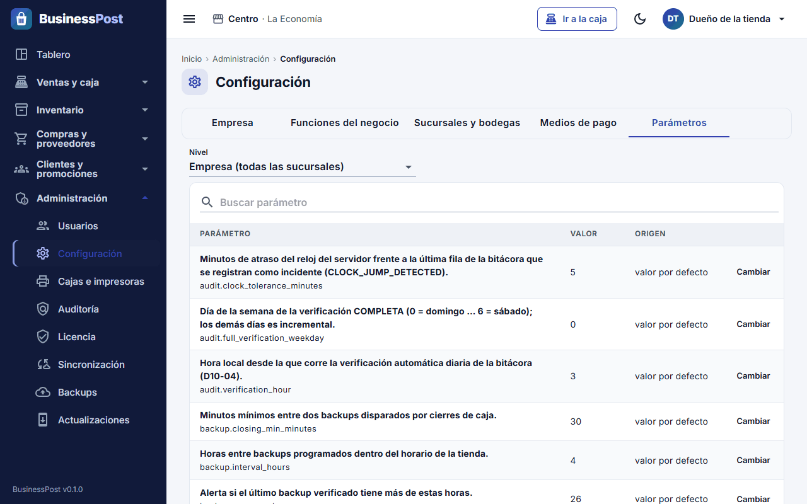

En **Nivel** elige si el cambio vale para toda la empresa, para una sucursal o para una caja. En **Origen** ve si el valor es el de
fábrica ("valor por defecto") o uno que alguien cambió.

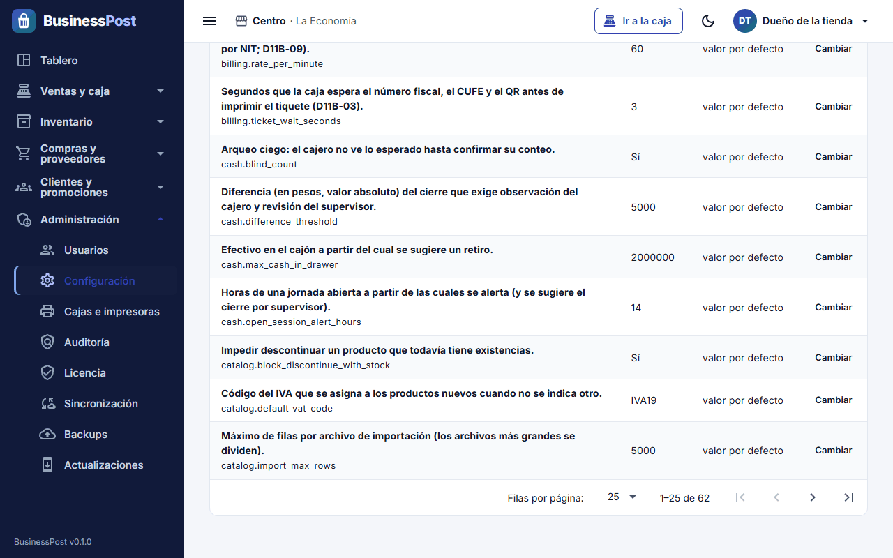

Para cambiar uno:

1. Busque el parámetro (puede escribir parte del nombre en **Buscar parámetro**).
2. Pulse **Cambiar**. La ventana muestra la descripción, el valor actual y el campo **Nuevo valor**.
3. Escriba el nuevo valor y guarde. El cambio queda en la Auditoría.

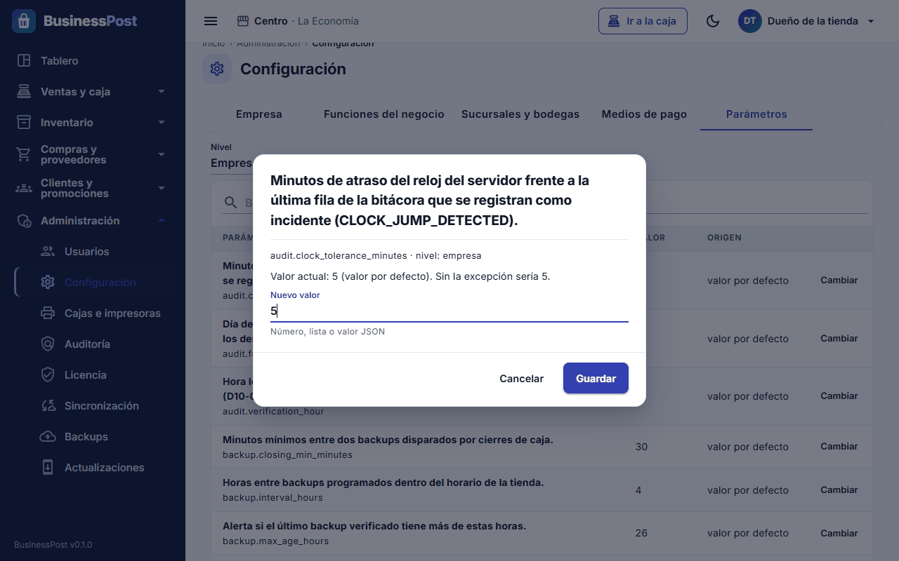

Los parámetros que más vale la pena revisar antes de abrir:

| Parámetro | Valor inicial | Cuándo cambiarlo |
|---|---|---|
| Arqueo ciego (el cajero no ve lo esperado al cerrar) | Encendido | Déjelo encendido: hace que el conteo sea honesto. |
| Diferencia del cierre que exige observación y revisión | $5.000 | Bájelo si quiere revisar hasta las diferencias pequeñas. |
| Horas de turno abierto para alertar | 14 | Ajústelo a la duración de sus turnos. |
| Redondeo del pago en efectivo | $50 | Según las monedas que maneje. |
| Valor de un ajuste de inventario que requiere aprobación de otro usuario | $500.000 | Bájelo si quiere controlar más los ajustes. |
| Días de anticipación para alertar lotes por vencer | 30 | Súbalo en droguería; bájelo en perecederos. |
| Qué hacer si un precio queda por debajo del costo | Advertir | Cámbielo a bloquear si quiere evitarlo del todo. |

> **Consejo:** cambie un parámetro solo cuando entienda su efecto. Si tiene dudas, deje el valor por defecto: es el recomendado.

## 9. Cargar los productos desde Excel o CSV

Crear los productos uno por uno sirve para pocos productos. Para todo el catálogo use **Inventario → Importar desde Excel**: acepta
archivos de Excel (.xlsx) y CSV.

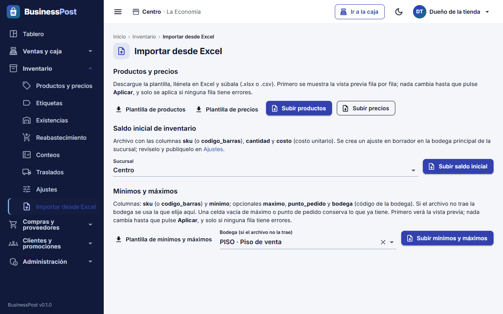

### Paso a paso

1. Pulse **Plantilla de productos** para descargar el archivo modelo.
2. Ábralo en Excel y llene una fila por producto. No cambie los nombres de las columnas.
3. Guarde el archivo (como .xlsx o como CSV).
4. Pulse **Subir productos** y elija el archivo.
5. Revise la **vista previa**: muestra cuántas filas son nuevas, cuántas cambian, cuántas quedan igual y cuántas tienen errores, con
   el motivo de cada error. También avisa qué categorías y marcas se van a crear.
6. Si hay errores, corrija el archivo y vuelva a subirlo. **Nada se guarda todavía.**
7. Cuando no haya errores, pulse **Aplicar**. Si se arrepiente, pulse **Descartar**.

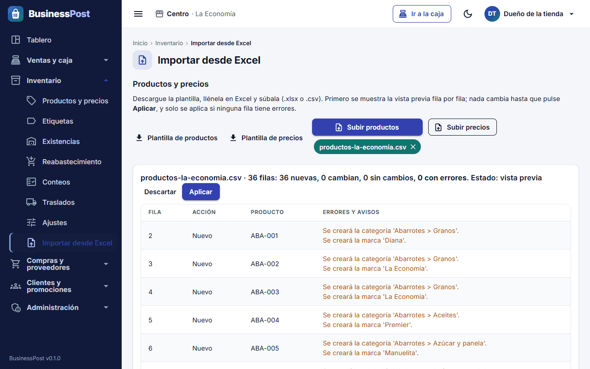

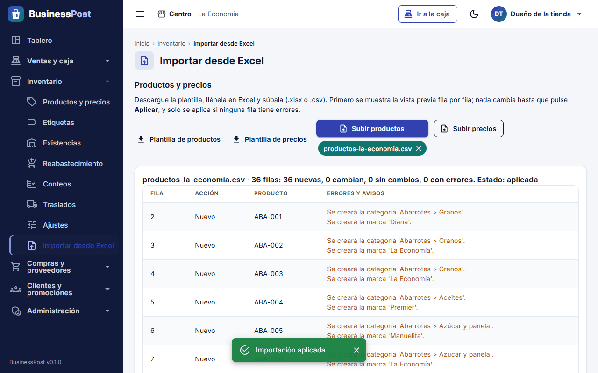

### Las columnas de la plantilla

| Columna | Qué escribir | Ejemplo |
|---|---|---|
| `sku` | Código interno del producto. Si lo deja vacío, se genera uno. | LECHE-ENT-1100 |
| `nombre` | Nombre completo. | Leche entera 1100 ml |
| `nombre_corto` | Nombre corto para el tiquete y la caja (opcional). | Leche entera 1100 |
| `descripcion` | Opcional. | |
| `categoria` | Categoría; con `>` se indica la subcategoría. Si no existe, se crea. | Lácteos > Leches |
| `marca` | Opcional. Si no existe, se crea. | Alquería |
| `unidad` | Unidad base: UND (unidad), KG, ML, etc. | UND |
| `modo_venta` | UNIDAD, PESO o VOLUMEN. | UNIDAD |
| `tipo` | INVENTARIABLE (lleva existencias) o SERVICIO (no lleva). | INVENTARIABLE |
| `iva` | IVA19, IVA5, IVA0_EXENTO o IVA_EXCLUIDO. | IVA5 |
| `codigo_barras` | El código de fábrica. Si lo deja vacío, se genera uno interno. | 7701234000014 |
| `precio` | Precio de venta **con IVA incluido**. | 4.980 |
| `plu` | PLU de báscula (solo productos por peso). | 123 |
| `bascula` | SI si se vende por báscula; NO si no. | NO |
| `contenido_neto` y `unidad_contenido` | Contenido del empaque (opcional). | 1100 · ML |

> **Importante:** el **código de barras no se puede repetir**. Si dos filas tienen el mismo código, o si el código ya pertenece a
> otro producto, la vista previa lo marca como error y no deja aplicar.

> **Consejo:** la plantilla trae dos filas de ejemplo (una leche por unidad y un tomate por peso): bórrelas antes de subir el archivo.
> Si su sistema anterior exporta a Excel, copie y pegue sus columnas dentro de la plantilla. Es mucho más rápido que
> escribir el catálogo desde cero.

### Revise los productos cargados

Abra **Inventario → Productos y precios** y revise unos cuantos al azar: nombre, código de barras, precio e IVA. Para corregir un
precio, pulse **Cambiar** en la fila.

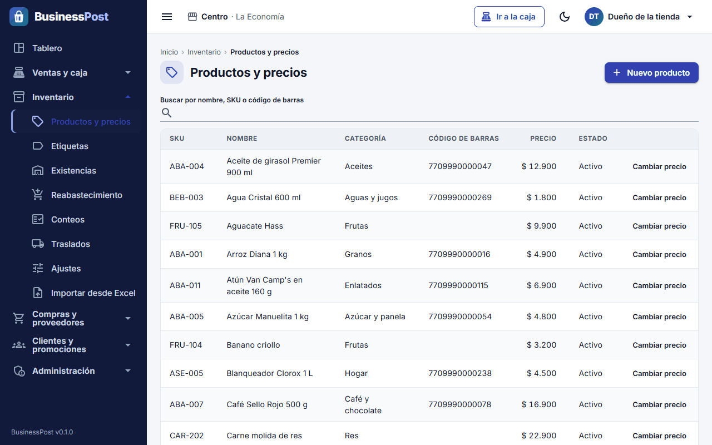

**Productos por peso** (fruver, carnes, granos a granel): ábralos y revise que tengan la unidad (Kilogramo, Gramo o **Libra (500 g)**),
el **PLU de báscula**, la casilla **Se vende por báscula** y la **tara** en gramos de la bolsa o bandeja, si aplica.

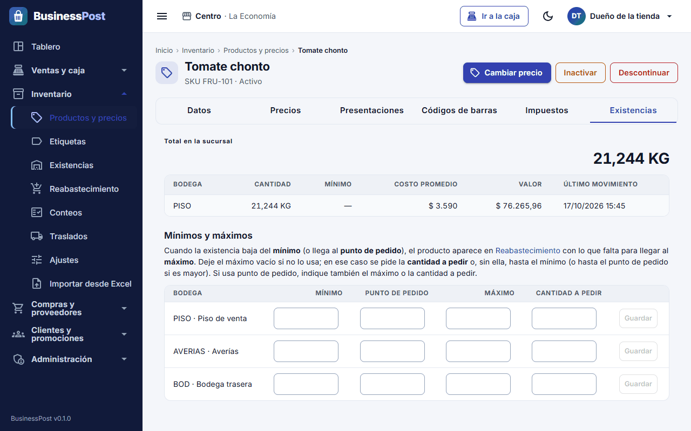

**Según su tipo de negocio**, revise también:

| Negocio | Qué revisar en la ficha del producto |
|---|---|
| Supermercado | Lotes y vencimiento en lácteos, carnes frías y panadería; báscula en fruver y carnes. |
| Fruver o carnicería | Todo lo que se pesa con "Se vende por báscula", PLU y tara. |
| Droguería | **Maneja lotes** y **Maneja fecha de vencimiento** en todos los medicamentos; presentaciones (caja, blíster, unidad). |
| Ropa, calzado o deportes | Un producto por talla o color, cada uno con su código de barras (por ejemplo, "Tenis X talla 38"). |
| Ferretería o papelería | **Permite cantidades con decimales** en cable, manguera o tela; presentaciones (caja, paquete, resma). |

### Imprima las etiquetas de góndola

Con los precios revisados, imprima las etiquetas de precio en **Inventario → Etiquetas**: agregue los productos por **categoría** (un
pasillo a la vez), revise precios y cantidades, elija el tamaño (hoja A4 de 24 o de 14 etiquetas, o adhesivos para impresora de
etiquetas) y pulse **Descargar PDF**. Imprima las hojas **al 100 %**. A los productos sin código de barras puede generarles un **código
interno** (empieza por 29) desde la misma pantalla. El paso a paso está en el Manual de administración, sección Etiquetas de góndola.

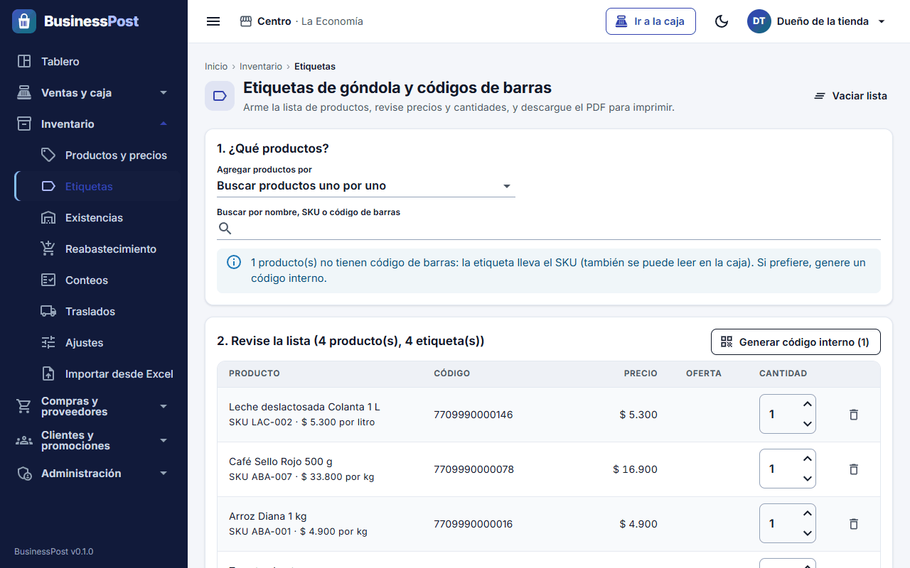

> **Consejo:** imprima primero una sola hoja y compruebe que el lector de la caja lee el código antes de imprimir toda la tienda.

## 10. Cargar el inventario inicial

Con los productos creados, cargue las cantidades que contó y su costo. Así las existencias y la utilidad quedan bien desde el
primer día.

1. En **Inventario → Importar desde Excel**, sección **Saldo inicial de inventario**, prepare un archivo con las columnas `sku` (o
   `codigo_barras`), `cantidad` y `costo` (costo unitario).
2. Elija la **sucursal** y pulse **Subir saldo inicial**. El saldo entra a la bodega principal de esa sucursal (el piso de venta). BusinessPost crea un **ajuste en borrador** con todos los productos.

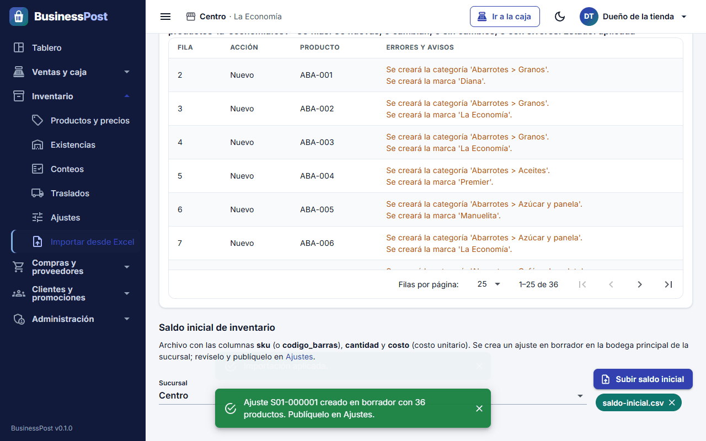

3. Abra **Inventario → Ajustes**. El ajuste aparece en estado **Borrador**.

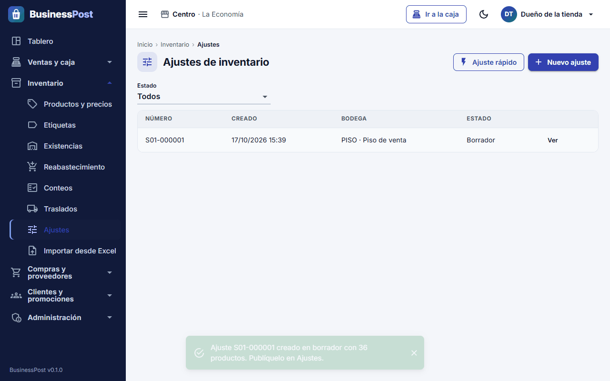

4. Ábralo y revise productos, cantidades y costos. Si algo está mal, corríjalo aquí.

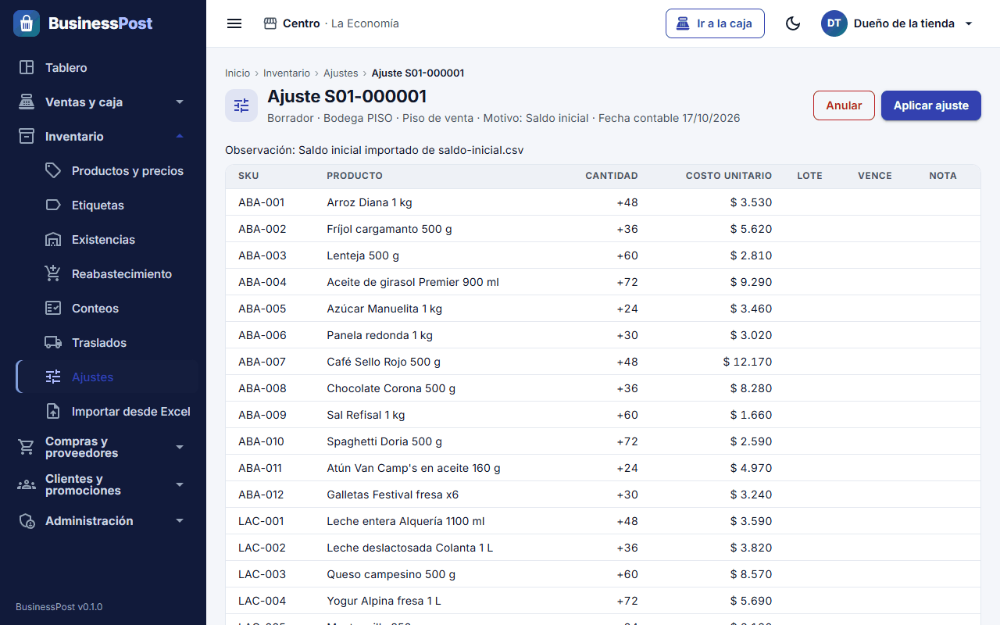

5. Pulse **Aplicar ajuste** y confirme. Desde ese momento las existencias quedan cargadas.

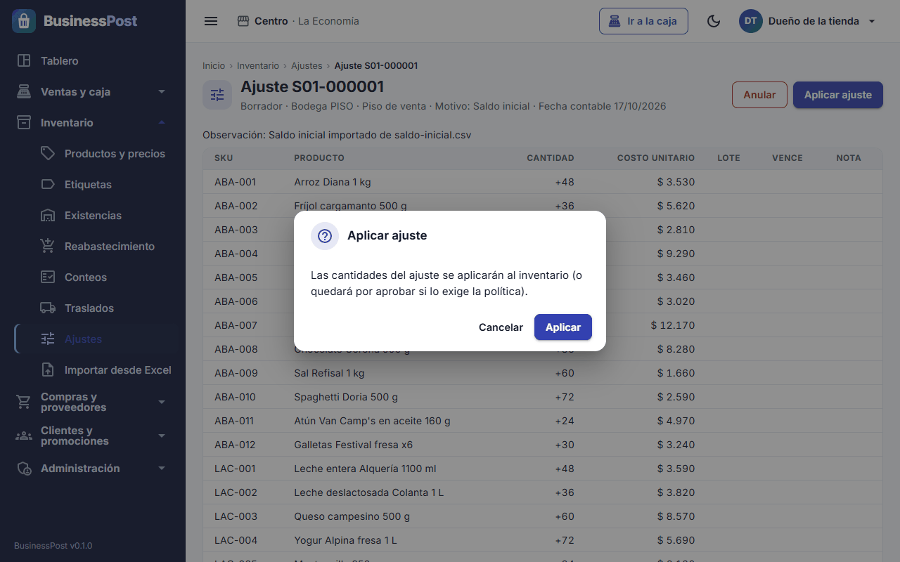

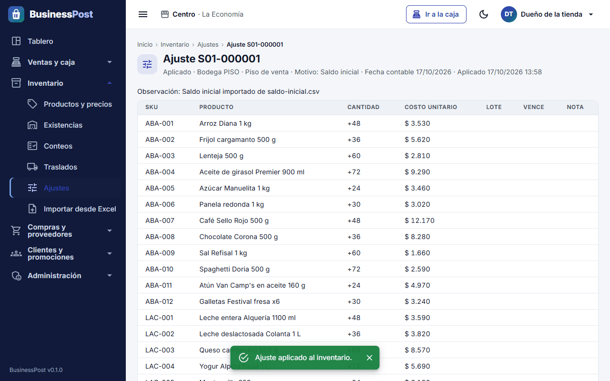

> **Importante:** si el ajuste supera el valor fijado en Parámetros (por defecto $500.000 a costo), queda **por aprobar** y otro
> usuario con permiso debe aprobarlo. Es normal en el saldo inicial: pídale al propietario o al administrador que lo apruebe.

> **Consejo:** si quiere, en el mismo momento cargue los **mínimos y máximos** de cada producto (Importar desde Excel → Mínimos y
> máximos). No es obligatorio para abrir: también puede calcularlos después con las ventas reales (vea el Manual de administración,
> Reabastecimiento).

## 11. Usuarios y roles

Cada persona debe tener **su propio usuario**. Así cada venta, descuento o ajuste queda con el nombre de quien lo hizo.

1. Abra **Administración → Usuarios** y pulse **Nuevo usuario**.
2. Escriba el **usuario** (por ejemplo, maria.caja), el **nombre completo** y una **contraseña inicial**. La persona la cambia la
   primera vez que entra.
3. Elija el **rol**.
4. Si la persona va a vender, escriba su **código de caja** (3 a 6 dígitos) y su **PIN** (4 a 6 dígitos). Con ellos entra a la caja.
   Revíselos bien: por ahora el rol, el código de caja y el PIN no se pueden cambiar después desde la pantalla (próximamente).
5. Pulse **Crear**.

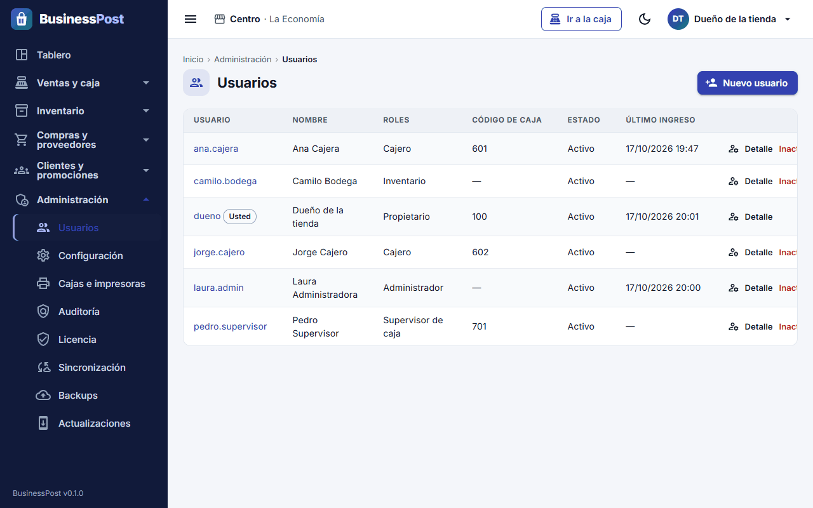

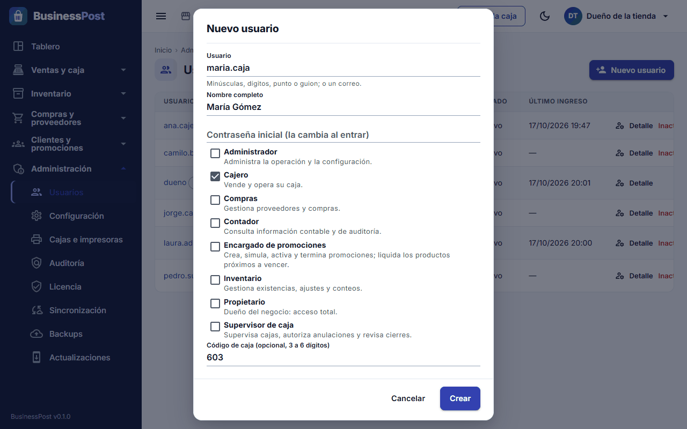

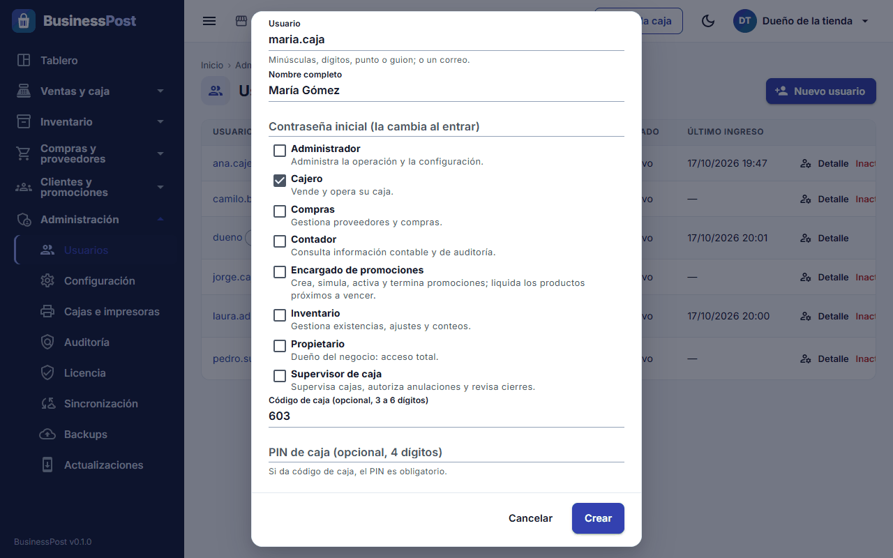

| Rol | Para quién | Qué puede hacer |
|---|---|---|
| **Propietario** | El dueño | Todo. Es el único que activa la licencia y maneja el código de recuperación. |
| **Administrador** | Administrador del local | Toda la operación y la configuración, salvo lo exclusivo del propietario. |
| **Supervisor de caja** | Jefe de cajas | Vender, autorizar descuentos y cancelaciones, peso digitado y lotes vencidos; revisar y cerrar turnos. |
| **Cajero** | Cajeros | Vender, reimprimir y crear clientes rápidos. Quitar una línea antes de cobrar depende del permiso de anular líneas; los descuentos y las cancelaciones necesitan supervisor. |
| **Inventario** | Bodeguero | Productos, existencias, conteos, ajustes, traslados e importación; también registra compras y define mínimos y máximos. |
| **Compras** | Comprador | Proveedores, órdenes, facturas de compra y cuentas por pagar. |
| **Contador** | Su contador | Consultar reportes, impuestos y auditoría, y exportarlos. No modifica nada. |
| **Encargado de promociones** | Mercadeo | Crear, simular, activar y terminar promociones. |

> **Importante:** no comparta el usuario del propietario ni los PIN. Si alguien deja de trabajar en el negocio, pulse
> **Inactivar** en su usuario ese mismo día.

> **Consejo:** tenga uno o dos supervisores por turno. Cuando un cajero necesite dar un descuento, el supervisor escribe su código y
> su PIN en la misma caja y la autorización queda registrada con su nombre.

## 12. Cajas, impresora y báscula

En **Administración → Cajas e impresoras** está la caja que creó la instalación ("Caja 1"), con sus botones **Editar**, **Impresora**,
**Báscula**, **Inactivar** y **Bloquear**. Para crear otra caja, pulse **Nueva caja**. En **Multicaja** aparecen además **Emparejar
equipo** (en cada caja, para unir el computador de esa caja) y **Emparejar PC administrativo** (arriba, para un computador de
oficina que solo usa la administración).

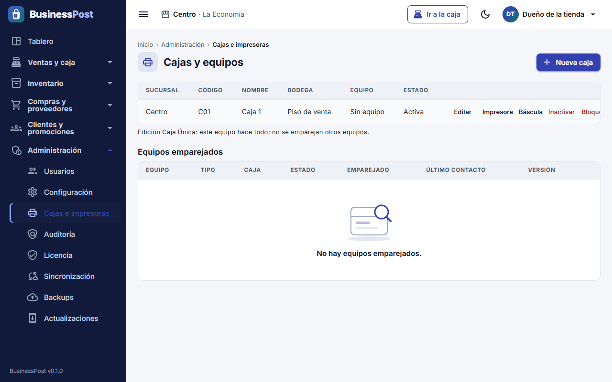

> **Consejo:** en la edición **Caja Única** el mismo computador hace todo. En **Multicaja**, cada caja adicional se instala y se
> empareja como se explica en el Manual de instalación.

### Impresora de tiquetes

1. Pulse **Impresora** en la fila de la caja.
2. En **Conexión** elija cómo está conectada: **Red** (escriba la dirección, por ejemplo 192.168.1.50:9100),
   **Impresora instalada en Windows** (escriba su nombre exacto) o **Puerto serie o USB virtual** (por ejemplo, COM3). La opción **Archivo** no imprime en
   papel: es solo para pruebas.
3. Elija el **ancho del papel** (80 mm o 58 mm) y deje la página de códigos **PC850** para que salgan las tildes y la ñ.
4. Si tiene cajón monedero, márquelo y elija el pin (casi siempre el **Pin 2**).
5. Pulse **Guardar**.

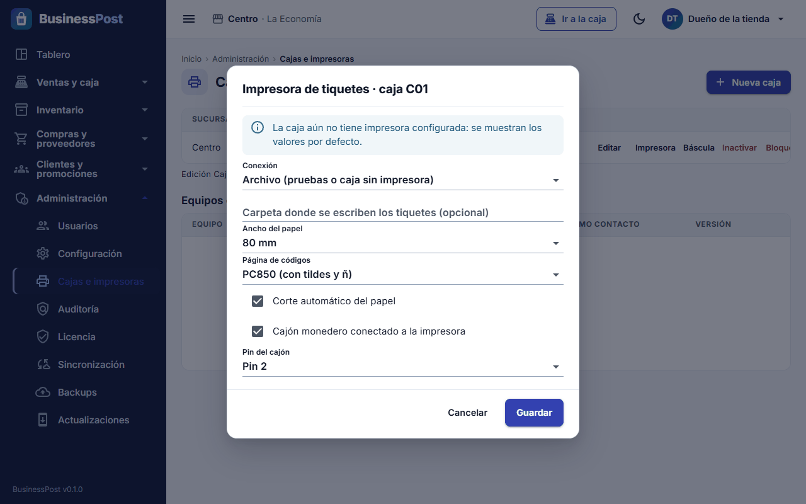

La prueba de la impresora es la venta de prueba (sección 14): debe imprimirse el tiquete, cortarse el papel y abrirse el cajón.

### Báscula (si vende por peso)

Si su báscula va conectada al computador de la caja, pulse **Báscula**, marque que la caja tiene báscula, elija la marca y el
puerto, y use **Probar báscula** con un peso conocido (en el computador de esa caja): debe verse el peso en vivo y la palabra
"Estable". Pulse **Guardar**. Después, en la pantalla de venta de esa caja, pulse **F1 → Vincular báscula** con la autorización de un
supervisor: sin esa vinculación el servidor no acepta los pesos y la caja solo puede digitarlos. El detalle está en el **Manual de
integraciones y facturación**.

## 13. Facturación electrónica

Si su negocio debe facturar electrónicamente, conecte su cuenta de **Factus** (el proveedor de fábrica) en **Ventas y caja →
Facturación electrónica**, pestaña **Configuración**: escriba los cuatro datos de Factus, elija el ambiente de pruebas y el modo de
emisión (solo cuando el cliente la pide, o en cada venta) y pulse **Conectar**. BusinessPost prueba la conexión y, solo si funciona,
trae los rangos de numeración y enciende la facturación; luego asigne los rangos a cada sucursal. El paso a paso completo está en el
**Manual de integraciones y facturación**.

> **Importante:** haga la venta de prueba con la facturación en **ambiente de pruebas** o desconectada. En **producción** cada venta genera
> una factura real ante la DIAN.

### Antes del Día 1: pasar a producción

Cuando las facturas de prueba estén bien y su contador las haya revisado, el día antes de abrir:

1. En **Facturación electrónica → Configuración**, pulse **Desconectar** en la tarjeta de Factus.
2. Escriba las **credenciales de producción** de Factus, elija el ambiente **Producción (documentos reales ante la DIAN)** y el modo que
   va a usar, y pulse **Conectar**.
3. En **Rangos de numeración**, **asigne** los rangos de producción a cada sucursal (o caja). Si no aparecen, pulse
   **Sincronizar desde Factus**.
4. Haga una venta real pequeña y verifique en **Documentos** que quede **Aceptado**, y que el tiquete traiga número, CUFE y QR.

## 14. Primera venta de prueba

Haga esta prueba el día anterior a la apertura, con un cajero y un supervisor presentes. Sirve para comprobar la impresora, el
cajón, el lector, la báscula y los precios, y para que el equipo practique.

> **Importante:** la venta de prueba es una venta real: descuenta inventario y aparece en los reportes. Una venta ya cobrada
> todavía no se puede anular desde la pantalla (llega próximamente). Use un producto barato y, si quiere, devuelva la unidad al
> inventario con un **Ajuste rápido** (Inventario → Ajustes).

### Entrar a la caja

La caja se usa con **código de cajero y PIN**, no con la contraseña de la administración. En la pantalla de ingreso, elija la
pestaña **Caja**, escriba el código y el PIN y pulse **Entrar a la caja**.

Si está en la administración y pulsa **Ir a la caja**, el programa le pide entrar como cajero.

### Abrir el turno

La primera vez, la caja pide **abrir el turno**: el cajero cuenta la **base del cajón** por billetes y monedas y pulsa **Abrir
turno**.

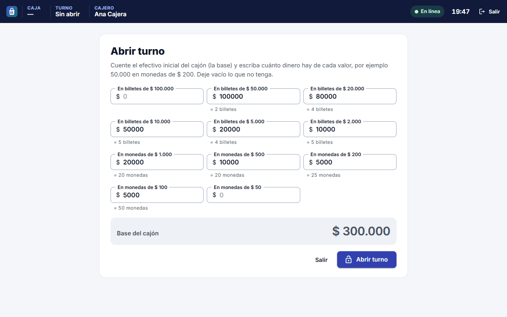

### Vender y cobrar

1. Escanee unos productos con el lector (o escriba el código y pulse Enter). Para varias unidades escriba, por ejemplo, `3*` antes
   del código. Las promociones se aplican solas.

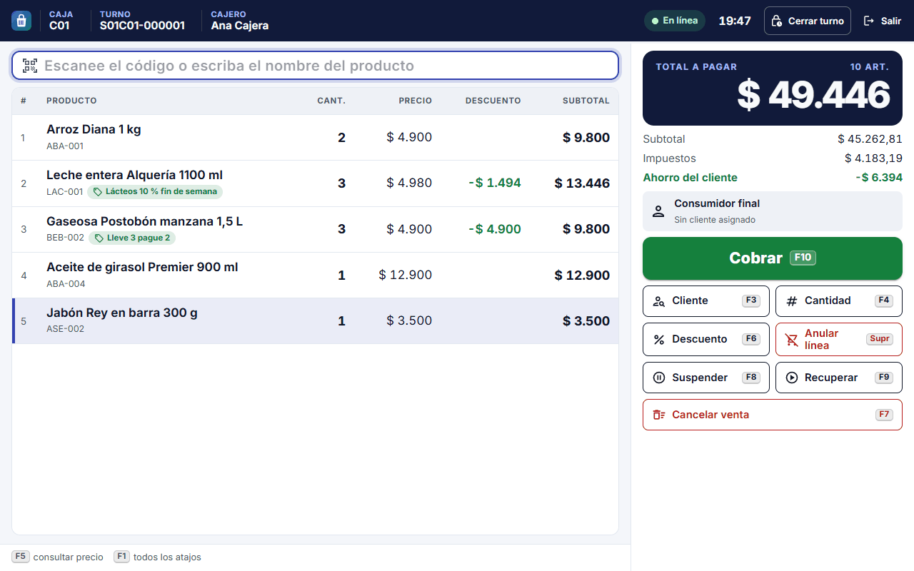

2. Si tiene báscula, registre un producto por peso: la caja lee el peso sola cuando está estable. Antes, la báscula debe estar
   **vinculada** con la caja (**F1 → Vincular báscula**, con un supervisor); si no, la caja avisa "Báscula no vinculada" y solo deja
   digitar el peso. Retire el producto de la báscula antes de pesar el siguiente.

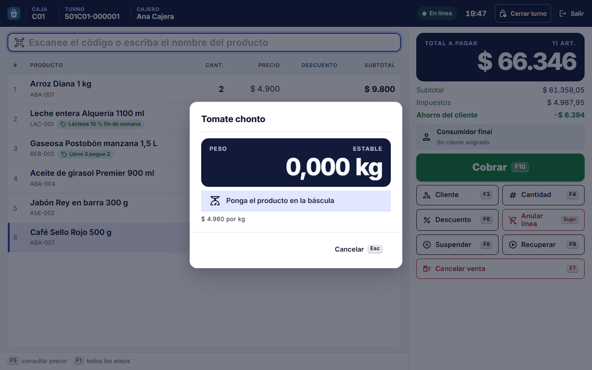

3. Pulse **F10** para cobrar. Escriba el valor recibido: la caja calcula el cambio.

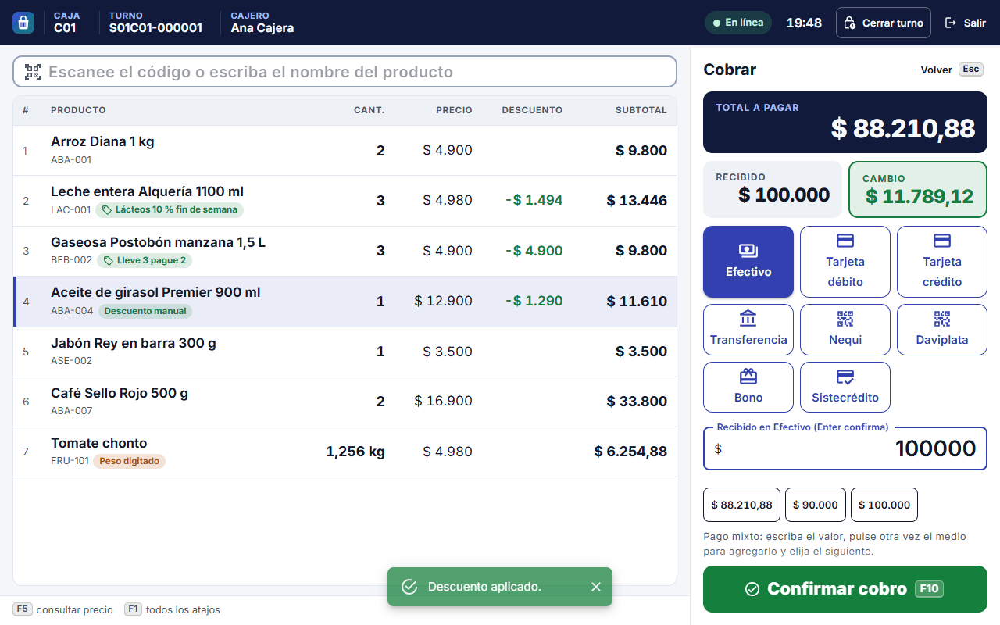

4. Pulse **F10** o Enter para confirmar. Debe imprimirse el tiquete y abrirse el cajón.

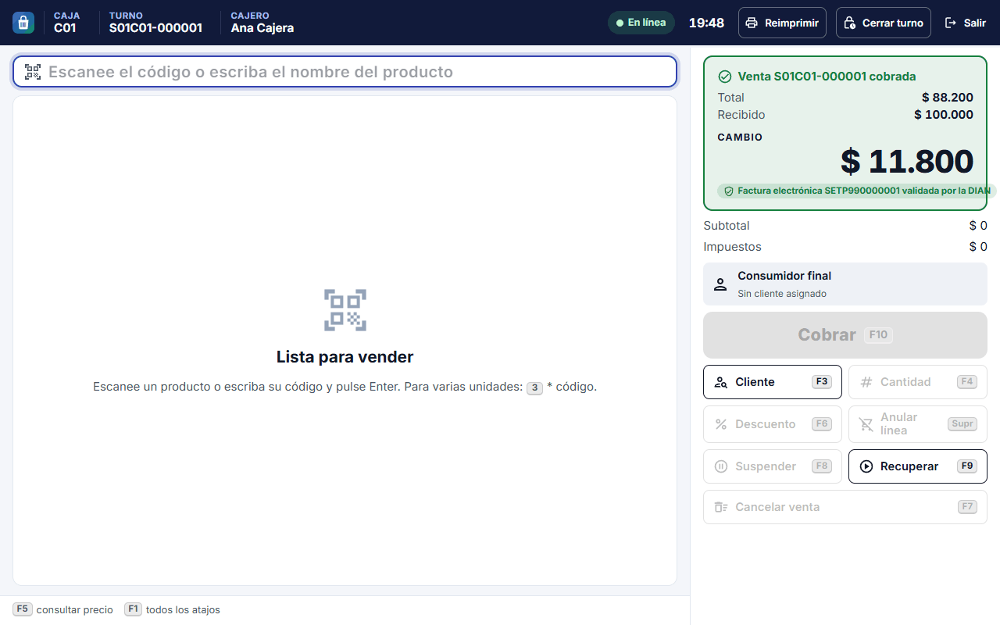

Practique también una venta con **datáfono** (con su referencia), un **pago mixto** (parte en Nequi y parte en efectivo), una venta
con **cliente** (F3) y un **descuento autorizado por el supervisor** (F6). La tecla **F1** muestra todos los atajos de la caja.

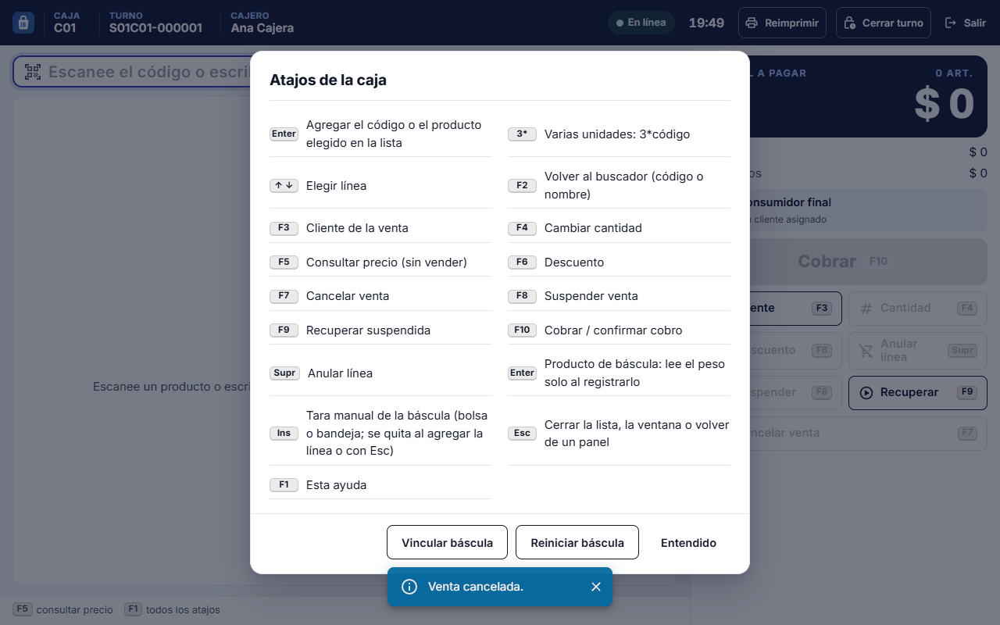

### Revise el tiquete

Compare el tiquete impreso con lo esperado: nombre y NIT de la empresa, productos, precios, IVA, medio de pago y, si factura
electrónicamente, el número de la factura y el código QR.

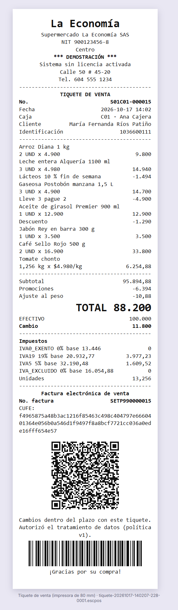

## 15. Primer cierre de caja

Al final de la prueba (y de cada turno real), el cajero cierra su turno:

1. En la caja, pulse **Cerrar turno**.
2. Cuente el efectivo por billetes y monedas y escriba el total de los demás medios (datáfono, transferencias). El sistema
   **no le muestra lo esperado**: compara al confirmar. Así el conteo es honesto.

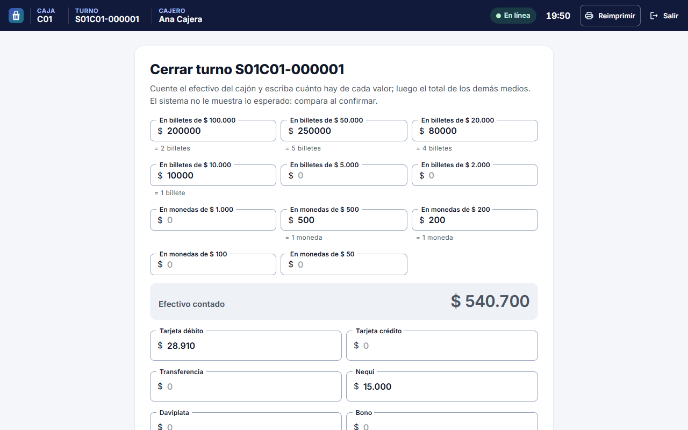

3. Si hay diferencia, escriba una nota que la explique y pulse **Confirmar cierre**.
4. Sale el **Reporte Z** en pantalla y se imprime solo. Guárdelo.

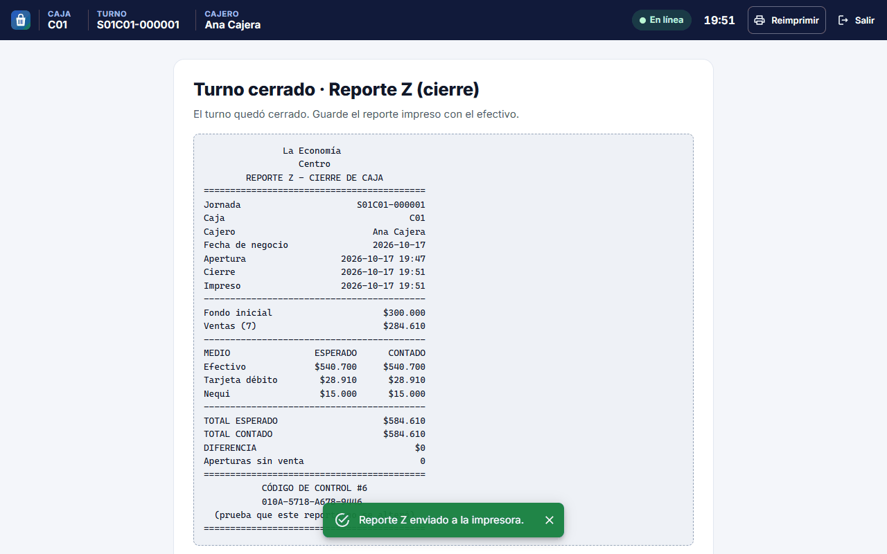

Luego, desde la administración, revise el turno en **Ventas y caja → Turnos de caja**: esperado, contado y diferencia por cada medio
de pago.

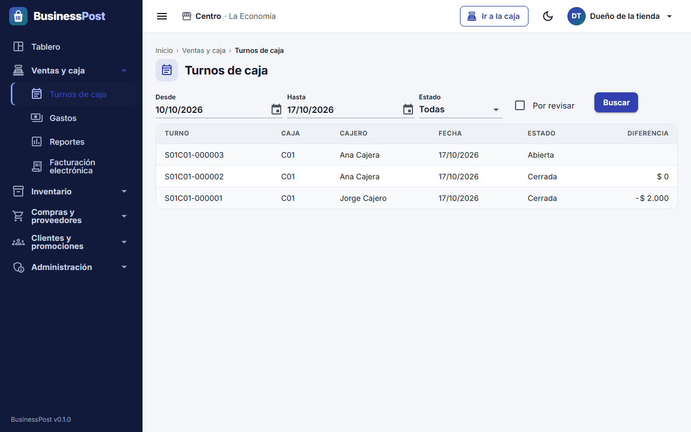

> **Consejo:** si la prueba cuadró (diferencia en cero), su configuración de medios de pago y su impresora están bien. Si no
> cuadró, revise qué medio de pago tiene la diferencia antes de abrir al público.

## 16. Día 1, semana 1 y mes 1

### Día 1

| Momento | Qué hacer |
|---|---|
| Apertura | Cada cajero entra con su código y abre su turno contando la base. Revise que las impresoras impriman. |
| Primeras 2 horas | Acompañe a cada cajero. Anote los productos sin código o con precio equivocado y corríjalos en **Productos y precios**. |
| Mediodía | Mire el **Tablero**: ventas, productos bajo el mínimo y turnos abiertos. |
| Cierre | Cada cajero cierra su turno a ciegas. Revise las diferencias en **Turnos de caja**. |
| Después del cierre | Compare el **Resumen diario de ventas** y **Ventas por medio de pago** con el efectivo y los comprobantes del datáfono. |

> **Consejo:** tenga a la mano su método anterior (caja registradora o cuaderno) el primer día. Si algo falla, la tienda sigue
> vendiendo mientras se resuelve.

### Semana 1

| Día | Qué hacer |
|---|---|
| Todos los días | Revisar cierres con diferencia (**Turnos de caja → Por revisar**) y el recuadro **Requiere atención** del Tablero. |
| Día 2 o 3 | Un **conteo parcial** de una categoría (Inventario → Conteos) para confirmar que las existencias cuadran. |
| Día 4 o 5 | Registrar la **primera compra real** (Compras → Nueva factura de compra) y, si es a crédito, su pago en **Cuentas por pagar**. |
| Día 5 | Revisar **Backups** y, si tiene facturación electrónica, **Alertas y conciliación**. |
| Día 7 | Reunión corta con el equipo: qué falta, qué sobra, qué es lento. Corrija productos, precios o permisos. |

### Mes 1

- Defina **mínimos y máximos** con la venta real (Inventario → Reabastecimiento → Calcular mínimos sugeridos) y haga los pedidos con
  el **pedido sugerido**.
- Cree sus primeras **promociones** y simúlelas antes de activarlas.
- Agrupe a sus clientes frecuentes y asigne **listas de precio** si les da precios especiales.
- Exporte para su contador los reportes de impuestos y el libro de ventas.
- Revise los **usuarios**: inactive a quien ya no trabaja y confirme que cada rol es el correcto.
- En **Auditoría**, pulse **Verificar la integridad**.
- Active la licencia si todavía está en demostración y revise su vigencia en **Administración → Licencia**.

## 17. Lista de verificación final

Imprima esta lista y márquela antes de abrir al público.

| Listo | Tarea | Dónde |
|---|---|---|
| ☐ | La instalación terminó y la licencia está activada (o en demostración, con fecha para activarla antes del día 30) | Administración → Licencia |
| ☐ | En Multicaja: cada caja adicional instalada y emparejada | Administración → Cajas e impresoras |
| ☐ | El código de recuperación está anotado y guardado fuera del local | Asistente, paso 3 |
| ☐ | Los datos de la empresa están completos y revisados por el contador | Configuración → Empresa |
| ☐ | Sucursales y bodegas creadas; la bodega de venta está marcada | Configuración → Sucursales y bodegas |
| ☐ | Medios de pago revisados, con referencia en datáfono y transferencias | Configuración → Medios de pago |
| ☐ | Tipo de negocio y funciones correctos | Configuración → Funciones del negocio |
| ☐ | Parámetros principales revisados | Configuración → Parámetros |
| ☐ | Productos importados sin errores; precios e IVA revisados al azar | Inventario → Productos y precios |
| ☐ | Productos por peso con unidad, PLU, báscula y tara | Ficha del producto |
| ☐ | Saldo inicial aplicado (y aprobado, si lo pidió) | Inventario → Ajustes |
| ☐ | Un usuario por persona, con su rol, código y PIN de caja | Administración → Usuarios |
| ☐ | Etiquetas de góndola impresas y puestas, con el mismo precio de la caja | Inventario → Etiquetas |
| ☐ | Cada caja con su impresora configurada y, si aplica, su báscula probada | Administración → Cajas e impresoras |
| ☐ | Facturación electrónica probada en pruebas y pasada a **producción** con sus rangos asignados (si aplica) | Ventas y caja → Facturación electrónica |
| ☐ | Venta de prueba hecha: tiquete impreso, cajón abierto, precios bien | Caja |
| ☐ | Cierre de prueba hecho y Reporte Z impreso | Caja y Turnos de caja |
| ☐ | Cajeros y supervisores capacitados (entrar, vender, cobrar, suspender, autorizar y cerrar) | Caja |
| ☐ | El método anterior queda a la mano para el primer día | |

---

¿Dudas? Comuníquese con BusinessPost. Los manuales actualizados están en el portal, en **Descargas**.
